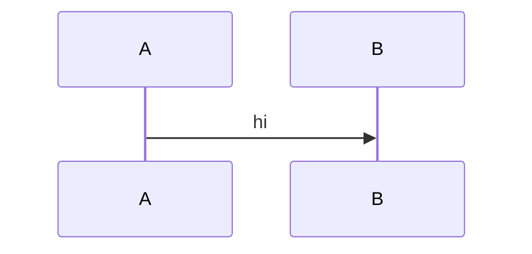

# mdwiki

Point it at a directory of markdown files and a port, get a served wiki.
No database, no business-logic coupling. Install as a CLI or as a Python
module.

```bash
pip install git+https://github.com/manuelagirre/mdwiki.git
mdwiki serve --dir ./example --config ./example/mdwiki.yml --port 8000
```

(Or `pip install -e .` from a local checkout for development.)

Then open `http://localhost:8000/`. While writing, add `--watch` and open
pages reload themselves whenever a content or theme file changes (edits to
`mdwiki.yml` itself still need a restart). The `./example` directory in this repo
is a small worked example - browse its files alongside this guide.

Programmatic usage, instead of the CLI:

```python
from mdwiki import serve
serve(dir="./wiki", port=8000, config="./mdwiki.yml")
```

This launches its own ASGI process on its own port - there is no
in-process/ASGI-mount API. Run it as its own process alongside whatever
host app you're integrating it with.

### Static export

To publish without running a server (GitHub Pages, Netlify, S3, any
static file host), export the site to plain files:

```bash
mdwiki build --dir ./wiki --config ./mdwiki.yml --out ./site
```

Every page is produced by the same app `mdwiki serve` runs, so the output
matches it exactly. `lessons/loops.md` becomes `lessons/loops.html`
(static hosts like GitHub Pages and Netlify serve it at
`/lessons/loops`), directory pages become `dir/index.html`, raw files are
copied as-is, the theme and the widgets in use land under `_assets/` and
`_widgets/`, and the "Page not found" page is written as `404.html`. The
nav search box is left out, since search needs the server.

`--out` must be outside the content root, and either empty or a previous
build's output (which is replaced); mdwiki won't overwrite a directory it
didn't create.

## Routing

Any `.md` file under the content root is served 1:1 by its relative path:
`lessons/loops.md` → `/lessons/loops`. A directory's own `dir/index.md`
folds to `/dir/`. There is no fixed URL scheme to configure - whatever
files exist define the URLs that exist.

A directory with no `index.md` of its own (including the content root,
when there's no `index.md` or `index:`) gets a generated listing at
`/dir/` instead of a 404: its pages and page-holding sub-folders, in
`_order.yml` order, each linked by its title. Write an `index.md` to
replace it. Folders without any pages (e.g. `images/`) still 404.

Anything under a path segment starting with `.` (`.github/`, `.git/`,
`.drafts/`, a `.notes.md` file) is not part of the site at all: never
rendered, served raw, listed, ordered or searched.

Path-traversal attempts and missing pages both 404 identically (never a
400 that would hint which case it was). The 404 is a "Page not found" page
in the site's own theme, with the nav, so a reader who followed a stale
link can find their way back.

### Plain HTML pages and other files

Any other file under the content root is served raw, as authored, at its
literal path: a hand-written `reports/q3.html` is served at
`/reports/q3.html` in full - its own `<head>`, styles and scripts, with no
mdwiki nav, theme, widgets or markdown processing - and an image beside a
page (`lessons/diagram.png`) is served at `/lessons/diagram.png`. The
content type is guessed from the file extension.

A `.md` page always wins its URL: raw files are only consulted when no
`<path>.md` or `<path>/index.md` matches. A few files are never served raw
and 404 like a missing page: `.md` sources themselves (`/lessons/loops.md`
is not a URL - use `/lessons/loops`), `_order.yml` manifests, the site's own
`mdwiki.yml` (if it lives inside the content root), and anything
under a path segment starting with `.` (e.g. `.git/`, `.wiki-manifest.json`).
Paths under `/_assets/` and `/_widgets/`, plus `/_search` and `/_watch`, are
reserved for mdwiki itself.

### Cross-links between pages

Write plain relative markdown links to sibling `.md` files - the same
convention GitHub renders correctly when browsing the raw files:

```markdown
See [the loops lesson](../lessons/loops.md#exercises) for more.
```

At render time, mdwiki rewrites `.md`/`.../index.md` link targets to the
extension-less URLs it actually serves (`../lessons/loops#exercises` above)
- so the same source is correct both on GitHub and through `mdwiki serve`.
Only `<a href>` targets are rewritten; external URLs (any `scheme://`),
`mailto:`/`tel:` links, and pure `#fragment` links pass through untouched.
Image `src` and other non-`.md` targets are never touched either - those
files are served raw at their literal path (see "Plain HTML pages and other
files" above), so a relative link like `[report](q3.html)` or
`` already resolves as written.

## Writing pages

Pages are [Python-Markdown](https://python-markdown.github.io/) with these
extensions switched on, beyond plain markdown:

| Syntax | What it gives you |
|---|---|
| `\| a \| b \|` rows | tables |
| ```` ```python ```` fences | syntax-highlighted code (Pygments) |
| `Text[^1]` + `[^1]: note` | footnotes |
| `!!! note "Title"` + indented body | admonition boxes (`note`, `warning`, ...) |
| `Term` + `:   definition` | definition lists |
| `[TOC]` on its own line | a table of contents of the page's headings |
| `## Heading {: #my-id }` | a custom heading id (attribute lists) |
| `<div markdown="1">...</div>` | markdown inside raw HTML blocks |

Every heading gets an `id` (for `page.md#heading` links) and a `#`
permalink shown on hover. Raw HTML is passed through as written - mdwiki
assumes its authors are trusted.

## Mermaid diagrams

Plain ```` ```mermaid ```` fenced code blocks render as diagrams by default -
no widget, no macro, just the fence:

````markdown

````

Rendered via [mermaid.js](https://mermaid.js.org/) loaded from a pinned CDN
version (`mermaid@11.17.2`), included only on pages that actually contain a
diagram - not paid for on every page load. Any other fenced-code language
(```` ```python ````, etc.) still goes through the normal `codehilite`
syntax highlighting untouched; only the literal `mermaid` language tag is
intercepted.

## Frontmatter

Optional YAML frontmatter at the top of any `.md` file:

```yaml
---
title: Lesson 3 - Loops
back_link:
  href: ../lesson-2
  label: Back to Lesson 2
widgets:
  exclude: [next-button]   # opt this page out of a matching hook widget
---
```

- `title` (optional): overrides the page's `<title>`/heading. Default falls
  back to the file's own `# H1`, then the filename, humanized.
- `back_link` (optional `href` + `label`): rendered as a plain `<a>` in the
  page shell, in place of the automatic breadcrumbs (`Wiki › Guides ›`)
  that nested pages otherwise get. This is core-rendered, not a widget - static markup from data
  you supplied, no JS/data-fetch involved.
- `widgets.exclude` (optional list of names): skips specific hook-injected
  widgets on this page, even though their `selector` would otherwise match.

## Site config (`mdwiki.yml`)

```yaml
title: My Wiki
index: Project-Overview.md   # optional - serve this file at `/` instead of requiring index.md
nav:
  - label: Home
    href: /
  - label: Lessons
    href: /lessons/
theme: ./my-theme        # optional - your page.html and/or app.css (either one alone is fine)
widgets_dir: ./widgets    # optional - host widgets; `--widgets` overrides it
backend_base: "http://localhost:8001"   # optional, see "Backend calls" below
widgets:                  # optional - auto-injected ("hook") widgets
  - name: next-button
    anchor: bottom        # top | bottom | both
    selector: "lessons/*"
```

`nav`/`title`/`theme`/`widgets_dir`/`backend_base`/`index` are all
optional (`theme` and `widgets_dir` resolve relative to `mdwiki.yml`); an absent
`mdwiki.yml` just gets you the default theme with no nav links, and `/`
requires a literal `index.md` at the content root.

**`index`** lets a content root without an `index.md` still serve something
at `/` - useful when the homepage has a more descriptive name (e.g. a
generated `Project-Overview.md`). Tried before the plain `index.md` fallback;
if the named file is missing, resolution falls back to `index.md` exactly as
if `index` had never been set.

**A note on `top`/`bottom`/`both`:** these are anchors *inside the content
region* - immediately before/after the rendered markdown, not the page shell
as a whole. There's no anchor (yet) for a persistent header/nav-bar region
outside the content area; nothing in this package's own reference case
needed one. If you need that, it's a genuinely new anchor to add, not a
variant of `top`.

**`selector`** is a glob matched against the page's resolved relative path
(e.g. `lessons/lesson-1.md`, `lessons/lesson-1/index.md`). `*` matches
within one path segment only (it does not cross `/`) - same semantics as
`pathlib.PurePath.match()`. So `lessons/*` matches `lessons/lesson-1.md`
but not `lessons/lesson-1/exercises/ex-1.md`.

## Search

Every page of the default theme has a search box in the nav; it submits to
`/_search?q=...`, which lists the pages containing *all* the query's words
(case-insensitive, title or text), title matches first, each with a short
highlighted snippet. No index to build and no JavaScript: pages are read
fresh on each search, so results always match what's on disk. Dot-paths
(`.git/`, ...) are never searched. A custom `page.html` can add the same
box with `<form action="/_search"><input name="q"></form>`.

## Dark mode

The default theme follows the reader's OS light/dark setting - page,
code highlighting, mermaid diagrams and the standard widgets. Its colours
are CSS custom properties on `:root` (`--mdwiki-bg`, `--mdwiki-accent`,
...), so a theme's `app.css` can retune either palette without copying the
whole stylesheet.

## Page ordering (`_order.yml`)

Drives "what page comes next" for the standard `next-button` widget (and
anything else that needs sequencing). One `_order.yml` per directory,
optional - sibling to the `.md` files it orders:

```yaml
# lessons/_order.yml
- intro.md
- variables.md
- loops.md
- exercises
- wrap-up.md
```

- Only pages take part: `.md` files and subdirectories that contain pages.
  Dot-entries (`.git/`) and page-less folders (`images/`) are ignored.
- No `_order.yml` in a directory → plain alphabetical order. The common
  case (filenames that already sort correctly) needs zero setup.
- Files/dirs on disk but missing from the manifest are appended after the
  explicit entries, alphabetically among themselves - never excluded from
  the sequence.
- A directory with its own `index.md` is visited as a leaf when the walk
  enters it (folds to `dir/`, matching the routing rule above); the walk
  then continues into the rest of that directory's own children, so nested
  pages (e.g. an `exercises/` subfolder) stay reachable. `index.md` itself
  is never listed in its own directory's `_order.yml`.
- The whole tree is walked as **one global depth-first order**. `next()`/
  `prev()` = the adjacent entry in that global order, filtered down to
  whichever `selector` the requesting widget/hook cares about. This is what
  lets, say, a `next-lesson` hook (`selector: lessons/*/index.md`) skip
  straight from one lesson to the next while a separate `next-exercise`
  hook (`selector: lessons/*/exercises/*`) sequences exercises across
  lesson boundaries - same global walk, two different filters.
- A stale manifest entry (references something no longer on disk) is
  skipped at resolve time, not a hard failure.

Edit `_order.yml` without hand-touching the YAML:

```bash
mdwiki order insert-after  lessons lesson-2.md lesson-2b.md
mdwiki order insert-before lessons wrap-up.md   new-exercise.md
mdwiki order append        lessons wrap-up.md
mdwiki order remove        lessons wrap-up.md
```

Positioning a name that's already listed moves it rather than listing it
twice, and an `existing_name` that is neither listed nor on disk is an
error (nothing is written) - so a typo can't silently drop the new entry
at the top or bottom.

### `mdwiki validate`

A pre-flight check, separate from the graceful runtime fallbacks above
(stale entries are skipped, unresolved widgets substitute `toast` - a bad
reference never breaks a live page). Run it before publishing:

```bash
mdwiki validate --dir ./wiki --config ./mdwiki.yml
```

Reports, in one sweep: every `_order.yml` entry that doesn't resolve on
disk; every file/dir present but unlisted in its directory's manifest (a
warning, not an error - it'll append alphabetically until positioned);
every `{{ widget: name }}` macro and hook `name` that doesn't resolve under
`./widgets/` or the standard set; every page whose frontmatter is invalid
YAML or has a field of the wrong shape (the live server ignores such a
field rather than failing the page); every internal `<a href>` (post-rewrite,
see "Cross-links between pages") that doesn't resolve to a real page; every
`#fragment` link whose target page has no matching `id=`; the same checks
for `mdwiki.yml` `nav` links and frontmatter `back_link`s (they sit in the
page shell, outside the rendered content); and an `index:` that names a
missing file. The link/anchor
checks render every page through the same `WikiRenderer` the live server
uses, so they can't drift from what actually 404s at runtime. Links to
author-written `.html` pages and other raw files count as resolving when
the file exists, and the links inside `.html` pages are checked too.

Errors exit with status 1. Warnings - pages not yet positioned in their
folder's `_order.yml`, and unknown (ignored) keys in `mdwiki.yml` - are
listed but don't fail the run, so adding a page doesn't break CI; pass
`--strict` to fail on those too.

## Writing a widget

A widget is a directory, `./widgets/<name>/`, containing `widget.js` and
`widget.css`. No manifest file - the directory name is the widget's name.

Two ways a widget ends up on a page:

- **Content-authored (macro):** the page author writes
  `{{ widget: my-widget param="value" }}` inline in the markdown, anywhere
  in the prose. A macro inside inline code or a code block is shown as
  written, not expanded - so docs can show the syntax (as this line does).
- **Auto-injected (hook):** a row in `mdwiki.yml`'s `widgets:` list, matched
  against every page whose resolved path matches `selector`. The page
  author does nothing; a page can still opt out via frontmatter
  (`widgets: exclude: [...]`).

Either way, params become plain HTML attributes on a Shadow-DOM host
element; your widget's JS reads them with `getAttribute()`:

```js
// widgets/my-widget/widget.js
import {mountWidget} from '/_assets/shadow-helper.js';

document.querySelectorAll('[data-widget="my-widget"]').forEach((host) => {
  mountWidget(host, (container) => {
    const p = document.createElement('p');
    p.textContent = `hi, param = ${host.getAttribute('param') || ''}`;
    container.appendChild(p);
  });
});
```

Put param values into the DOM with `textContent` / `setAttribute`, not by
interpolating them into an `innerHTML` string: `getAttribute()` returns the
value HTML-decoded, so `innerHTML` would re-parse an author's `<T>` (or a
stray ``) as real markup.

`mountWidget` (shipped with core, at `/_assets/shadow-helper.js`) attaches
a Shadow DOM to the host, loads your widget's own `widget.css` into that
shadow root, and hands you an empty container to render into - real
CSS/DOM isolation, no global class-name collisions with the page's theme
or other widgets.

Your JS is always loaded as `<script type="module">`. A given module URL
is fetched and evaluated exactly once per page per the HTML spec, no
matter how many times it's referenced - so multiple occurrences of the
same widget on one page are safe by construction; you never need to guard
your own init code against double-firing.

Point `mdwiki serve` at your widgets directory with `--widgets <path>` (or
`widgets_dir:` in `mdwiki.yml`). An unresolved widget name never fails the
page - it substitutes the built-in `toast` widget, styled as an error, in
its place.

## Standard widgets

Two widgets ship with mdwiki itself - nothing to author or install, usable
immediately by name via either mechanism above:

- **`toast`** - a colored panel with bold title + text. Params: `title`
  (optional), `text`, `style` (`info` | `warning` | `error`, default
  `info`). Also the built-in not-found fallback (rendered with
  `style="error"`).
- **`next-button`** - a "next page" link. Its `href`/`label` are normally
  computed by core from `_order.yml` when used as a hook; usable directly
  too (`{{ widget: next-button href="/lessons/loops" label="Next Lesson" }}`).

A host can shadow either by providing its own `./widgets/toast/` or
`./widgets/next-button/` - your own copy is checked before the standard one.

## Backend calls

If your widgets need to call back to a host app's API (not just the wiki
server itself), set `backend_base` in `mdwiki.yml`. Core exposes it to
every page as `window.MDWIKI_BACKEND_BASE`:

```js
const base = window.MDWIKI_BACKEND_BASE || '';
const res = await fetch(`${base}/api/whatever`);
```

Convention: an absolute `http(s)://` URL means "call the backend"; a
relative URL means "call the wiki server itself."

**CORS.** Since the wiki and your backend are separate processes/ports,
a widget's `fetch()` to `backend_base` needs the backend to send CORS
headers for the wiki's origin, or the browser blocks it regardless of how
correct the URL is. With FastAPI:

```python
from fastapi.middleware.cors import CORSMiddleware

app.add_middleware(
    CORSMiddleware,
    allow_origins=["http://localhost:8000"],  # the wiki's origin
    allow_methods=["*"],
    allow_headers=["*"],
)
```

If you skip this, widget fetches will fail silently in the browser console
with an opaque CORS error, not an obviously-wiki-related one - worth
checking first if a widget "does nothing" after wiring it up.

## Worked example

See `./example/` in this repo: a tiny site with a homepage using the
`toast` macro, a `lessons/` section with three pages sequenced by
`_order.yml`, and a `next-button` hook auto-injected at the bottom of every
lesson page except the last. Run it with the quickstart command at the top
of this guide.

## Development

```bash
pip install -e ".[test]"
pytest
```

CI (`.github/workflows/tests.yml`) runs the test suite on Python 3.11-3.13
and checks that `./example` still passes `mdwiki validate`.
