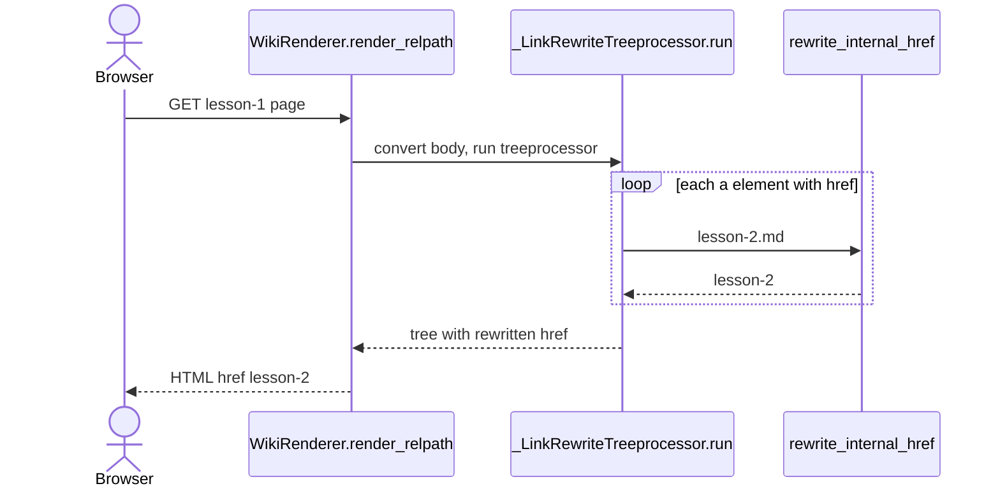
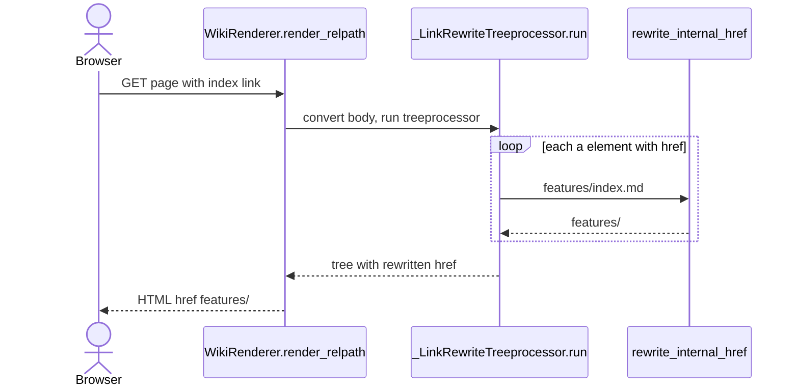
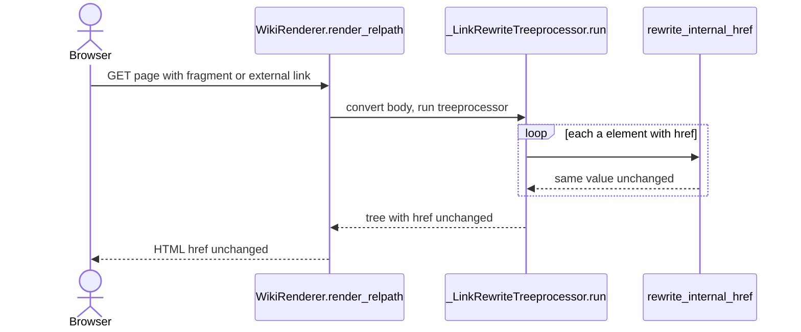
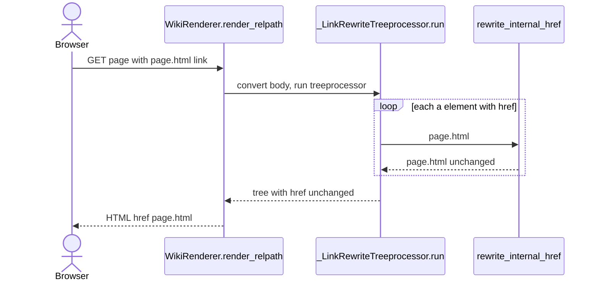
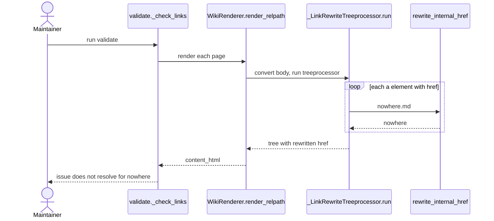

# Internal Link Rewriting

Category: Content Rendering

Job: rewrite `<a href>` targets in rendered Markdown. `X.md` -> `X`. `dir/index.md` -> `dir/`. `index.md` -> `./`. Fragment kept. Everything else untouched. Never touches ``.

## Code Elements

| Code Element | What it does | File path |
|---|---|---|
| `rewrite_internal_href` | Pure string transform of one href. Strips `.md`/`index.md`. Guards: empty, `#frag`, external scheme. Returns non-`.md` hrefs unchanged. | `mdwiki/link_rewrite.py` |
| `_EXTERNAL_SCHEME_RE` | Module regex `^[A-Za-z][A-Za-z0-9+.\-]*:`. Catches `https:`, `mailto:`, any scheme. | `mdwiki/link_rewrite.py` |
| `_LinkRewriteTreeprocessor.run` | Walks parsed element tree. Every `a` element with non-None `href` -> `rewrite_internal_href`. | `mdwiki/link_rewrite.py` |
| `InternalLinkExtension.extendMarkdown` | Registers `_LinkRewriteTreeprocessor` as treeprocessor `mdwiki_link_rewrite` at priority 4. | `mdwiki/link_rewrite.py` |
| `MD_EXTENSIONS` | Module-level extension list. Includes `InternalLinkExtension()` in the render pipeline. | `mdwiki/render.py` |
| `WikiRenderer.render_relpath` | Builds fresh `markdown.Markdown(extensions=MD_EXTENSIONS)`, calls `convert` on page body. Runtime entry into this feature. | `mdwiki/render.py` |
| `_check_links` | Validation consumer. Renders every page, scans rendered `<a href>` values, checks each via `page_exists`. | `mdwiki/validate.py` |

## Process Flow

1. Caller needs page HTML: HTTP page request (`WikiRenderer.render_url` -> `render_relpath`) or `validate` run (`_check_links` -> `render_relpath`).
2. `render_relpath` creates Markdown instance with `MD_EXTENSIONS`. `InternalLinkExtension.extendMarkdown` registers `_LinkRewriteTreeprocessor` under name `mdwiki_link_rewrite`, priority 4.
3. Markdown parse runs. Treeprocessor priority 4 is low, so it runs after inline (20) and toc (5). It sees final `a` elements.
4. `_LinkRewriteTreeprocessor.run` iterates `root.iter("a")`. For each element with `href`, sets `href` to `rewrite_internal_href(href)`.
5. `rewrite_internal_href` branches: empty / `#` prefix / external scheme -> return as-is. Path ends `/index.md` -> strip `index.md`. Exactly `index.md` -> `./`. Ends `.md` -> strip suffix. Else -> return as-is. Fragment re-attached.
6. Tree serializes to HTML. Widget macro placeholders filled afterwards in `render_relpath`. Rewritten hrefs go to browser (or to `_check_links`).

## Entry Points

- HTTP GET of a wiki page: `WikiRenderer.render_url` -> `WikiRenderer.render_relpath`. Rewrite runs on every render.
- `mdwiki validate` run: `validate` -> `_check_links` -> `WikiRenderer.render_relpath`. Rewrite runs on every page rendered for checking.

No other entry point. `rewrite_internal_href` has no production caller besides the treeprocessor.

## Outputs

- Rewritten `<a href>` attribute in page HTML served to browser (`render_relpath` return value `content_html`).
- Rewritten `<a href>` values fed into `_check_links` reachability and anchor checks (issue list returned by `validate`).

## Use Cases

### UC1: Markdown Link -> Extension-less URL

Author writes `[Lesson 2](lesson-2.md#lesson-2-widgets)` (GitHub-native form). Page render runs treeprocessor. `rewrite_internal_href` hits the `.md` branch, strips suffix, re-attaches fragment. Browser gets `href="lesson-2#lesson-2-widgets"`, which resolves to served page.

Tests: Covered — tests/test_render.py::test_md_suffixed_relative_link_resolves_through_the_live_server

### UC2: Index Link -> Folded Directory URL

Author writes `[Features](features/index.md)` or `[Home](index.md)`. `rewrite_internal_href` hits `/index.md` branch -> `features/`, or bare `index.md` branch -> `./`. Served as directory URL.

Tests: Covered (unit level only, `rewrite_internal_href` called directly, not through render) — tests/test_link_rewrite.py::test_index_md_folds_to_trailing_slash, tests/test_link_rewrite.py::test_bare_index_md_folds_to_dot_slash

### UC3: Fragment, External, Mailto, Empty Href -> Unchanged

Author writes `[Top](#top)`, `[Docs](https://example.com/x.md)`, `[Mail](mailto:a@example.com)`, or empty href. Guards in `rewrite_internal_href` return input unchanged. Browser gets original href.

Tests: Covered (unit level only, `rewrite_internal_href` called directly, not through render) — tests/test_link_rewrite.py::test_pure_fragment_link_untouched, tests/test_link_rewrite.py::test_external_scheme_untouched, tests/test_link_rewrite.py::test_mailto_untouched, tests/test_link_rewrite.py::test_empty_href_untouched

### UC4: Non-Markdown Href -> Unchanged -> Raw File URL

Author writes `[Page](page.html)` or `[Asset](../screenshots/foo.png)`. `rewrite_internal_href` hits final `return href` branch. Href reaches browser unchanged. Click lands on literal path; [Page Routing](Page-Routing.md) serves existing content-root file raw (`WikiRenderer.resolve_file`), 404 only if missing or excluded.

Tests: Covered — tests/test_link_rewrite.py::test_non_md_target_untouched (passthrough, `.png`), tests/test_static_files.py::test_validate_accepts_links_to_html_and_static_files (rendered `reports/q3.html#summary` link from `index.md` passes through and resolves).

### UC5: Validate Run -> Rewritten Href Checked for Dangling Link

Maintainer runs `mdwiki validate`. `_check_links` renders each page, which rewrites hrefs. Checker resolves each rewritten href via `page_exists`. Dangling target goes into issue list.

Tests: Covered — tests/test_render.py::test_validate_catches_dangling_link_and_broken_anchor

## Core Points

1. One job only: `<a href>` `.md` links -> served extension-less URLs. Nothing else in pipeline.
2. Runs as Markdown treeprocessor on parsed element tree. Not regex on output HTML. Only Markdown-produced `a` elements are seen.
3. Output shape must match Page Routing `resolve_url` candidates. Change one side, change both.
4. Passthrough is default. Only case-sensitive `.md` suffix and `index.md` forms are rewritten.

## Non-Obvious Solutions

- Bare `index.md` -> `./`, not empty string. Empty href is a guard value that means "leave alone". `./` keeps the link active and resolves to current directory root.
- Directory fold keeps trailing slash (`dir/index.md` -> `dir/`). `resolve_url` tries `<path>.md` before `<path>/index.md`, and slash form matches the directory URL that `relpath_to_url` produces for `dir/index.md`.
- Raw HTML is not rewritten. Inline raw `<a href="raw.md">raw</a>` in a paragraph stays `raw.md` (probed). Raw HTML blocks and un-parsed `
` contents never become `a` elements in the tree, so the treeprocessor never sees them. Authors writing raw widget-host HTML must write served URLs by hand.

## Dependencies

- [Markdown Rendering](Markdown-Rendering.md) -> Internal Link Rewriting: runtime call. `WikiRenderer.render_relpath` builds `markdown.Markdown` with `MD_EXTENSIONS`, which includes `InternalLinkExtension()`.
- Internal Link Rewriting -> [Page Routing](Page-Routing.md): data-model sharing. Shape: extension-less URL path string as written into `<a href>`. Forms: `lesson-2`, `lesson-2#fragment`, `dir/` (trailing slash), `./` (root). Must match `WikiRenderer.resolve_url` candidates `<path>.md`, then `<path>/index.md`. Inverse mapping is `relpath_to_url` in `mdwiki/render.py`.
- [Site Validation](Site-Validation.md) -> Internal Link Rewriting: data-model sharing. Shape: post-rewrite `<a href>` string value, extracted by `_HREF_RE` in `mdwiki/validate.py` and checked by `_check_links` via `page_exists`, then `resolve_file` for raw content files.

## Fragility Points

- Case-sensitive suffix match: `rewrite_internal_href` tests `endswith(".md")`. `X.MD` returned unchanged (probed: `[d](X.MD)` -> `href="X.MD"`).
- Only `a` elements rewritten: `_LinkRewriteTreeprocessor.run` walks `root.iter("a")`. `` untouched (probed). By design per module docstring: non-`.md` files served raw at literal path, so image `src` needs no rewrite.
- Raw HTML links not rewritten: only parsed Markdown `a` elements seen (see Non-Obvious Solutions).
- Scheme regex duplicated: `_EXTERNAL_SCHEME_RE` defined identically in `mdwiki/link_rewrite.py` and `mdwiki/validate.py`. Drift changes what rewrite skips versus what validate skips.

## Fragility Note

Readers get dead links, not errors, when an unrewritten `.md`-style link (`.MD`, raw HTML `.md`) reaches the browser: href literal, and raw serving excludes `.md`, so click 404s. `.html`/asset links resolve when file exists. Quiet for readers. `_check_links` checks each rendered href through `page_exists`/`resolve_file`, so `mdwiki validate` reports these as "does not resolve" issues. Loud only if someone runs validate. Whoever clicks the link notices first. The duplicated scheme regex fails silently: validate and rewrite could disagree on external-link detection with no error raised.
