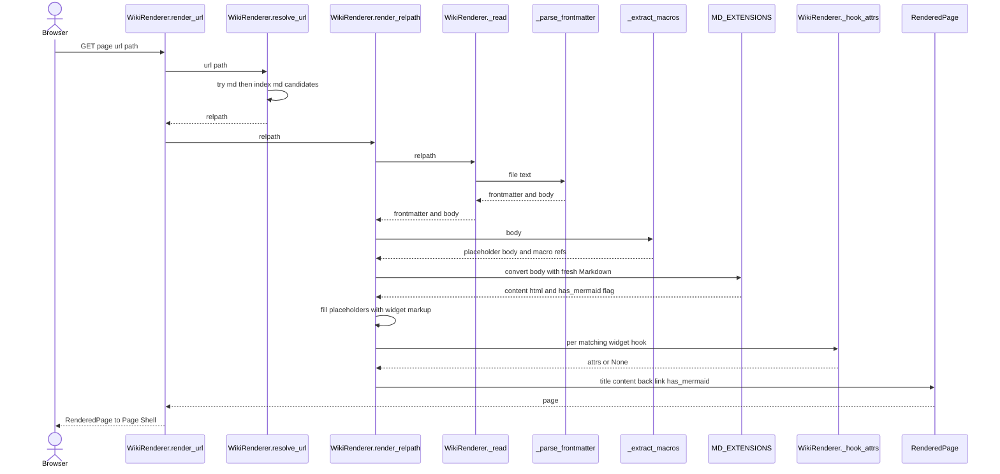
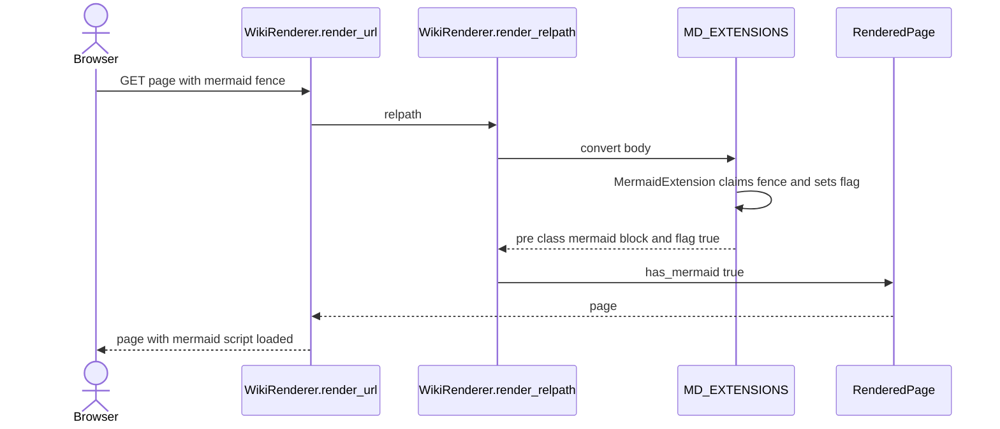
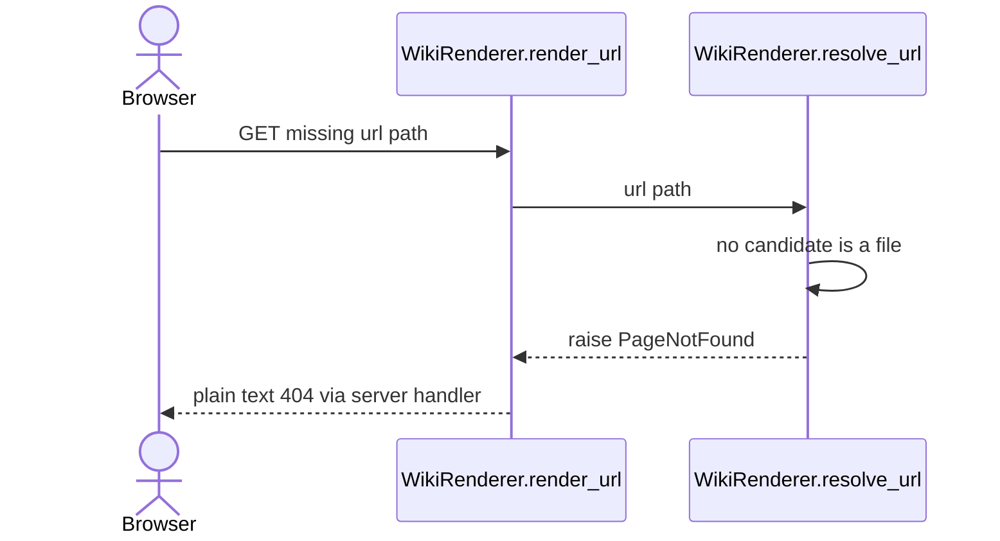
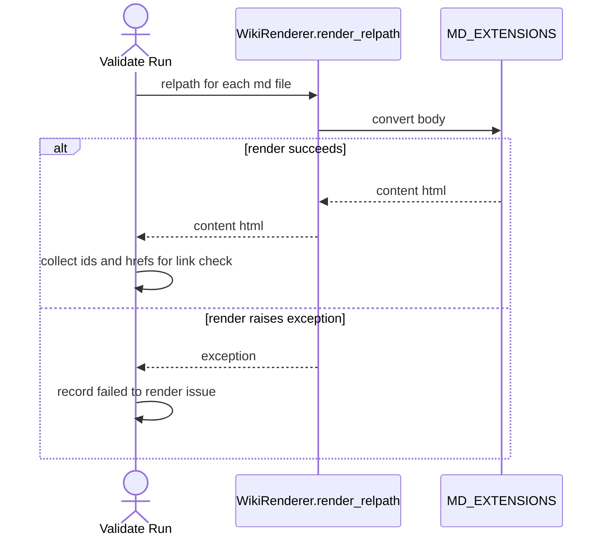
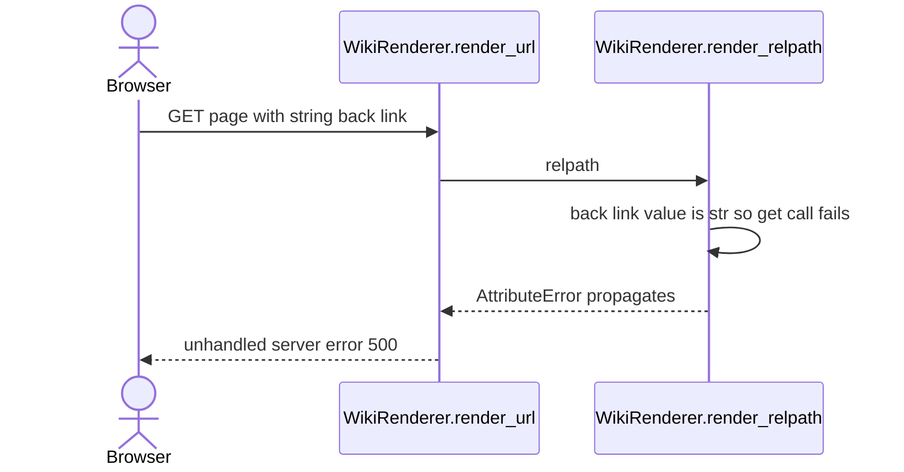

# Markdown Rendering

**Category:** Content Rendering
**Domain span:** Python Server (single domain, no Shared Contract)

`.md` file on disk -> `RenderedPage` (title, HTML body, optional back link, mermaid flag). Pure in-process transform. No DB, no network. Inputs: content root, `SiteConfig`, optional widgets dir.

## Code Elements

| Code Element | What it does | File path |
|---|---|---|
| `MD_EXTENSIONS` | List passed to every `markdown.Markdown`: `extra`, `admonition`, `sane_lists`, `codehilite`, `toc`, `InternalLinkExtension()`, `MermaidExtension()`. Module constant, not config. | mdwiki/render.py |
| `MD_EXTENSION_CONFIGS` | `codehilite.guess_lang=False`, `toc.permalink=False` | mdwiki/render.py |
| `_FRONTMATTER_RE` | `\A---\n(.*?\n)---\n` regex. Matches LF-only frontmatter at file start. | mdwiki/render.py |
| `_parse_frontmatter` | Splits YAML head from body. Returns `({}, text)` on no match. Non-dict YAML becomes `{}`. | mdwiki/render.py |
| `_H1_RE` | `^#\s+(.+)$` multiline. First H1 = title fallback. | mdwiki/render.py |
| `_page_title` | Title priority: frontmatter `title` > first H1 > humanized filename (`index.md` uses dir name). | mdwiki/render.py |
| `WIDGET_MACRO_RE` / `_WIDGET_MACRO_RE` | `{ { widget: name key="val" } }` (braces split here so mdwiki does not expand it) macro syntax. Public name plus internal alias. | mdwiki/render.py |
| `_ATTR_RE` | `key="value"` attr pairs inside a macro. | mdwiki/render.py |
| `_extract_macros` | Swaps each macro for a placeholder token, returns `(body, [(name, attrs), ...])`. | mdwiki/render.py |
| `_PLACEHOLDER` / `_PLACEHOLDER_RE` | `MDWIKIWIDGETPLACEHOLDER{idx}ENDMDWIKIWIDGETPLACEHOLDER` token format and its matcher. Alnum on purpose (see Non-Obvious Solutions). | mdwiki/render.py |
| `relpath_to_url` | `.md` relpath -> served URL (`index.md` folds to `/dir/`). | mdwiki/render.py |
| `RenderedPage` | Dataclass return shape: `title`, `content_html`, `back_link` (dict or None), `has_mermaid`. | mdwiki/render.py |
| `PageNotFound` | Exception for missing file and path escape. Server maps it to plain 404. | mdwiki/render.py |
| `WikiRenderer` | Holds `root` (resolved), `config`, `widgets_dir`. | mdwiki/render.py |
| `WikiRenderer._safe_join` | Joins relpath under root; raises `PageNotFound` if resolved path escapes root. | mdwiki/render.py |
| `WikiRenderer.resolve_url` | URL path -> relpath. Tries `<path>.md`, then `<path>/index.md`. At root tries `config.index_page` first. Raises `PageNotFound`. | mdwiki/render.py |
| `WikiRenderer.page_exists` | Boolean wrapper over `resolve_url`. | mdwiki/render.py |
| `WikiRenderer._read` | Reads file as UTF-8, returns `_parse_frontmatter` result. Raises `PageNotFound` if not a file. | mdwiki/render.py |
| `WikiRenderer._title_for` | Title of another page (used for next-button label). | mdwiki/render.py |
| `WikiRenderer._hook_attrs` | Params for a hook widget. `next-button` -> `adjacent()` target `{href, label}`; `None` = no button. Other hooks -> `{}`. | mdwiki/render.py |
| `WikiRenderer.render_url` | URL path -> `resolve_url` -> `render_relpath`. | mdwiki/render.py |
| `WikiRenderer.render_relpath` | Full pipeline: read, title, macro extract, Markdown convert, macro fill, hook splice, back link, return `RenderedPage`. | mdwiki/render.py |

## Process Flow

Pipeline in `render_relpath`, in order:

1. `_read(relpath)` -> `_parse_frontmatter` -> `(frontmatter dict, body)`.
2. `_page_title` picks title.
3. `excluded` = set from `frontmatter.widgets.exclude` (read here, semantics owned by Widget Injection).
4. `_extract_macros(body)` swaps `{ { widget: ... } }` for placeholder tokens, collects refs.
5. Fresh `markdown.Markdown(MD_EXTENSIONS, MD_EXTENSION_CONFIGS)` converts body. Mermaid preprocessor (priority 27, before `fenced_code`) claims ` ```mermaid ` fences and sets `md.mdwiki_has_mermaid`.
6. Placeholder regex replaces each token with `widget_markup(name, attrs, widgets_dir)`.
7. Hook loop over `config.widget_hooks`: skip if name in `excluded`, skip if `Path(relpath).match(selector)` fails, call `_hook_attrs`, skip if `None`, route markup to top (`anchor` top/both) and/or bottom (bottom/both).
8. `full_html = top hooks + content_html + bottom hooks`.
9. `back_link` built from frontmatter `back_link` (dict only; `href` default `""`, `label` default `"Back"`).
10. Return `RenderedPage(title, full_html, back_link, has_mermaid)`.

No error catching here. `PageNotFound` from `_read` / `resolve_url` propagates. `yaml.safe_load` errors and `AttributeError` from non-dict `back_link` propagate too.

## Entry Points

- HTTP GET page: `WikiRenderer.render_url` called from `_render_response` in mdwiki/server.py via routes `_index` (`/`) and `_page` (`/{url_path:path}`). Routing is owned by Page Routing; render entry is `render_url`.
- Validation run: `WikiRenderer.render_relpath` called from `validate()` in mdwiki/validate.py (page render at lines 87 and 99; `_ids_for` also renders link targets). Triggered by `mdwiki validate`.

No other callers of `render_url` / `render_relpath` in the repo.

## Outputs

- `RenderedPage` returned to server. `_render_response` maps fields to `page.html` template context (`title`, `content`, `back_link`, `has_mermaid`). User-visible HTML page.
- `PageNotFound` -> plain-text 404 via `@app.exception_handler(PageNotFound)` in mdwiki/server.py.
- Unhandled exception (malformed frontmatter YAML, string `back_link`) -> server 500 on page request. In validate, caught by `except Exception` and reported as `"<relpath>: failed to render (<exc>)"`.
- `content_html` string consumed by `validate()` to collect `id=` values and `href` targets (link/anchor check). Not user-visible.

## Use Cases

### UC1: HTTP Page Request -> Rendered HTML Page

Browser GET -> `render_url`. `resolve_url` finds `.md` or `index.md`. `render_relpath` runs full pipeline. Widget macros and hook widgets (next-button on `lessons/*`) spliced in. Back link from frontmatter `back_link` dict. Page Shell turns `RenderedPage` into HTML.



Tests: Covered — tests/test_render.py `test_home_page_renders_and_has_toast_macro`, `test_lessons_index_has_back_link_and_no_next_button`, `test_lesson_1_has_next_button_pointing_to_lesson_2`, `test_lesson_3_is_last_no_next_button`

### UC2: HTTP Page Request -> Mermaid Diagram Page

` ```mermaid ` fence in body. `MermaidExtension` claims it before `fenced_code`, emits `<pre class="mermaid">` with escaped raw source, sets `md.mdwiki_has_mermaid`. `render_relpath` copies flag to `RenderedPage.has_mermaid`. Template loads mermaid.js only when flag true. No fence -> unflagged.



Tests: Covered — tests/test_mermaid.py `test_mermaid_script_only_loaded_on_pages_that_need_it`, `test_mermaid_fence_becomes_pre_mermaid_with_raw_source`, `test_page_without_mermaid_fence_is_unflagged`

### UC3: HTTP Page Request -> Missing Page 404

No `<path>.md` nor `<path>/index.md` on disk, or path escapes root. `resolve_url` raises `PageNotFound` before any read. Server exception handler returns plain-text 404. No rendering.



Tests: Covered — tests/test_render.py `test_missing_page_is_404`, `test_path_traversal_is_404`

### UC4: Validation Run -> Per-Page Render -> Issue Report

`mdwiki validate` walks every `.md` under root, calls `render_relpath`. Success: content HTML feeds id set and href list for link/anchor checks. Failure: exception caught in `validate()`, recorded as `failed to render` issue. This use-case = success branch only.



Tests: Covered — tests/test_render.py `test_validate_is_clean_on_example_site` (success branch only). Failure branch Uncovered, no test renders a raising page.

### UC5: HTTP Page Request -> Non-Dict back_link -> Server 500

Frontmatter `back_link` is string (e.g. `back_link: Home`) not `{href, label}` mapping. Body converts fine. Back-link block does `bl.get(...)` on `str` -> `AttributeError`. Not `PageNotFound`, no handler: unhandled server 500. Same for malformed frontmatter YAML (`yaml.safe_load` raises before body work).



Tests: Uncovered — no automated test exercises a non-dict `back_link` or malformed frontmatter.

Tally: 4 of 5 use-cases covered.

## Core Points

1. Single pipeline in `render_relpath`. Order: frontmatter, title, macro extract, Markdown convert, macro fill, hook splice, back link. Order matters: macros extracted before Markdown, filled after.
2. Fresh `markdown.Markdown` per call. Mermaid flag lives on instance; shared instance unsafe under FastAPI threadpool.
3. Per-page config seam = frontmatter only: `title`, `back_link`, `widgets.exclude`. Site-level seams from `SiteConfig` (`index_page`, `widget_hooks`). Extension set has no config key.
4. No error handling here. `PageNotFound` -> 404 (server handler). Everything else -> 500 on page, "failed to render" in validate.

## Non-Obvious Solutions

- Placeholder plain alnum (`MDWIKIWIDGETPLACEHOLDER...`), not `\x02`/`\x03`. Python-Markdown uses STX/ETX internally and strips them; STX token would vanish silently (render.py lines 49-51).
- Widget macros replaced before Markdown, filled after. Widget host markup is raw HTML; `md_in_html` (in `extra`) lets it pass through Markdown.
- Top/bottom widget hooks concatenated outside `content_html`, not inserted into Markdown source. Hook markup never sees Markdown processing.
- `MermaidExtension` registered at priority 27, before `fenced_code`, so ` ```mermaid ` claimed before generic code highlighting (see Mermaid Diagram Rendering).

## Dependencies

- Internal Link Rewriting: runtime call. `InternalLinkExtension()` in `MD_EXTENSIONS`; treeprocessor rewrites `.md` hrefs during `md.convert`.
- Mermaid Diagram Rendering: runtime call. `MermaidExtension()` in `MD_EXTENSIONS`; `render_relpath` reads `md.mdwiki_has_mermaid` into `RenderedPage.has_mermaid`.
- Widget Injection: runtime call. `_extract_macros` and `widget_markup` for macros; hook loop in `render_relpath` over `SiteConfig.widget_hooks`. Frontmatter `widgets.exclude` is read in `render_relpath` but its semantics belong to Widget Injection.
- Page Ordering: runtime call. `_hook_attrs` calls `adjacent()` (mdwiki/ordering.py) for `next-button`.
- Site Configuration Loading: data-model sharing. Shape: `SiteConfig.index_page` (str or None, read in `resolve_url`) and `SiteConfig.widget_hooks` (list of `WidgetHook` with fields `name`, `anchor`, `selector`, read in `render_relpath`).
- Page Routing: runtime call (Page Routing calls `render_url` through server routes `_index` / `_page`).
- Page Shell & Asset Serving: runtime call (`_render_response` calls `render_url` and reads `RenderedPage` fields `title`, `content_html`, `back_link`, `has_mermaid`).
- Site Validation: runtime call (`validate()` calls `render_relpath` on every `.md` file and on link targets).

## Fragility Points

1. Frontmatter regex is LF-only: `_FRONTMATTER_RE = re.compile(r"\A---\n(.*?\n)---\n", re.DOTALL)` (render.py line 43). CRLF file: `---\r\n` never matches, so frontmatter is treated as body. Verified by regex; no test covers CRLF.
2. `back_link` assumed dict: lines 217-219 call `bl.get(...)` with no type check. String value -> `AttributeError`. No test covers it.
3. Extension set is module constant: `MD_EXTENSIONS` (render.py lines 29-37). `SiteConfig` has no extensions key, so adding or dropping a Markdown extension requires a code edit.
4. Frontmatter parse errors unhandled: `yaml.safe_load` (line 66) has no try/except. Malformed YAML -> page 500 / validate "failed to render".
5. `_hook_attrs` hard-codes one hook name: only `next-button` gets params. Any other hook gets `{}` and the comment says "extend here as new hook widgets need params" (lines 159-169).

## Fragility Note

Worst quiet failure: CRLF `.md` file. Frontmatter (`title`, `back_link`, `widgets.exclude`) silently ignored, YAML shows as body text, `---` renders as horizontal rule, title falls back to H1 or filename. No error, no validate issue. Author notices first, from wrong title or garbage text.

Loud failures: string `back_link` and malformed YAML -> 500 on page and validate issue. Validate catches only when run; live request hits reader first.
