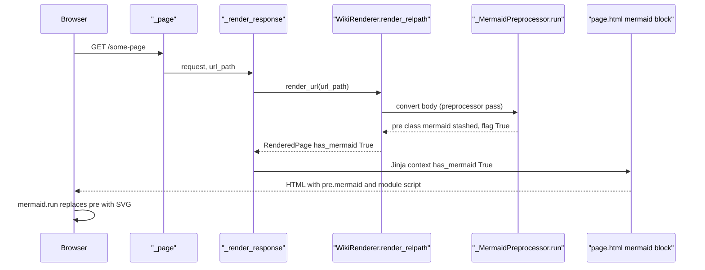
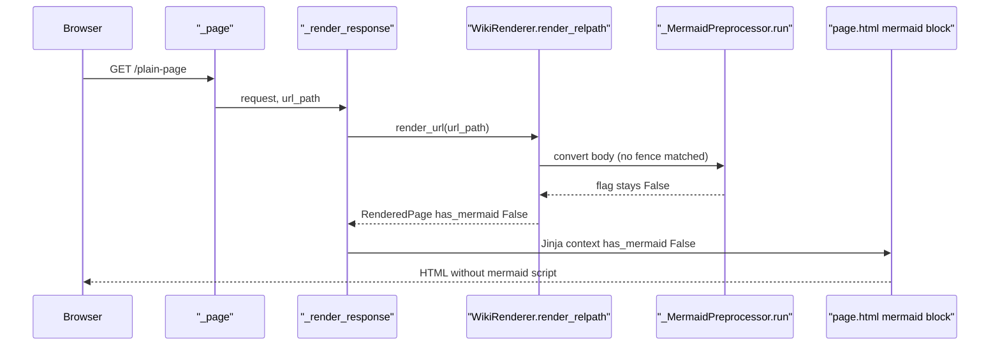
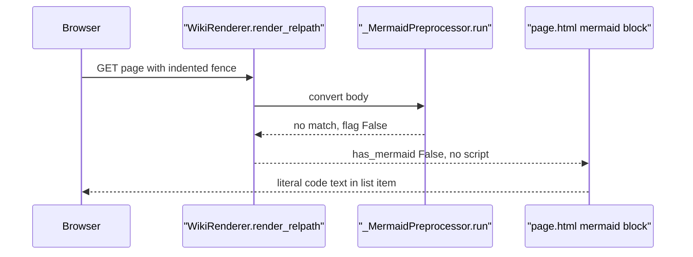

# Mermaid Diagram Rendering

Category: Content Rendering. Domains: Python Server + Browser Client.

## Code Elements

| Code Element | What it does | File path |
|---|---|---|
| `_FENCE_RE` | Regex claims ```` ```mermaid ```` / `~~~mermaid` fences at column 0, captures fence string and code body | `mdwiki/mermaid.py` |
| `_MermaidPreprocessor.run` | Replaces each matched fence with `<pre class="mermaid">` + HTML-escaped raw source, stashed via `htmlStash`; sets `md.mdwiki_has_mermaid = True` | `mdwiki/mermaid.py` |
| `MermaidExtension.extendMarkdown` | Initialises `md.mdwiki_has_mermaid = False`; registers preprocessor `mdwiki_mermaid` at priority 27 | `mdwiki/mermaid.py` |
| `MD_EXTENSIONS` | Module list that includes `MermaidExtension()` in the Markdown extension chain | `mdwiki/render.py` |
| `WikiRenderer.render_relpath` | Builds fresh `markdown.Markdown` per call, converts body, reads `md.mdwiki_has_mermaid` into `RenderedPage.has_mermaid` | `mdwiki/render.py` |
| `RenderedPage` | Dataclass; field `has_mermaid: bool` carries the per-page flag to the server | `mdwiki/render.py` |
| `_render_response` | Passes `page.has_mermaid` into Jinja context under key `"has_mermaid"` | `mdwiki/server.py` |
| `_page` / `_index` | Route handlers for `GET /{url_path:path}` and `GET /`; both delegate to `_render_response` | `mdwiki/server.py` |
| `page.html` mermaid block | `` gate around inline `<script type="module">` that imports mermaid@11.17.2 ESM from jsdelivr, calls `mermaid.initialize({ startOnLoad: false })` and `mermaid.run({ querySelector: ".mermaid" })` | `mdwiki/theme/page.html` |
| `pre.mermaid` rule | CSS: `overflow-x: auto`, centred, no background/border, padding; keeps wide SVG from blowing page width | `mdwiki/theme/app.css` |

## Process Flow

Server side, per page request:

1. `_page` (or `_index`) calls `_render_response`, which calls `WikiRenderer.render_relpath`.
2. `render_relpath` builds a fresh `markdown.Markdown(extensions=MD_EXTENSIONS, ...)`, calls `convert` on body.
3. Preprocessors run by priority, high first. `MermaidExtension` (27) runs before `fenced_code` (25), so `_MermaidPreprocessor.run` claims mermaid fences first.
4. `_MermaidPreprocessor.run` regex-subs each match to `<pre class="mermaid">` + `html.escape(code)`, stored with `htmlStash.store`. Stash keeps Markdown from re-processing the content.
5. Flag `md.mdwiki_has_mermaid` set True only if at least one fence matched.
6. `render_relpath` copies flag into `RenderedPage.has_mermaid`. `_render_response` puts it in template context as `has_mermaid`.
7. Jinja renders `page.html`. Script block emitted only when `has_mermaid` truthy.

Browser side:

8. Browser parses HTML. `<pre class="mermaid">` text node holds escaped source; `.textContent` decodes it back to raw mermaid syntax.
9. Module script loads mermaid ESM from cdn.jsdelivr.net, runs `mermaid.run({ querySelector: ".mermaid" })`. mermaid.js replaces each `pre.mermaid` content with an SVG in place.
10. `app.css` `pre.mermaid` styles the resulting SVG container.

## Entry Points

- HTTP `GET /{url_path}` on any wiki page: `_page` in `mdwiki/server.py`. Only way in; no other trigger.
- HTTP `GET /` (site index): `_index` in `mdwiki/server.py`. Same path through `_render_response`.

## Outputs

- Server HTML: `<pre class="mermaid">` with HTML-escaped raw diagram source, from `_MermaidPreprocessor.run` (`mdwiki/mermaid.py`).
- Server HTML: inline `<script type="module">` importing mermaid@11.17.2 from cdn.jsdelivr.net, only on flagged pages, from `page.html` mermaid block.
- Browser DOM: SVG diagram replacing the `pre.mermaid` text, produced by mermaid.js `mermaid.run` in the browser (client-side output, driven by `page.html` script).

## Use Cases

### UC1: Page With Mermaid Fence -> Diagram Rendered in Browser

Page file contains a ```` ```mermaid ```` fence. `_FENCE_RE` matches it at column 0; `_MermaidPreprocessor.run` stashes `<pre class="mermaid">` and sets the flag. `render_relpath` copies flag to `RenderedPage.has_mermaid`; `_render_response` puts it in context; `page.html` emits the module script. Browser runs mermaid.js and replaces the `pre` with SVG.



Tests: Covered — `tests/test_mermaid.py::test_mermaid_fence_becomes_pre_mermaid_with_raw_source` (server-side `<pre class="mermaid">` output and flag) and `tests/test_mermaid.py::test_mermaid_script_only_loaded_on_pages_that_need_it` (script tag present in served HTML). Browser-side SVG replacement: Uncovered — no browser/e2e tests exist.

### UC2: Page Without Mermaid Fence -> Plain Page, No Mermaid Script

No mermaid fence in body. `_MermaidPreprocessor.run` never sets the flag; `has_mermaid` stays False; `page.html` skips the `<script type="module">` block. No mermaid.js request is made.



Tests: Covered — `tests/test_mermaid.py::test_page_without_mermaid_fence_is_unflagged` (flag False, no `mermaid` in HTML) and `tests/test_mermaid.py::test_mermaid_script_only_loaded_on_pages_that_need_it` (`plain.md` served without `mermaid.esm.min.mjs`).

### UC3: Indented Mermaid Fence (inside list) -> Literal Inline Code, No Diagram

Fence indented (e.g. inside a numbered list item). `_FENCE_RE` anchors with `^` and no leading whitespace allowed, so no match; flag stays False. Generic Markdown then renders the text as inline `<code>` with the literal `mermaid` source. No diagram, no error.



Tests: Uncovered — no automated test exercises an indented fence.

## Core Points

- Two halves, one flag. Python side claims fence and sets `has_mermaid`. Browser side only runs when flag is True. Flag is the only link; both sides must agree on class `mermaid`.
- Claim order matters. Priority 27 must beat `fenced_code` (25), or mermaid fences become syntax-highlighted code and never render.
- Source is escaped, not parsed. Server never validates mermaid syntax; a bad diagram fails in the browser at `mermaid.run`.
- Flag lives on a per-call `Markdown` instance. Fresh instance per `render_relpath` call is deliberate (threadpooled handlers); do not reuse a shared instance.

## Non-Obvious Solutions

- Priority numbers look backwards. Python-Markdown runs higher priority first, so 27 > 25 means mermaid runs before fenced code. Comment in `mermaid.py` explains; a "fix" to lower it silently breaks rendering.
- `html.escape` (not raw interpolation) is required. Mermaid syntax like `A->>B` and `"quoted(label)"` must reach the browser as entities so `.textContent` gives back exact source. `tests/test_mermaid.py::test_mermaid_diagram_with_parens_and_quotes_round_trips` pins this.
- Per-page flag, not per-site. Script is injected only on pages that contain a fence, so most pages pay no mermaid.js load.

## Dependencies

- Markdown Rendering -> Mermaid Diagram Rendering: `runtime call`. `MD_EXTENSIONS` in `mdwiki/render.py` includes `MermaidExtension()`; Markdown Rendering invokes the extension in-process on every `convert`.
- Mermaid Diagram Rendering -> Page Shell & Asset Serving: `data-model sharing`. Shape: Jinja context key `has_mermaid` (bool), set by `_render_response` in `mdwiki/server.py` from `RenderedPage.has_mermaid`, read by `` in `mdwiki/theme/page.html`.

## Shared Contract

Spans Python Server (`mdwiki/mermaid.py`, `mdwiki/render.py`, `mdwiki/server.py`) and Browser Client (`mdwiki/theme/page.html`, `mdwiki/theme/app.css`). Artifacts:

- Jinja context key `has_mermaid` (bool): written in `mdwiki/server.py` `_render_response` context dict as `"has_mermaid": page.has_mermaid`; read in `mdwiki/theme/page.html` ``. Silent failure: rename on either side makes Jinja treat it as undefined (falsy, default non-strict env), so script never loads. No error.
- CSS/DOM class `mermaid`: emitted as `<pre class="mermaid">` in `mdwiki/mermaid.py` `_MermaidPreprocessor.run`; selected by `mdwiki/theme/page.html` `querySelector: ".mermaid"` and styled by `mdwiki/theme/app.css` `pre.mermaid`. Silent failure: rename on one side leaves diagram as raw text in `pre` (or unstyled); no error logged.
- HTML-escaped raw source as text content of `pre.mermaid`: escaping in `mdwiki/mermaid.py` (`html.escape`), decoded by browser `.textContent`. Silent failure: unescaped `<` or `&` breaks HTML parse or mermaid input; mermaid shows its own syntax error in page.

## Fragility Points

- CDN pin with no integrity check and no fallback. `mdwiki/theme/page.html` imports `https://cdn.jsdelivr.net/npm/mermaid@11.17.2/dist/mermaid.esm.min.mjs` with no `integrity` attribute and no local copy. jsdelivr outage or blocked CDN leaves `pre.mermaid` showing raw source text. Upgrade direction: vendor the ESM bundle under `/_assets` or add SRI hash.
- Column-0 anchor in fence regex. `_FENCE_RE` in `mdwiki/mermaid.py` uses `^` with no leading-whitespace allowance. Verified: fence indented inside a list item renders as inline `<code>` with literal source, flag False (UC3). Also: an info string after `mermaid` (e.g. `mermaid title=x`) is not claimed. Upgrade direction: allow leading indent matching the enclosing block.
- Hardcoded class name `mermaid` in three places (`mdwiki/mermaid.py` `class="mermaid"`, `mdwiki/theme/page.html` `querySelector: ".mermaid"`, `mdwiki/theme/app.css` `pre.mermaid`). No constant shared between Python and template/CSS. Drift is silent (see Shared Contract).
- Flag only set by fence preprocessor. Raw `<pre class="mermaid">` typed directly in Markdown or emitted by a widget does not set `mdwiki_has_mermaid`, so the module script is not loaded and the element is never rendered.

## Fragility Note

Fails quietly. Three silent modes: (1) `has_mermaid` key drift between `server.py` and `page.html`, or class-name drift across Python/template/CSS, makes diagrams show as raw source with no error; the wiki reader notices first. (2) CDN outage shows raw source text on every diagram page; reader notices first, author may not. (3) Indented fences (UC3) render as literal code with no diagram; author notices only on visual review. Core fence-to-flag path is covered by tests; browser-side render is not.
