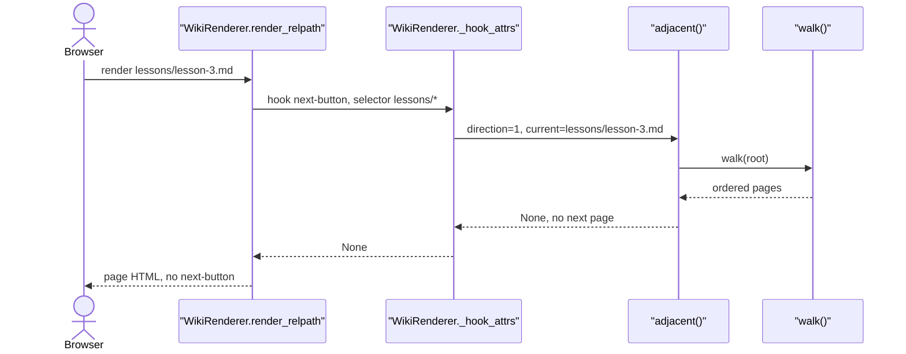
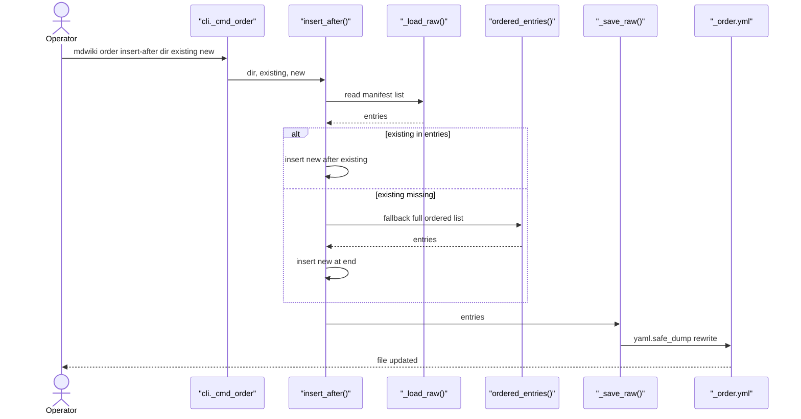
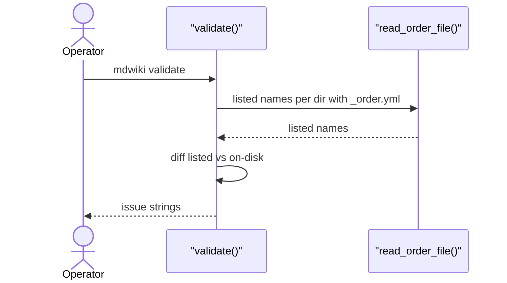

# Page Ordering

Category: Site Management. Domain span: Python Server only. No Shared Contract.

## Code Elements

| Code Element | What it does | File path |
|---|---|---|
| `ORDER_FILENAME` | Const `"_order.yml"`. Per-dir manifest name. | `mdwiki/ordering.py` |
| `read_order_file()` | Load one dir's `_order.yml`. Missing file, empty file, or non-list YAML -> `[]`. Entries coerced to `str`. | `mdwiki/ordering.py` |
| `_read_order_file` | Internal alias of `read_order_file()`. | `mdwiki/ordering.py` |
| `ordered_entries()` | One dir's children: listed names that exist on disk first (manifest order), then unlisted names sorted alphabetically. Only dirs and `.md` files count. Stale manifest names dropped. | `mdwiki/ordering.py` |
| `Page` | Frozen dataclass, field `relpath` (POSIX, root-relative, `.md` kept, e.g. `lessons/index.md`). | `mdwiki/ordering.py` |
| `walk()` | Global DFS over content tree -> `list[Page]`. Dir with `index.md` yields `dir/index.md` leaf, then descends into dir (skipping its own `index.md`). | `mdwiki/ordering.py` |
| `adjacent()` | Filter `walk()` output by selector glob (`PurePosixPath.match`), return neighbor of `current_relpath` at `direction` (+1 next, -1 prev), or `None`. Re-walks whole tree every call. | `mdwiki/ordering.py` |
| `_load_raw()` | Raw manifest list for write path. Wraps `read_order_file()`. | `mdwiki/ordering.py` |
| `_save_raw()` | Write list to `_order.yml` via `yaml.safe_dump(entries, sort_keys=False)`. Overwrites file; drops any comments. | `mdwiki/ordering.py` |
| `insert_after()` | Insert `new_name` after `existing_name` in manifest. Missing `existing_name` -> falls back to full `ordered_entries()` and inserts at end. | `mdwiki/ordering.py` |
| `insert_before()` | Insert `new_name` before `existing_name`. Missing `existing_name` -> falls back to `ordered_entries()` and inserts at index 0. | `mdwiki/ordering.py` |
| `append()` | Append `new_name` to manifest (seeds from `ordered_entries()` if no manifest). No-op if already listed. Does not check `new_name` exists on disk. | `mdwiki/ordering.py` |
| `remove()` | Remove `name` from manifest. Absent name -> silent no-op, no write. | `mdwiki/ordering.py` |
| `_cmd_order()` | CLI dispatch for `mdwiki order {insert-after,insert-before,append,remove}`. Maps args to ordering.py write API. | `mdwiki/cli.py` |
| `order` subparsers (`insert-after`, `insert-before`, `append`, `remove`) | argparse defs for `mdwiki order` subcommands; `order_dir` positional on each. | `mdwiki/cli.py` |
| `WikiRenderer._hook_attrs()` | For `next-button` hook: calls `adjacent(..., direction=1)`; `None` -> no widget. Else returns `{"href", "label"}`. | `mdwiki/render.py` |
| `WikiRenderer._title_for()` | Title of target page, used as next-button `label`. | `mdwiki/render.py` |
| `WikiRenderer.render_relpath()` | Page render. Loops `widget_hooks`, calls `_hook_attrs()` per matching hook, `attrs is None` -> skip hook. | `mdwiki/render.py` |
| `relpath_to_url()` | Turns `Page.relpath` into URL (`index.md` -> `/`, `dir/index.md` -> `/dir/`, `x.md` -> `/x`). Consumes `Page.relpath` string. | `mdwiki/render.py` |
| `validate()` | Pre-flight: per dir with `_order.yml`, reports listed names missing on disk and on-disk `.md`/dirs not listed (except `index.md`). | `mdwiki/validate.py` |

## Process Flow

Two paths touch this feature. Read path (render) and write path (CLI). Validate reads manifests too.

Read path, per page render:
1. `render_relpath()` iterates `config.widget_hooks`. Skips hook if name in `widgets.exclude` or `Path(relpath).match(hook.selector)` false.
2. `_hook_attrs("next-button", selector, relpath)` calls `adjacent(root, relpath, selector, direction=1)`.
3. `adjacent()` calls `walk(root)`. `walk()` calls `ordered_entries()` per dir, recursively. `ordered_entries()` calls `read_order_file()` per dir.
4. `adjacent()` filters pages by selector glob, finds index of `relpath`, returns next `Page` or `None`.
5. `None` -> no markup. Else `_title_for(target.relpath)` for label, `relpath_to_url(target.relpath)` for href, `widget_markup("next-button", attrs)` builds HTML. Markup placed top/bottom per hook `anchor`.

Write path, per CLI call:
1. `mdwiki order <action> <dir> ...` -> `_cmd_order()`.
2. Dispatch to `insert_after` / `insert_before` / `append` / `remove`.
3. Each loads raw list via `_load_raw()` (or `ordered_entries()` fallback), edits list in memory, calls `_save_raw()`. `remove()` writes only on hit.

Validate path: `validate()` calls `read_order_file()` per dir with manifest. Compares to on-disk names. Emits issue strings. Does not write.

No `prev()` caller exists. `adjacent(direction=-1)` is dead in production (see Fragility Points).

## Entry Points

- Page render: `WikiRenderer.render_relpath()` (called via `render_url()`), running `_hook_attrs()` for every `next-button` hook match. Triggered per page request; hook call chain traced here, server route that calls render not traced.
- CLI write: `mdwiki order insert-after|insert-before|append|remove` -> `_cmd_order()` (`mdwiki/cli.py`).
- CLI check: `mdwiki validate` -> `validate()` (`mdwiki/validate.py`). Reads manifests only.

## Outputs

- `next-button` widget HTML with `href` (from `relpath_to_url()`) and `label` (from `_title_for()`). Produced by `_hook_attrs()` + `widget_markup()`, emitted via `render_relpath()`.
- `_order.yml` file rewritten in dir. Produced by `_save_raw()`, called from `insert_after()`, `insert_before()`, `append()`, `remove()`.
- Validation issue strings (`"<dir>/_order.yml: entry '<name>' does not exist on disk"` and unlisted-name warning). Produced by `validate()`.
- No output on the no-next path: `_hook_attrs()` returns `None`, `render_relpath()` skips hook.

## Use Cases

### UC1: Page Render -> Next Button Rendered

Page `lessons/lesson-1.md` rendered. `render_relpath()` finds `next-button` hook matching `lessons/*`. `_hook_attrs()` calls `adjacent(direction=1)`. `adjacent()` calls `walk()`, which reads `example/lessons/_order.yml` through `ordered_entries()`/`read_order_file()`, giving `lessons/lesson-2.md` as next. `_title_for()` supplies label "Lesson 2". `relpath_to_url()` gives `/lessons/lesson-2`. Branch: target found -> markup emitted.

```mermaid
sequenceDiagram
    actor Browser
    participant RR as "WikiRenderer.render_relpath"
    participant HA as "WikiRenderer._hook_attrs"
    participant ADJ as "adjacent()"
    participant WALK as "walk()"
    participant OE as "ordered_entries()"
    participant ROF as "read_order_file()"
    participant TITLE as "WikiRenderer._title_for"
    participant WM as "widget_markup()"
    Browser->>RR: render lessons/lesson-1.md
    RR->>HA: hook next-button, selector lessons/*
    HA->>ADJ: direction=1, current=lessons/lesson-1.md
    ADJ->>WALK: walk(root)
    WALK->>OE: ordered_entries(dir) per dir
    OE->>ROF: read _order.yml
    ROF-->>OE: lesson-1.md, lesson-2.md, lesson-3.md
    OE-->>WALK: listed entries first
    WALK-->>ADJ: Page lessons/lesson-2.md
    ADJ-->>HA: Page lessons/lesson-2.md
    HA->>TITLE: title of lessons/lesson-2.md
    TITLE-->>HA: Lesson 2
    HA->>WM: href /lessons/lesson-2, label Lesson 2
    WM-->>RR: next-button markup
    RR-->>Browser: page HTML with next-button
```

Tests: Covered — `tests/test_render.py: test_lesson_1_has_next_button_pointing_to_lesson_2`

### UC2: Last Page Render -> No Next Button

Page `lessons/lesson-3.md` is last matching page. `adjacent()` finds no index+1 in filtered list, returns `None`. `_hook_attrs()` returns `None`. `render_relpath()` `continue`s: no markup, no error.



Tests: Covered — `tests/test_render.py: test_lesson_3_is_last_no_next_button`

### UC3: CLI Order Edit -> _order.yml Rewritten

`mdwiki order insert-after <dir> <existing> <new>` (or `insert-before`, `append`, `remove`). `_cmd_order()` dispatches to `insert_after()`. `_load_raw()` reads manifest. Branch: `existing` listed -> insert at its position; `existing` absent -> `insert_after()` appends at end, `insert_before()` prepends at 0. `_save_raw()` writes full list with `yaml.safe_dump`, losing any comments. `remove()` on absent name: no write.



Tests: Uncovered — no automated test exercises `mdwiki order` or `ordering.py` write API.

### UC4: CLI Validate -> Manifest Issues Reported

`mdwiki validate` runs `validate()`. For each dir with `_order.yml`, `read_order_file()` gives listed names. Names not on disk -> "does not exist on disk" issue. On-disk `.md`/dirs not listed (except `index.md`) -> "unlisted" issue. Output is text lines, no file write.



Tests: Uncovered — no automated test exercises `_order.yml` entry checks in `validate()`.

## Core Points

- Order = one global DFS. Per-dir `_order.yml` only sets sibling order; nesting comes from directory tree. Dir with `index.md` is a leaf, then walk descends.
- Only `.md` files and dirs are ever sequenced. Anything else is invisible to `walk()` even if listed.
- `next-button` is the only consumer. Standard Widgets and Widget Injection depend on `adjacent(direction=1)` output shape.
- Every `next` call re-walks the whole content tree. Correct but O(tree) per page render.

## Non-Obvious Solutions

- Dir `index.md` appears in walk twice-safe: yielded as leaf on entering dir, then `skip_own_index=True` stops re-visit while still descending. Keeps nested pages in same global order.
- `validate()` exempts `index.md` from "unlisted" warnings because it is folded in by parent level, not sequenced by its own manifest.
- `insert_after` / `insert_before` fall back to full `ordered_entries()` when no manifest or name absent. Fallback writes out a full explicit list, so a first CLI edit freezes current alphabetical order into the file.

## Dependencies

- [Widget Injection](Widget-Injection.md): runtime call. Widget Injection's hook path calls `adjacent()` (`render.py` `_hook_attrs`) to get next page.
- [Page Routing](Page-Routing.md): data-model sharing. Shape: `Page.relpath` string, e.g. `lessons/index.md`, consumed by `relpath_to_url()` to build URL.
- [Standard Widgets](Standard-Widgets.md): data-model sharing. Shape: `next-button` attrs `href` and `label` (from `adjacent()` target via `_hook_attrs`).
- [Site Validation](Site-Validation.md): runtime call. `validate()` calls `read_order_file()` and imports `ORDER_FILENAME`.

## Fragility Points

- `adjacent(direction=-1)` (prev) has no production caller. Only call site is `render.py` `_hook_attrs` with `direction=1`. A prev-button widget would need new hook code path; the `-1` branch is untested by production use.
- `adjacent()` re-runs full `walk(root)` on every render of a hook-matched page. No cache. Cost grows with tree size. `ordered_entries()` also re-reads `_order.yml` per dir each time.
- Non-`.md` names in `_order.yml` silently dropped by `ordered_entries()` (`.md` filter on `on_disk`). `validate()` uses same filter and reports listed non-`.md` file as "does not exist on disk", which is misleading.
- Non-list YAML (e.g. mapping) silently treated as empty by `read_order_file()`. Dir then gets pure alphabetical order with no error.
- `remove()` of absent name: silent no-op, exit 0. `insert_after()` with absent anchor appends at end. `insert_before()` with absent anchor prepends at 0. No warning on either path.
- `append()` and `insert_*()` do not check `new_name` exists on disk. Typo writes stale entry; only `mdwiki validate` catches it.
- `_save_raw()` rewrites with `yaml.safe_dump`, dropping comments. `example/lessons/_order.yml` has a header comment that a CLI edit would lose.

## Fragility Note

Quiet failures: (1) non-list YAML and non-`.md` listed names fail silently at render time, so a page just gets no next-button or wrong order, and nobody sees it unless running `mdwiki validate`. Author notices first, if at all. (2) CLI `remove` of absent name and `insert_*` with absent anchor exit 0 and write a file; wrong order shows up in site nav, found by reader. (3) Dead `prev()` path is not a live failure, only untested surface.
