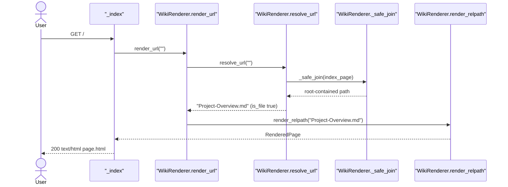
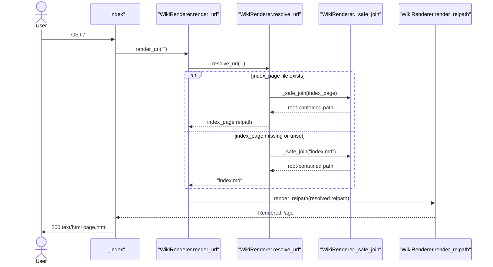
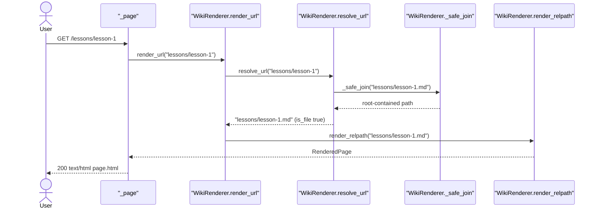
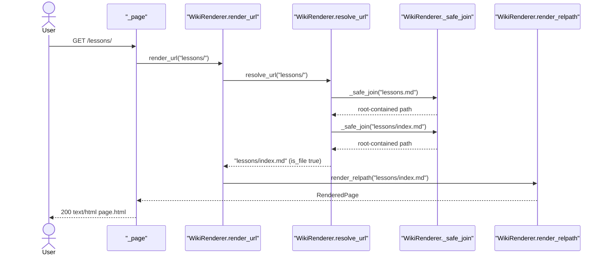
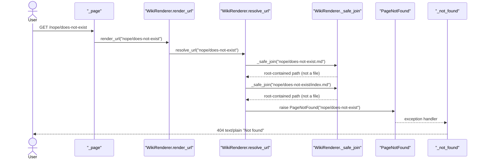
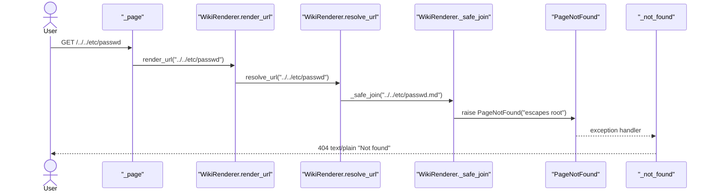
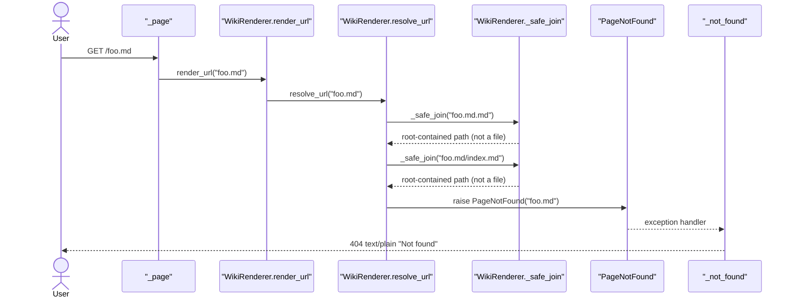
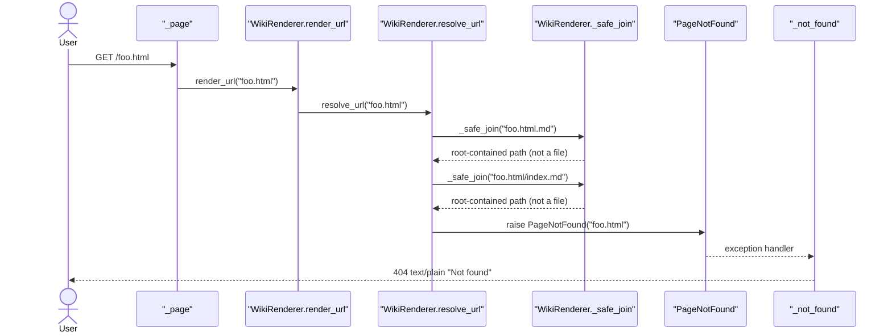
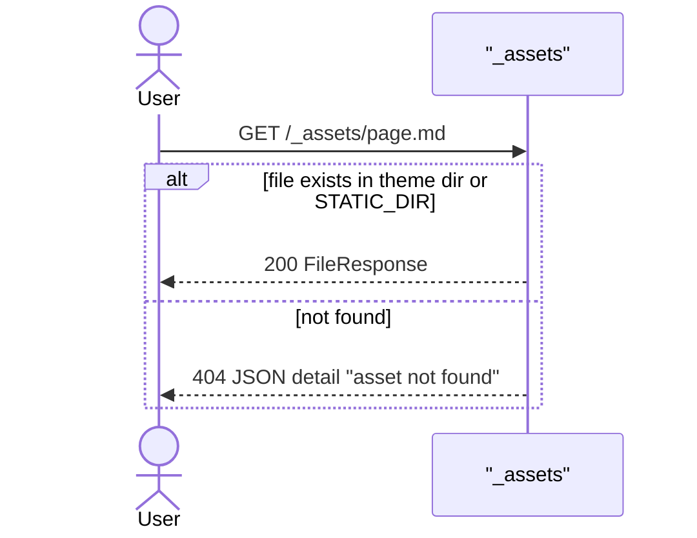

# Page Routing

Maps request URL path to content `.md` relpath, 404s if none. Only `.md` candidates ever built. Traversal and missing both -> same plain 404.

## Code Elements

| Code Element | What it does | File path |
|---|---|---|
| `create_app` | Builds `WikiRenderer`, registers exception handler and routes. Registration order decides match order. | mdwiki/server.py |
| `_index` | `GET /` handler. Calls `_render_response(request, "")`. | mdwiki/server.py |
| `_page` | `GET /{url_path:path}` catch-all. Calls `_render_response(request, url_path)`. | mdwiki/server.py |
| `_render_response` | Calls `renderer.render_url`, fills `page.html` template. | mdwiki/server.py |
| `_not_found` | `PageNotFound` exception handler. Returns plain text `Not found`, status 404. | mdwiki/server.py |
| `_assets` | `GET /_assets/{asset_path}`. Serves file from theme dir or STATIC_DIR only, else JSON 404. Registered before catch-all. | mdwiki/server.py |
| `_widget_assets` | `GET /_widgets/{name}/{asset_path}`. Serves file from widget dir. Registered before catch-all. | mdwiki/server.py |
| `WikiRenderer.render_url` | URL path -> `resolve_url` -> `render_relpath`. | mdwiki/render.py |
| `WikiRenderer.resolve_url` | Builds candidate relpaths, returns first existing file, else raises `PageNotFound`. | mdwiki/render.py |
| `WikiRenderer._safe_join` | Joins relpath under root, resolves it, raises `PageNotFound` if result escapes root. | mdwiki/render.py |
| `WikiRenderer.page_exists` | Bool wrapper over `resolve_url`. Not on request path, used by validate. | mdwiki/render.py |
| `PageNotFound` | Exception for missing file and for traversal. Always becomes 404. | mdwiki/render.py |
| `relpath_to_url` | Inverse: `.md` relpath -> served URL. Not on request path, used by validate and next-button hook. | mdwiki/render.py |
| `WikiRenderer.render_relpath` | Downstream handoff: reads and renders the resolved relpath. Owned by Markdown Rendering. | mdwiki/render.py |
| `SiteConfig.index_page` | Config value from `mdwiki.yml` key `index:`. Read by `resolve_url` at root. | mdwiki/config.py |

## Process Flow

1. `create_app` registers, in order: `PageNotFound` handler, `/_assets/`, `/_widgets/`, `/` (`_index`), `/{url_path:path}` (`_page`).
2. Request matching `/_assets/*` or `/_widgets/*` goes to its own handler. Never reaches `_page`.
3. `_index` and `_page` both call `_render_response`, which calls `WikiRenderer.render_url(url_path)`.
4. `render_url` calls `resolve_url(url_path)`. Result is content relpath, or `PageNotFound`.
5. `resolve_url` strips slashes from `url_path`.
   - Non-empty path: candidates `<path>.md`, then `<path>/index.md`.
   - Empty path (root): candidates `config.index_page` (if set), then `index.md`.
6. For each candidate, `_safe_join` builds root-contained path (raises `PageNotFound` on escape). First candidate where `is_file()` is true wins. No match -> `PageNotFound(url_path)`.
7. Resolved relpath passed to `render_relpath` (Markdown Rendering). Result template-rendered as 200 HTML.
8. `PageNotFound` raised anywhere in steps 3-6 is caught by `_not_found` -> 404 `Not found` text/plain.

Probe of live server (uvicorn, temp content dir with `foo.html`, `foo.md`, `pic/x.png`, `_assets/page.md`, `bar.md`, `index.md`):

- `/foo.html` -> 404 `Not found`. File exists, still 404.
- `/foo.md` -> 404 `Not found`.
- `/pic/x.png` -> 404 `Not found`.
- `/bar` -> 200 HTML.
- `/foo` -> 200 HTML (`foo.md`).
- `/index` -> 200 HTML (`index.md`).
- `/pic/` -> 404 `Not found`.
- `/_assets/page.md` -> 404 JSON `{"detail":"asset not found"}`, from `_assets`, not `_page`.
- `/%2e%2e/etc/passwd` -> 404 `Not found`.

## Entry Points

- `GET /` -> `_index` (mdwiki/server.py). Root page.
- `GET /{url_path:path}` -> `_page` (mdwiki/server.py). Every other content URL, nested or not.

No other entry points. `_assets` and `_widget_assets` are reserved-prefix routes, owned by Page Shell & Asset Serving, not this feature.

## Outputs

- 200 `text/html` page, template `page.html`, from `_render_response` via `_index` / `_page`.
- 404 `text/plain` body `Not found`, from `_not_found` for every `PageNotFound` (missing file, traversal, `.md`-suffixed URL, non-md file).

## Use Cases

### UC1: Root -> Index Override Page Rendered

Request `GET /` -> `_index` -> `render_url("")` -> `resolve_url("")`. `config.index_page` set (from `mdwiki.yml` `index:`) and file exists -> that relpath returned first. Rendered via `render_relpath`.

Tests: Covered — `test_index_override_serves_at_root` in tests/test_render.py (direct `WikiRenderer` call, no HTTP).

### UC2: Root -> Plain index.md Fallback Rendered

Request `GET /` with `index_page` unset or file absent. `resolve_url("")` falls through to literal `index.md`.

Tests: Covered — `test_index_override_falls_back_to_plain_index_md_when_missing` in tests/test_render.py (direct `WikiRenderer` call, no HTTP).

### UC3: Page Path -> `<path>.md` Rendered

Request `GET /lessons/lesson-1`. First candidate `lessons/lesson-1.md` exists -> returned. `<path>/index.md` never checked.

Tests: Covered — `test_lesson_1_has_next_button_pointing_to_lesson_2` in tests/test_render.py (`GET /lessons/lesson-1`).

### UC4: Directory Path -> `<path>/index.md` Rendered

Request `GET /lessons/`. Slashes stripped -> `lessons`. `lessons.md` misses, `lessons/index.md` hits.

Tests: Covered — `test_lessons_index_has_back_link_and_no_next_button` in tests/test_render.py (`GET /lessons/`).

### UC5: Missing Path -> 404 Not Found

Request `GET /nope/does-not-exist`. Neither candidate is a file -> `PageNotFound` -> `_not_found`.

Tests: Covered — `test_missing_page_is_404` in tests/test_render.py (`GET /nope/does-not-exist`).

### UC6: Traversal Path -> 404 Not Found

Request path escaping root, e.g. `/../../etc/passwd`. `_safe_join` raises `PageNotFound` before any `is_file` check. Same 404 as missing, no hint. Client may normalize `..` first -> 307 then 404.

Tests: Covered — `test_path_traversal_is_404` in tests/test_render.py (`GET /../../etc/passwd`, follows 307 if issued).

### UC7: `.md`-Suffixed URL -> 404 Not Found

Request `GET /foo.md` (file `foo.md` exists). Candidates become `foo.md.md` and `foo.md/index.md`. Neither exists -> 404. Probe-verified.

Tests: Uncovered — no automated test exercises this path.

### UC8: Non-md File Path -> 404 Not Found

Request `GET /foo.html` (file `foo.html` exists in content root) or `GET /pic/x.png` (image beside page). No static passthrough exists: candidates are only `<path>.md` and `<path>/index.md`. Neither is a file -> 404. Probe-verified for both. Answer to upstream question: `/foo.html` returns 404 `Not found` (text/plain) even when `foo.html` exists in content root.

Tests: Uncovered — no automated test exercises this path.

### UC9: `/_assets/` Path -> Asset Handler, Content Under Dir Shadowed

Request `GET /_assets/page.md` where content root has `_assets/page.md`. `_assets` handler registered before catch-all, so it answers. It searches only theme dir and STATIC_DIR, never content root. No file there -> JSON 404. `_page` never runs. Probe-verified.

Tests: Uncovered — `test_theme_assets_serve` checks theme assets return 200 only; no test checks that content under `_assets/` is shadowed.

## Core Points

- Routing = per-request `is_file()` check on exactly two `.md` candidates. No index, no cache, no static passthrough.
- Candidate order is the contract: `<path>.md` before `<path>/index.md`; root uses `index_page` before `index.md`.
- All failure paths (missing, traversal, `.md` suffix, non-md file) raise `PageNotFound` -> one 404 body `Not found`. Callers cannot tell which happened.
- Route registration order matters. `/_assets` and `/_widgets` registered before catch-all `/{url_path:path}`, so content under those prefixes is unreachable.
- URL shape is shared with Internal Link Rewriting and Page Ordering. Change candidate list here -> `link_rewrite.py` and `validate.py` must change in same edit.

## Non-Obvious Solutions

- Traversal and missing raise same exception on purpose (docstring: caller always 404s, never 400, so no hint which case).
- `_safe_join` runs before `is_file` on every candidate. Escape raises even when the candidate would not exist.
- `_safe_join` calls `.resolve()`, which follows symlinks. A symlink inside content root pointing outside root gets `PageNotFound`. By code reading, not probed.
- Missing `index_page` file falls through silently to `index.md`. Test asserts this is intended behavior.
- `page_exists` and `relpath_to_url` are not on request path. Used by `validate.py` (link target checks) and next-button hook.

## Dependencies

- Page Routing -> Site Configuration Loading (runtime call): reads `SiteConfig.index_page`, from `mdwiki.yml` key `index:` (mdwiki/config.py). Root candidate.
- Page Routing -> Markdown Rendering (runtime call): `render_url` = `resolve_url` then `render_relpath`.
- Internal Link Rewriting -> Page Routing (data-model sharing): shape = extension-less URL path or `dir/` fold produced by `rewrite_internal_href` (mdwiki/link_rewrite.py). Must match `resolve_url` candidates `<path>.md` / `<path>/index.md`.
- Page Ordering -> Page Routing (data-model sharing): shape = `Page.relpath` string such as `lessons/index.md`, consumed by `relpath_to_url`.
- Site Validation -> Page Routing (runtime call): `validate.py` calls `WikiRenderer.page_exists`, `WikiRenderer.resolve_url`, and `relpath_to_url`.

## Fragility Points

- Only `.md` candidates built (render.py `resolve_url`, line 132). No passthrough for other files. Probe: `/foo.html` 404 with file present; `/pic/x.png` 404, so images beside pages break. Direction: fall back to root-contained static file via `_safe_join`, with content-type.
- Reserved prefixes `/_assets` and `/_widgets` registered before catch-all (server.py lines 46, 54, 85). Content under those dirs shadowed. Probe: `/_assets/page.md` -> asset-handler JSON 404. Direction: move reserved prefixes to a config key, or route content first.
- Direct `.md` URL never resolves (`foo.md` -> `foo.md.md`). Probe-verified 404. Direction: strip `.md` suffix in candidate build; must stay in sync with link rewriting.
- Root `index_page` missing -> silent fallback to literal `index.md` (render.py lines 134-135). No warning. Direction: log or fail when declared file absent.
- Candidate order makes `<path>.md` silently win over `<path>/index.md` when both exist (render.py line 132). By code order, not probed.

## Fragility Note

Quiet failures:

- Missing `index_page` file silently serves `index.md` as site home. Wrong home page, no error. Noticed first by whoever opens site root.
- Non-md files and `.md`-suffixed URLs return plain 404 `Not found` with no log line. Broken image or link noticed first by reader in browser, not by server.
- Reserved-prefix shadowing returns JSON 404 for content under `_assets/` or `_widgets/`. Silent to author until page is opened.
- Link rewriting depends on candidate shape. Mismatch yields dead link. `validate` catches it at build time via `page_exists`, so loud there but not at serve time.
