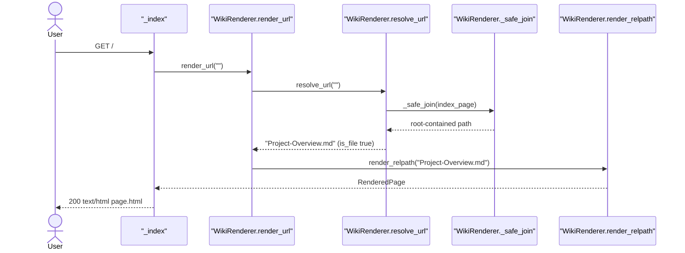
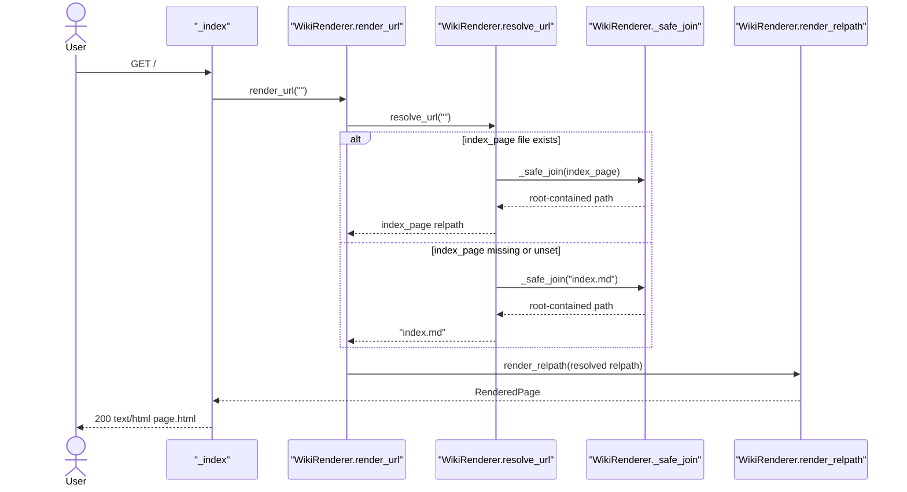
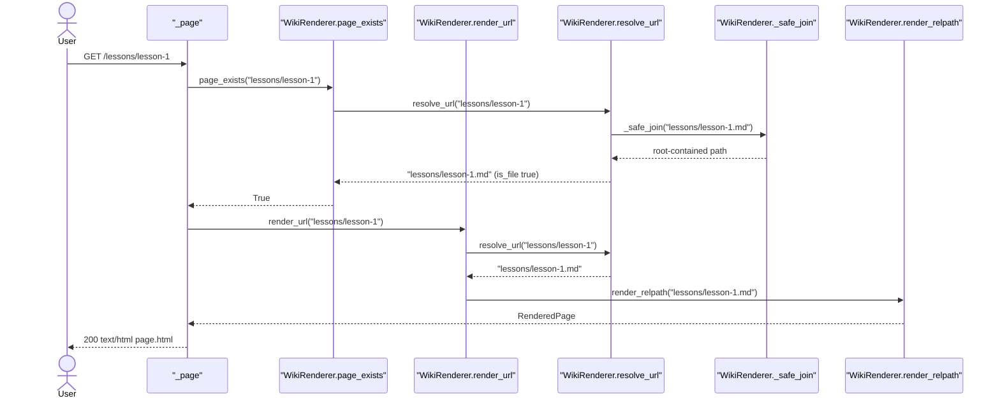
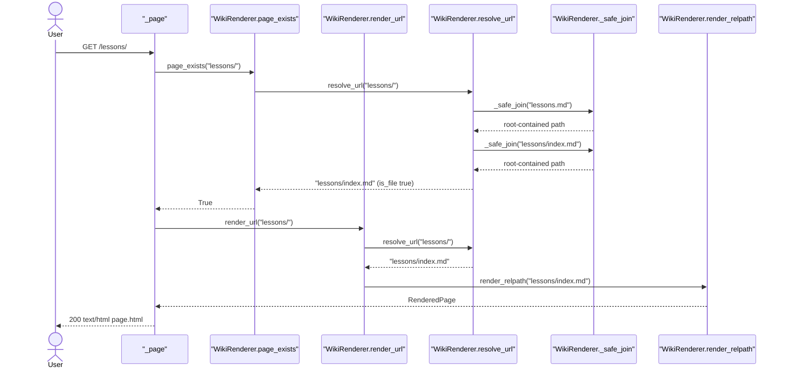
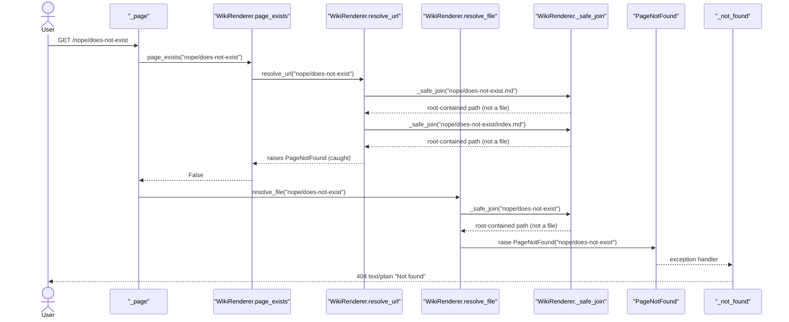
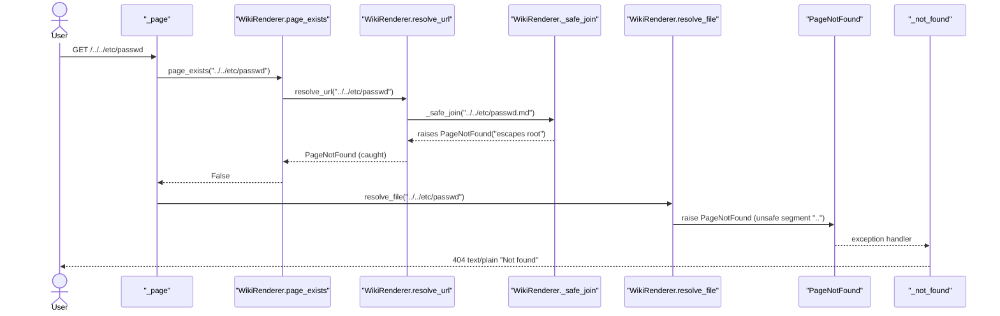
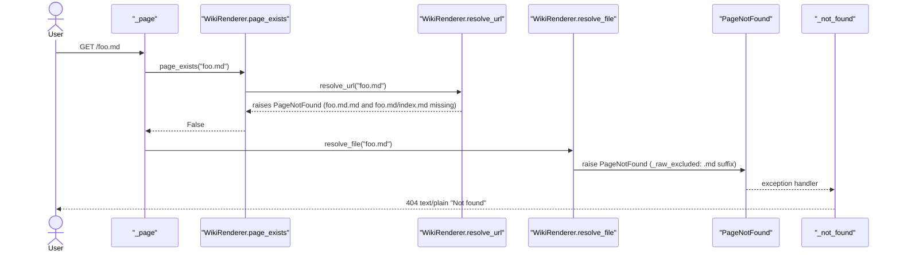
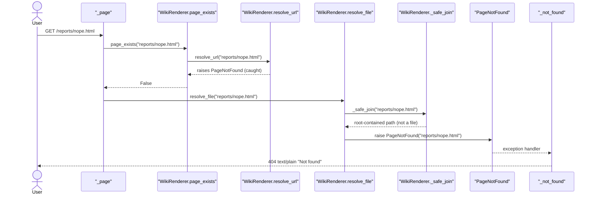
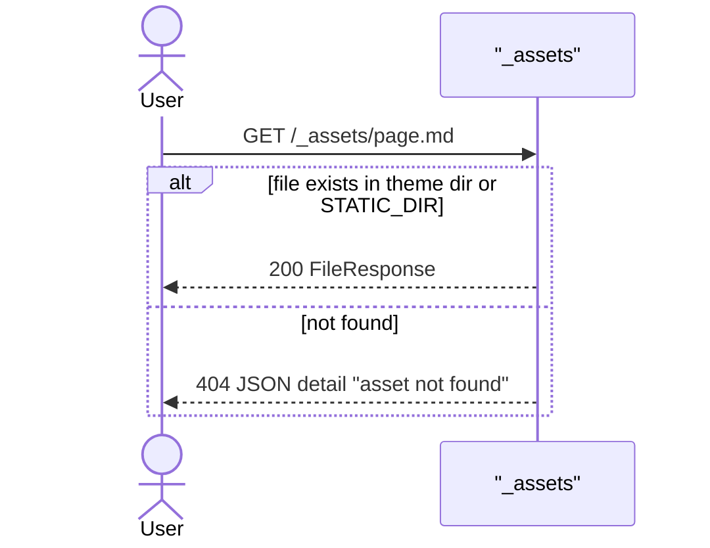
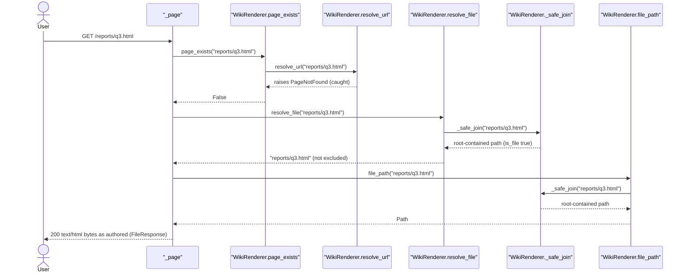

# Page Routing

Maps request URL path to content `.md` relpath and renders it. No `.md` match -> content-root file served raw, as authored (`resolve_file`). Excluded, missing, or traversal -> same plain 404.

## Code Elements

| Code Element | What it does | File path |
|---|---|---|
| `create_app` | Builds `WikiRenderer`, registers exception handler and routes. Registration order decides match order. | mdwiki/server.py |
| `_index` | `GET /` handler. Calls `_render_response(request, "")`. | mdwiki/server.py |
| `_page` | `GET /{url_path:path}` catch-all. `page_exists` true -> `_render_response`. Else `resolve_file` -> `FileResponse(file_path(relpath))`, raw bytes. `PageNotFound` -> 404 via handler. | mdwiki/server.py |
| `_render_response` | Calls `renderer.render_url`, fills `page.html` template. | mdwiki/server.py |
| `_not_found` | `PageNotFound` exception handler. Returns plain text `Not found`, status 404. | mdwiki/server.py |
| `_assets` | `GET /_assets/{asset_path}`. Serves file from theme dir or STATIC_DIR only, else JSON 404. Registered before catch-all. | mdwiki/server.py |
| `_widget_assets` | `GET /_widgets/{name}/{asset_path}`. Serves file from widget dir. Registered before catch-all. | mdwiki/server.py |
| `WikiRenderer.render_url` | URL path -> `resolve_url` -> `render_relpath`. | mdwiki/render.py |
| `WikiRenderer.resolve_url` | Builds candidate relpaths, returns first existing file, else raises `PageNotFound`. | mdwiki/render.py |
| `WikiRenderer._safe_join` | Joins relpath under root, resolves it, raises `PageNotFound` if result escapes root. Catches no `OSError`/`ValueError`/`RuntimeError`. | mdwiki/render.py |
| `WikiRenderer.page_exists` | Bool wrapper over `resolve_url`. Request-path gate in `_page` (`.md` branch if True). Also used by validate. | mdwiki/render.py |
| `WikiRenderer.resolve_file` | URL path -> relpath of content-root file served raw. Rejects empty path, unsafe segments, missing file, excluded file (checked on URL and resolved path). Raises `PageNotFound`. | mdwiki/render.py |
| `WikiRenderer.file_path` | relpath -> absolute path via `_safe_join`. Used by `_page` for `FileResponse` and by validate to read raw `.html`. | mdwiki/render.py |
| `_raw_excluded` | True if any segment starts with `.`, or name (case-insensitive) is in `_RAW_EXCLUDED_NAMES` or ends with `_RAW_EXCLUDED_SUFFIXES`. | mdwiki/render.py |
| `_unsafe_segment` | True if segment has backslash or colon, or trailing dot/space. Rejects `..` too. | mdwiki/render.py |
| `_RAW_EXCLUDED_SUFFIXES` / `_RAW_EXCLUDED_NAMES` | Hardcoded tuples: `(".md",)`, `("_order.yml",)`. Change = code edit. | mdwiki/render.py |
| `PageNotFound` | Exception for missing file, traversal, unsafe or excluded raw file. Always becomes 404. | mdwiki/render.py |
| `relpath_to_url` | Inverse: `.md` relpath -> served URL (`index.md` folds to dir). Non-`.md` relpath -> `/` + relpath (raw URL). Not on request path, used by validate and next-button hook. | mdwiki/render.py |
| `WikiRenderer.render_relpath` | Downstream handoff: reads and renders the resolved relpath. Owned by Markdown Rendering. | mdwiki/render.py |
| `SiteConfig.index_page` | Config value from `mdwiki.yml` key `index:`. Read by `resolve_url` at root. | mdwiki/config.py |

## Process Flow

1. `create_app` registers, in order: `PageNotFound` handler, `/_assets/`, `/_widgets/`, `/` (`_index`), `/{url_path:path}` (`_page`).
2. Request matching `/_assets/*` or `/_widgets/*` goes to its own handler. Never reaches `_page`.
3. `_index` calls `_render_response(request, "")` -> `render_url("")`. Root never falls back to raw file.
4. `_page` calls `renderer.page_exists(url_path)` first.
   - True -> `_render_response(request, url_path)` -> `render_url` -> Markdown branch (steps 5-6 below, then Markdown Rendering), template-rendered 200 HTML.
   - False -> raw fallback (step 7).
5. `page_exists` -> `resolve_url(url_path)`. Strips slashes first.
   - Non-empty path: candidates `<path>.md`, then `<path>/index.md`.
   - Empty path (root): candidates `config.index_page` (if set), then `index.md`.
   - For each candidate, `_safe_join` builds root-contained path (raises `PageNotFound` on escape). First candidate where `is_file()` is true wins. No match -> `PageNotFound` -> `page_exists` returns False.
6. Markdown branch: `render_url` repeats `resolve_url`, then `render_relpath` (Markdown Rendering).
7. Raw fallback: `resolve_file(url_path)`.
   - Strip slashes. Empty path or any `_unsafe_segment` part -> `PageNotFound`.
   - `_safe_join` (escape -> `PageNotFound`). `is_file()` false -> `PageNotFound`.
   - `_raw_excluded` on URL parts AND on resolved relpath -> `PageNotFound`.
   - Else relpath returned. `_page` returns `FileResponse(file_path(relpath))`: bytes as authored, no template, content-type guessed from extension. 200.
8. `PageNotFound` raised anywhere in steps 3-7 (except caught inside `page_exists`) is caught by `_not_found` -> 404 `Not found` text/plain.

Probe of live server (uvicorn, temp content dir):

- `/latin.html` (raw author HTML) -> 200 `text/html; charset=utf-8`, bytes as authored, no shell.
- `/sub.html` -> 200 raw. `/foo.html` and `/pic/x.png` (raw fallback, covered by tests) -> 200 raw.
- `/foo.md` -> 404 `Not found`.
- `/dir/index.html` -> 200 raw. `/dir/` and `/dir` -> 404 `Not found` (no dir fold for raw files).
- `/bar` -> 200 HTML. `/foo` -> 200 HTML (`foo.md` wins over `foo.html`). `/index` -> 200 HTML (`index.md`).
- `/pic/` -> 404 `Not found`.
- `/_assets/page.md` -> 404 JSON `{"detail":"asset not found"}`, from `_assets`, not `_page`.
- `/%2e%2e/etc/passwd` -> 404 `Not found`.
- `/a%00b.html` (NUL byte), symlink loop (`l1.html -> l2.html -> l1.html`), overlong name -> 500, not 404.

## Entry Points

- `GET /` -> `_index` (mdwiki/server.py). Root page.
- `GET /{url_path:path}` -> `_page` (mdwiki/server.py). Every other content URL, nested or not. Serves `.md` page if one resolves, else raw content-root file.

No other entry points. `_assets` and `_widget_assets` are reserved-prefix routes, owned by Page Shell & Asset Serving, not this feature.

## Outputs

- 200 `text/html` page, template `page.html`, from `_render_response` via `_index` / `_page` (`.md` branch).
- 200 raw file, bytes as authored, content-type guessed from extension (`.html` -> `text/html; charset=utf-8`, images, css, ...), from `_page` via `FileResponse`. No page shell.
- 404 `text/plain` body `Not found`, from `_not_found` for every `PageNotFound`: missing raw file, `.md`-suffixed URL, excluded raw file (`.md`, `_order.yml`, dot path), unsafe segment, traversal, symlink escaping root or pointing at excluded file.
- 500, unhandled exception, for NUL byte, symlink loop, overlong name in URL (see Fragility Points). Traceback to server log.

## Use Cases

### UC1: Root -> Index Override Page Rendered

Request `GET /` -> `_index` -> `render_url("")` -> `resolve_url("")`. `config.index_page` set (from `mdwiki.yml` `index:`) and file exists -> that relpath returned first. Rendered via `render_relpath`.

Tests: Covered — `test_index_override_serves_at_root` in tests/test_render.py (direct `WikiRenderer` call, no HTTP).

### UC2: Root -> Plain index.md Fallback Rendered

Request `GET /` with `index_page` unset or file absent. `resolve_url("")` falls through to literal `index.md`.

Tests: Covered — `test_index_override_falls_back_to_plain_index_md_when_missing` in tests/test_render.py (direct `WikiRenderer` call, no HTTP).

### UC3: Page Path -> `<path>.md` Rendered

Request `GET /lessons/lesson-1`. `page_exists` gate: first candidate `lessons/lesson-1.md` exists -> True. `render_url` resolves again -> rendered. `<path>/index.md` never checked.

Tests: Covered — `test_lesson_1_has_next_button_pointing_to_lesson_2` in tests/test_render.py (`GET /lessons/lesson-1`).

### UC4: Directory Path -> `<path>/index.md` Rendered

Request `GET /lessons/`. Slashes stripped -> `lessons`. `page_exists` gate: `lessons.md` misses, `lessons/index.md` hits -> True. Rendered from `lessons/index.md`.

Tests: Covered — `test_lessons_index_has_back_link_and_no_next_button` in tests/test_render.py (`GET /lessons/`).

### UC5: Missing Path -> 404 Not Found

Request `GET /nope/does-not-exist`. `page_exists` false (neither candidate is a file). Raw fallback `resolve_file` -> `is_file` false -> `PageNotFound` -> `_not_found`.

Tests: Covered — `test_missing_page_is_404` in tests/test_render.py (`GET /nope/does-not-exist`).

### UC6: Traversal Path -> 404 Not Found

Request path with `..` segments, e.g. `/../../etc/passwd`. `page_exists` false (`_safe_join` escape caught there). Raw fallback `resolve_file` rejects `..` via `_unsafe_segment` before any filesystem access. Same 404 as missing, no hint. Client may normalize `..` first -> 307 then 404. Symlink escape (a symlink inside root pointing outside) is caught by `_safe_join` containment, not by `_unsafe_segment`.

Tests: Covered — `test_path_traversal_is_404` in tests/test_render.py (`GET /../../etc/passwd`, follows 307 if issued); `test_raw_file_traversal_is_404` in tests/test_static_files.py (`GET /%2e%2e/secret.html`).

### UC7: `.md`-Suffixed URL -> 404 Not Found

Request `GET /foo.md` (file `foo.md` exists). `page_exists` candidates become `foo.md.md` and `foo.md/index.md`. Neither exists -> False. Raw fallback `resolve_file` finds `foo.md` but `_raw_excluded` (`.md` suffix) -> `PageNotFound` -> 404. Probe-verified.

Tests: Covered — `test_excluded_files_are_404` in tests/test_static_files.py (`GET /index.md` case of `.md` suffix; also `/reports/_order.yml`, `/.wiki-manifest.json`).

### UC8: Missing or Excluded Non-md File -> 404 Not Found

Request `GET /reports/nope.html` (no such file), or `GET /reports/_order.yml` / `GET /.wiki-manifest.json` (file exists but excluded). `page_exists` false. `resolve_file` raises `PageNotFound` either at `is_file` (missing) or at `_raw_excluded` (excluded). Same 404 tail.

Tests: Covered — `test_missing_raw_file_is_plain_404` (`GET /reports/nope.html`) and `test_excluded_files_are_404` (`GET /reports/_order.yml`, `GET /.wiki-manifest.json`) in tests/test_static_files.py; `test_exclusions_ignore_case_and_unsafe_segments` in tests/test_static_files.py covers case and unsafe-segment variants.

### UC9: `/_assets/` Path -> Asset Handler, Content Under Dir Shadowed

Request `GET /_assets/page.md` where content root has `_assets/page.md`. `_assets` handler registered before catch-all, so it answers. It searches only theme dir and STATIC_DIR, never content root. No file there -> JSON 404. `_page` never runs. Probe-verified.

Tests: Uncovered — `test_theme_assets_serve` checks theme assets return 200 only; no test checks that content under `_assets/` is shadowed.

### UC10: Content File Path -> Raw File Served

Request `GET /reports/q3.html` (author HTML, no `reports/q3.html.md` or `reports/q3.html/index.md`) or `GET /reports/chart.png`. `page_exists` false. `resolve_file` finds regular file, not excluded -> `_page` returns `FileResponse` of the bytes as authored. No page shell, no Markdown rendering.

Tests: Covered — `test_author_html_served_in_full_as_authored` (`GET /reports/q3.html`) and `test_static_file_served_raw_with_guessed_content_type` (`GET /reports/chart.png`, `image/png`) in tests/test_static_files.py.

## Core Points

- Routing = per-request `page_exists` gate (two `.md` candidates, `is_file()`), then raw fallback via `resolve_file`. No index, no cache.
- Candidate order is the contract: `<path>.md` before `<path>/index.md`; root uses `index_page` before `index.md`.
- All failure paths (missing, traversal, `.md` suffix, excluded raw file, unsafe segment) raise `PageNotFound` -> one 404 body `Not found`. Callers cannot tell which happened.
- Route registration order matters. `/_assets` and `/_widgets` registered before catch-all `/{url_path:path}`, so content under those prefixes is unreachable.
- URL shape is shared with Internal Link Rewriting and Page Ordering. Change candidate list or exclusions here -> `link_rewrite.py` and `validate.py` must change in same edit.

## Non-Obvious Solutions

- Traversal and missing raise same exception on purpose (docstring: caller always 404s, never 400, so no hint which case).
- `_safe_join` runs before `is_file` on every candidate. Escape raises even when the candidate would not exist.
- `_safe_join` calls `.resolve()`, which follows symlinks. A symlink inside content root pointing outside root gets `PageNotFound`. Covered by `test_symlink_escaping_root_is_404`.
- Exclusion check runs on both the requested URL parts and the resolved real path. Symlink `notes.txt -> secret.md` or `env.txt -> .env` returns 404. Covered by `test_symlink_to_excluded_file_is_404`.
- `.md` page always wins its URL: `odd.html.md` + `odd.html` -> `/odd.html` renders the Markdown. Covered by `test_md_page_wins_its_url_over_a_raw_file`.
- `_page` resolves `.md` twice (`page_exists`, then `render_url`). Redundant stat calls, not a bug.
- Missing `index_page` file falls through silently to `index.md`. Test asserts this is intended behavior.
- `relpath_to_url` is not on request path. Used by `validate.py` (link target checks) and next-button hook.

## Dependencies

- Page Routing -> Site Configuration Loading (runtime call): reads `SiteConfig.index_page`, from `mdwiki.yml` key `index:` (mdwiki/config.py). Root candidate.
- Page Routing -> Markdown Rendering (runtime call): `render_url` = `resolve_url` then `render_relpath`. Raw-file branch skips Markdown Rendering entirely.
- Internal Link Rewriting -> Page Routing (data-model sharing): shape = extension-less URL path or `dir/` fold produced by `rewrite_internal_href` (mdwiki/link_rewrite.py). Must match `resolve_url` candidates `<path>.md` / `<path>/index.md`. Links to raw non-`.md` files (`/q3.html`, `/chart.png`) pass unrewritten and resolve via `resolve_file`.
- Page Ordering -> Page Routing (data-model sharing): shape = `Page.relpath` string such as `lessons/index.md`, consumed by `relpath_to_url`.
- Site Validation -> Page Routing (runtime call): `validate.py` calls `WikiRenderer.page_exists`, `WikiRenderer.resolve_url`, `WikiRenderer.resolve_file`, `WikiRenderer.file_path`, and `relpath_to_url`. Reads raw `.html` pages via `file_path` to check their links and anchors.
- Page Shell & Asset Serving -> Page Routing (runtime call): `/_assets/*` and `/_widgets/*` routes registered before catch-all `_page`, so they pre-empt it. `_page` raw branch never sees those prefixes.

## Fragility Points

- Reserved prefixes `/_assets` and `/_widgets` registered before catch-all (server.py lines 46, 54, 85). Content under those dirs shadowed. Probe: `/_assets/page.md` -> asset-handler JSON 404. Direction: move reserved prefixes to a config key, or route content first.
- Direct `.md` URL 404 is deliberate exclusion, not a candidate gap: `_RAW_EXCLUDED_SUFFIXES = (".md",)` in `_raw_excluded`, plus `page_exists` candidates `foo.md.md`. Probe-verified (`/foo.md` 404). Link rewriting depends on extension-less URLs, so changing this needs `link_rewrite.py` and `test_excluded_files_are_404` updated together.
- Root `index_page` missing -> silent fallback to literal `index.md` (render.py `resolve_url`, lines 161-162). No warning. Direction: log or fail when declared file absent.
- Candidate order makes `<path>.md` silently win over `<path>/index.md` when both exist (render.py `resolve_url`, line 159). By code order, not probed.
- Raw directory index not folded: `dir/index.html` served at `/dir/index.html` only. `/dir/` and `/dir` -> 404 even with the file present (probed: `/dir/index.html` 200, `/dir/` 404). Only `.md` gets `<path>/index.md` fold. Direction: add `<path>/index.html` to `resolve_file` candidates.
- `FileResponse` forces `charset=utf-8` on `text/*` (Starlette `init_headers` appends it when absent). Header overrides author `<meta charset>`: probe `/latin.html` declares `iso-8859-1` in meta, served `text/html; charset=utf-8`, so non-UTF-8 author HTML decodes wrong. Direction: serve author HTML bytes with explicit headers if non-UTF-8 pages matter.
- Unreadable raw file passes `resolve_file` (`is_file()` is a stat, not a read). `FileResponse` open fails after headers sent -> 200 with empty body. Code review finding, not probed. Direction: open-check the file in `resolve_file`, raise `PageNotFound` on failure.
- NUL byte, symlink loop, overlong name in URL -> 500, not 404. Probed: `/a%00b.html` 500; `l1.html -> l2.html -> l1.html` 500 (`RuntimeError: Symlink loop`); 300-char name 500 (`OSError: File name too long`). Pre-existing: `_safe_join`, `resolve_file` and `is_file` raise `ValueError`/`RuntimeError`/`OSError`, and only `PageNotFound` is handled. Direction: catch those in `_safe_join` and raise `PageNotFound`.
- Exclusion list hardcoded: `_RAW_EXCLUDED_SUFFIXES = (".md",)`, `_RAW_EXCLUDED_NAMES = ("_order.yml",)`, dot-segment rule, and `_unsafe_segment` rules are code literals. New excluded type = code edit. Direction: move to config key.

## Fragility Note

Quiet failures:

- Missing `index_page` file silently serves `index.md` as site home. Wrong home page, no error. Noticed first by whoever opens site root.
- Missing or excluded raw files, `.md`-suffixed URLs, and `dir/` URLs return plain 404 `Not found` with no log line. Broken image or link noticed first by reader in browser, not by server.
- Non-UTF-8 author `.html` served with `charset=utf-8` header: garbled text, no error. Noticed first by reader of the page.
- Unreadable raw file: 200 with empty body, no error logged by mdwiki. Noticed first by reader of the page.
- Reserved-prefix shadowing returns JSON 404 for content under `_assets/` or `_widgets/`. Silent to author until page is opened.
- Link rewriting depends on candidate shape. Mismatch yields dead link. `validate` catches it at build time via `page_exists`, so loud there but not at serve time.

Loud, not silent: NUL / symlink-loop / overlong URLs return 500 with traceback in server log.
