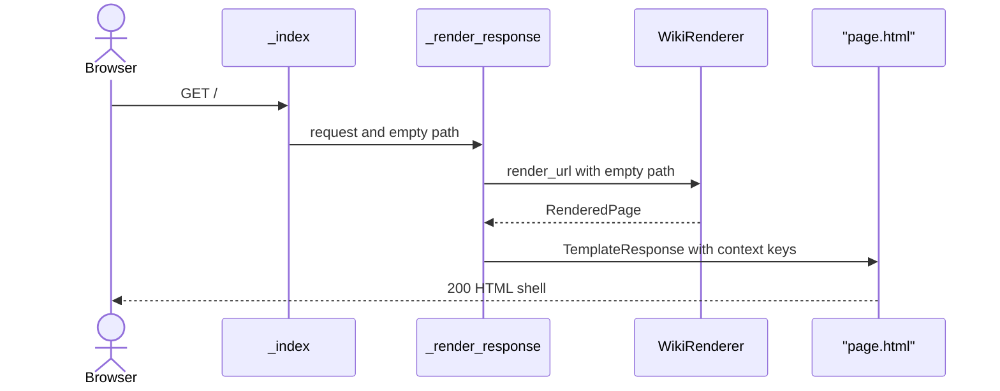
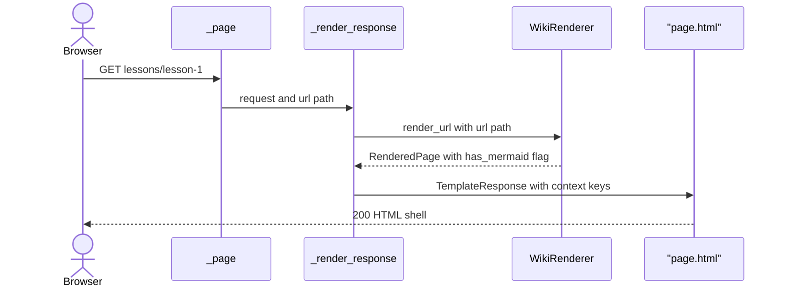
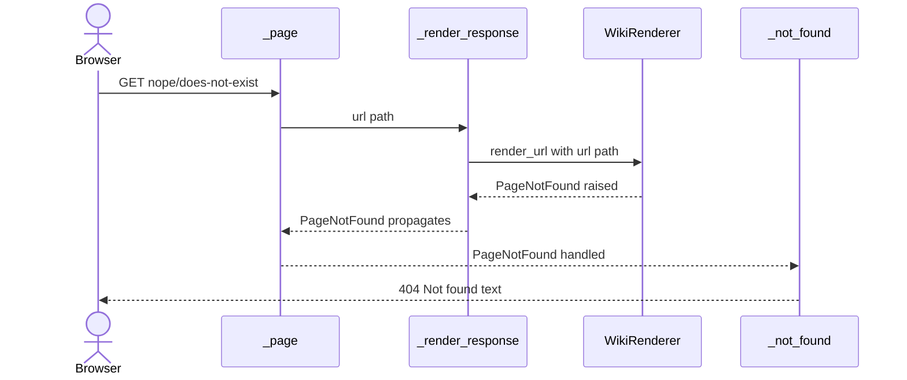
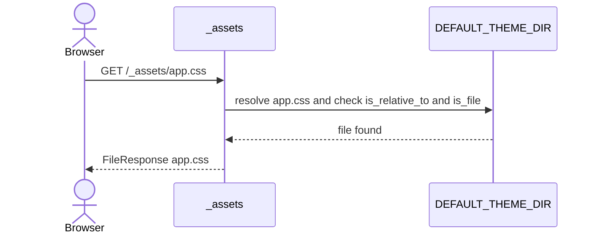
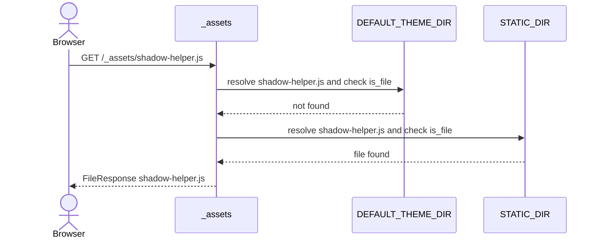
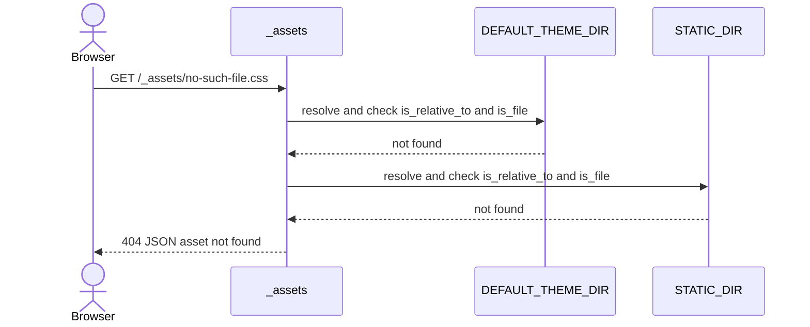
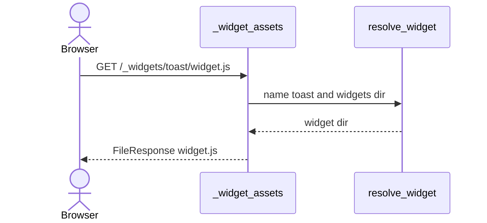
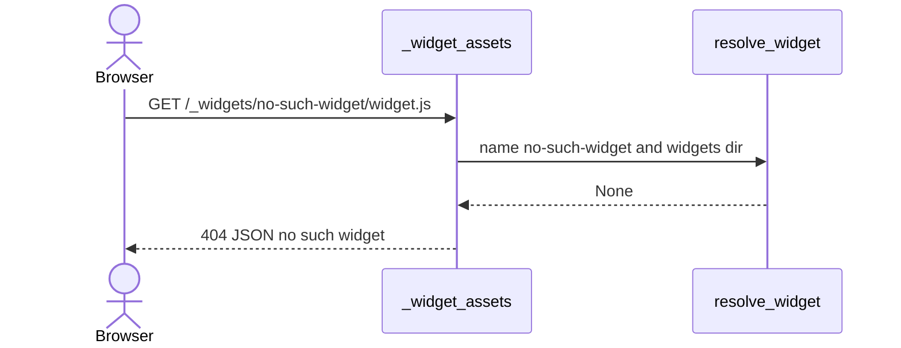
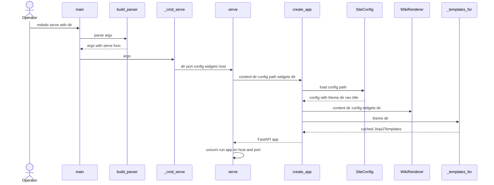

# Page Shell & Asset Serving

FastAPI app factory. Wraps rendered page HTML in one Jinja shell (`page.html`), serves theme and widget static files. Root-absolute URLs everywhere. Config and theme frozen at startup.

## Code Elements

| Code Element | What it does | File path |
|---|---|---|
| `create_app` | Factory. Loads `SiteConfig`, picks theme dir, builds `WikiRenderer` and Jinja templates, registers exception handler and routes. Route order: `/_assets`, `/_widgets`, `/`, catch-all. | mdwiki/server.py |
| `serve` | Calls `create_app`, then `uvicorn.run(app, host, port)`. Shared by CLI, `python -m mdwiki`, and `from mdwiki import serve`. | mdwiki/server.py |
| `_templates_for` | Returns `Jinja2Templates` for a theme dir. Cached per dir. | mdwiki/server.py |
| `_TEMPLATES_CACHE` | Module-level `dict[Path, Jinja2Templates]`. Keyed by theme dir. | mdwiki/server.py |
| `_index` | `GET /` handler. Calls `_render_response(request, "")`. | mdwiki/server.py |
| `_page` | `GET /{url_path:path}` catch-all. Calls `_render_response(request, url_path)`. | mdwiki/server.py |
| `_render_response` | Calls `WikiRenderer.render_url`, builds Jinja context dict, returns `TemplateResponse` for `page.html`. Sets `request_path` from `request.url.path`. | mdwiki/server.py |
| `_not_found` | `PageNotFound` exception handler. Plain text `Not found`, 404. | mdwiki/server.py |
| `_assets` | `GET /_assets/{asset_path:path}`. Searches theme dir, then `STATIC_DIR`. Path guard via `is_relative_to` after `.resolve()`. Else `HTTPException` 404. | mdwiki/server.py |
| `_widget_assets` | `GET /_widgets/{name}/{asset_path:path}`. Resolves widget dir, serves file under it with same guard. 404 if widget or file missing. | mdwiki/server.py |
| `DEFAULT_THEME_DIR` | `mdwiki/theme/` dir. Used when `mdwiki.yml` has no `theme:` key. | mdwiki/theme/__init__.py |
| `STATIC_DIR` | `mdwiki/static/` dir. Fallback for `/_assets`. Holds `shadow-helper.js` only. | mdwiki/theme/__init__.py |
| `page.html` | Jinja shell. `<head>` (title, `app.css` link, optional `MDWIKI_BACKEND_BASE` script, optional mermaid loader), nav with active state, optional back link, `content\|safe` body. | mdwiki/theme/page.html |
| `app.css` | Default theme styles. Generic layout, nav, admonition, `.mdwiki-widget`, and static pasted Pygments `.codehilite` block. | mdwiki/theme/app.css |
| `main` | CLI entry. Parses argv via `build_parser`, calls `args.func`, `sys.exit` on result. | mdwiki/cli.py |
| `build_parser` | argparse tree. `serve` subcommand: `--dir`, `--port` (8000), `--host` (127.0.0.1), `--config`, `--widgets`. | mdwiki/cli.py |
| `_cmd_serve` | Unpacks args, calls `serve`. Returns 0. | mdwiki/cli.py |
| `mdwiki/__init__.py` | Re-exports `serve` for `from mdwiki import serve`. | mdwiki/__init__.py |
| `mdwiki/__main__.py` | `python -m mdwiki` entry. Calls `main`. | mdwiki/__main__.py |
| `pyproject.toml` | `[project.scripts] mdwiki = "mdwiki.cli:main"`. `package-data` includes `theme/*`, `static/*`, `widgets/**/*`. | pyproject.toml |
| `SiteConfig` | Called here via `SiteConfig.load(config_path)`. Owned by Site Configuration Loading. | mdwiki/config.py |
| `WikiRenderer` | Called here via `render_url(url_path)`. Returns `RenderedPage` (title, content_html, back_link, has_mermaid). Owned by Page Routing and Markdown Rendering. | mdwiki/render.py |
| `resolve_widget` | Called here by `_widget_assets`. Returns widget dir or None. Owned by Widget Injection. | mdwiki/widgets.py |

## Process Flow

Page request:

1. `_index` (`/`) or `_page` (`/{url_path}`) calls `_render_response`.
2. `_render_response` calls `WikiRenderer.render_url(url_path)`. Returns `RenderedPage`, or raises `PageNotFound`.
3. `_render_response` builds context dict: `site_title`, `title`, `content`, `back_link`, `nav`, `backend_base`, `has_mermaid`, `request_path`.
4. `TemplateResponse` renders `page.html` from templates for `theme_dir`.
5. Template emits:
   - `<link>` to `/_assets/app.css`.
   - `window.MDWIKI_BACKEND_BASE` script only if `backend_base` set.
   - Mermaid CDN `<script type="module">` (pinned `mermaid@11.17.2`) only if `has_mermaid`.
   - Nav links. Class `active` when `request_path == link.href`, or `link.href != '/'` and `request_path` starts with `link.href`.
   - Back link only if `back_link` set.
   - `content|safe` body.
6. `PageNotFound` anywhere in steps 1-2 goes to `_not_found` -> 404 text.

Asset request:

1. `/_assets/{path}` -> `_assets`. Loops `(theme_dir, STATIC_DIR)`. For each: `resolve()` candidate, require `is_relative_to(base)` and `is_file()`. First hit -> `FileResponse`.
2. No hit -> `HTTPException` 404 (JSON `detail`).

Widget asset request:

1. `/_widgets/{name}/{path}` -> `_widget_assets`. `resolve_widget(name, effective_widgets_dir)`. None -> 404.
2. Candidate path guarded same way as `_assets`. Hit -> `FileResponse`. Miss -> 404.

Startup:

1. CLI or `serve()` -> `create_app(content_dir, config_path, widgets_dir)`.
2. `SiteConfig.load` once. Picks `theme_dir` (config value or `DEFAULT_THEME_DIR`). Builds `WikiRenderer` and `_templates_for(theme_dir)`.
3. `uvicorn.run(app, host, port)`.

## Entry Points

- `mdwiki serve --dir ...` CLI: `mdwiki/cli.py` `main` -> `_cmd_serve` -> `serve`. Console script from `pyproject.toml` `[project.scripts]`.
- `python -m mdwiki`: `mdwiki/__main__.py` -> `main` -> same path.
- `from mdwiki import serve`: `mdwiki/__init__.py` re-export of `serve`.
- HTTP `GET /`: `_index`.
- HTTP `GET /{url_path}`: `_page`.
- HTTP `GET /_assets/{asset_path}`: `_assets`.
- HTTP `GET /_widgets/{name}/{asset_path}`: `_widget_assets`.
- `create_app(...)` called directly: only programmatic path to the app object without uvicorn. Used by tests (`TestClient`).

## Outputs

- 200 `text/html` shell from `page.html` (`_render_response`).
- 404 `text/plain` `Not found` (`_not_found`).
- File response from theme dir or `STATIC_DIR` (`_assets`).
- 404 JSON `{"detail": "asset not found"}` (`_assets`).
- File response for widget asset (`_widget_assets`).
- 404 JSON `no such widget` or `asset not found` (`_widget_assets`).
- Bound HTTP server on `host:port` (`serve` -> `uvicorn.run`).

## Use Cases

### UC1: Index Request -> Rendered Shell Page

Browser `GET /`. `_index` -> `_render_response(request, "")`. `WikiRenderer.render_url("")` resolves root page (Page Routing). Returns `RenderedPage`. Context built. `page.html` renders with 200 HTML. Mermaid loader and backend script appear only if flags set.

**Tests:** Covered — `tests/test_render.py::test_home_page_renders_and_has_toast_macro`

### UC2: Page Request -> Rendered Shell Page

Browser `GET /{url_path}`. Same chain as UC1 via `_page`. Active nav and back link computed in template from `request_path`. Mermaid script only if `has_mermaid` true.

**Tests:** Covered — `tests/test_render.py::test_lesson_1_has_next_button_pointing_to_lesson_2` (shell render, back link in `test_lessons_index_has_back_link_and_no_next_button`). Mermaid branch: `tests/test_mermaid.py::test_mermaid_script_only_loaded_on_pages_that_need_it`. Themed-shell variant (`theme:` in `mdwiki.yml`): Uncovered — no test sets a theme dir.

### UC3: Missing Page Request -> 404 Not Found

Browser `GET` unknown path. `WikiRenderer.render_url` raises `PageNotFound`. Propagates up to `_not_found`. Plain text 404. No `page.html` render.

**Tests:** Covered — `tests/test_render.py::test_missing_page_is_404`

### UC4: Theme Asset Request -> Theme File Served

Browser `GET /_assets/app.css`. `_assets` checks theme dir first. File found and inside base -> `FileResponse`. Default theme dir = `DEFAULT_THEME_DIR`. Configured `theme:` dir replaces it.

**Tests:** Covered — `tests/test_render.py::test_theme_assets_serve`

### UC5: Shared Helper Request -> Static Fallback File Served

Browser `GET /_assets/shadow-helper.js`. Not in theme dir -> fallback to `STATIC_DIR`. Found -> `FileResponse`. This is how widget `import` of `/_assets/shadow-helper.js` resolves on the default theme.

**Tests:** Covered — `tests/test_render.py::test_theme_assets_serve`

### UC6: Missing Asset Request -> 404 Asset Not Found

Browser `GET /_assets/<name>` with name in neither dir. Both loop hits fail. `HTTPException` 404 JSON. Path traversal attempts also miss the guard and land here.

**Tests:** Uncovered — no automated test exercises `/_assets` 404 (the traversal test hits the catch-all `_page`, not `_assets`).

### UC7: Widget Asset Request -> Widget File Served

Browser `GET /_widgets/toast/widget.js`. `_widget_assets` calls `resolve_widget`. Widget dir found. Path guarded. `FileResponse`.

**Tests:** Covered — `tests/test_render.py::test_widget_assets_serve`

### UC8: Unknown Widget Asset Request -> 404 No Such Widget

Browser `GET /_widgets/no-such-widget/widget.js`. `resolve_widget` returns None. 404 JSON `no such widget`.

**Tests:** Covered — `tests/test_render.py::test_widget_assets_serve`

### UC9: CLI Serve -> Uvicorn Server Running

Operator runs `mdwiki serve --dir ./wiki`. `main` parses args, `_cmd_serve` -> `serve` -> `create_app`. `create_app` loads config once, picks theme dir, builds renderer and templates. `serve` runs `uvicorn.run`. `main` then `sys.exit(0)` on return path.

**Tests:** Uncovered — no automated test calls `main`, `_cmd_serve`, or `serve`.

## Core Points

1. `create_app` is the whole runtime. Config, theme dir, renderer, templates fixed at construction. Restart needed for any `mdwiki.yml` change.
2. `page.html` is the only page shell. Content arrives pre-rendered as HTML and is injected `|safe`. Nothing else in the template is escaped-by-design beyond Jinja defaults.
3. Asset lookup = theme dir first, `STATIC_DIR` second. Same guard for `/_assets` and `/_widgets`: `resolve()` then `is_relative_to`.
4. All URLs are root-absolute (`/_assets/...`, `/_widgets/...`, nav `href` from config). Only correct when mounted at site root.

## Non-Obvious Solutions

- Route order decides match. `/_assets/*` and `/_widgets/*` registered before `/{url_path:path}`. A content page under `_assets/` or `_widgets/` is unreachable.
- Theme lookup falls back to `STATIC_DIR` per file, not per theme. A theme dir with no `app.css` gets 404 for it, and `shadow-helper.js` still resolves from `STATIC_DIR`.
- Mermaid loader is gated by `has_mermaid` from `RenderedPage`, not by nav or config. Pages without a mermaid fence never request the CDN script.
- Active nav class is computed in Jinja from raw `request.url.path`. Server does not know which link is active.
- `_TEMPLATES_CACHE` is module-global, keyed by theme `Path`. Multiple `create_app` calls with the same theme dir share one `Jinja2Templates`.

## Dependencies

- [Page Routing](Page-Routing.md): runtime call. `_index`/`_page` delegate to `_render_response` -> `WikiRenderer.render_url` for URL -> content relpath and 404 (`PageNotFound`).
- [Markdown Rendering](Markdown-Rendering.md): runtime call. `render_url` returns `RenderedPage` (`title`, `content_html`, `back_link`, `has_mermaid`).
- [Site Configuration Loading](Site-Configuration-Loading.md): runtime call. `create_app` calls `SiteConfig.load(config_path)`.
- [Widget Injection](Widget-Injection.md): runtime call. `_widget_assets` uses `resolve_widget`.
- [Mermaid Diagram Rendering](Mermaid-Diagram-Rendering.md) -> this feature: data-model sharing. Shape: Jinja context key `has_mermaid` (bool) in `_render_response`, read by `page.html` ``.
- [Standard Widgets](Standard-Widgets.md) -> this feature: data-model sharing. Shape: served URL `/_assets/shadow-helper.js`, imported as ES module by `mdwiki/widgets/toast/widget.js` and `mdwiki/widgets/next-button/widget.js`.

## Shared Contract

This feature spans Python Server (server.py, cli.py) and Browser Client (page.html, app.css, widget JS). Artifacts the two sides share:

- Jinja context keys set in `_render_response` `context={...}` and read in `mdwiki/theme/page.html`: `site_title`, `title`, `content`, `back_link` (`href`, `label`), `nav` (items with `.label`, `.href`), `backend_base`, `has_mermaid`, `request_path`. Renaming one on either side: Jinja default `Undefined` renders empty, no error. `has_mermaid` missing -> diagrams stay raw text. `nav` missing -> nav empty.
- Global `window.MDWIKI_BACKEND_BASE` (set in `page.html` when `backend_base` non-empty). Documented in README "Backend calls" as read by host widgets. No shipped widget reads it (grep of `mdwiki/widgets` and `mdwiki/static`: zero hits). Misspelled read in a host widget -> silent `undefined`.
- Served URLs: `/_assets/app.css` (page.html), `/_assets/shadow-helper.js` (widget imports), `/_widgets/{name}/widget.js` (`mdwiki/widgets.py` line 42 emits `<script src>`).
- CSS class strings: `site-nav`, `active`, `site-content`, `back-link` (page.html and app.css), `mdwiki-widget` (`mdwiki/widgets.py` line 41 host div, styled in app.css). Renamed in one place -> layout or active state silently lost.

## Fragility Points

1. Nav active test is prefix match with no segment boundary: `request_path.startswith(link.href)` in `page.html`. Nav href `/lesson` lights up on `/lessons/...`. Upgrade direction: compare on path segment boundary.
2. All asset and nav URLs root-absolute: `/_assets/app.css` in `page.html`, `/_assets/shadow-helper.js` in `mdwiki/widgets/toast/widget.js` and `mdwiki/widgets/next-button/widget.js`, `/_widgets/...` in `mdwiki/widgets.py`. Mount under sub-path breaks all of them (loud, 404s).
3. `app.css` carries a static pasted Pygments `.codehilite` block ("generated via HtmlFormatter(style=\"default\")"). Tied to `codehilite` extension in `mdwiki/render.py` (line 33). Changing that extension config or style does not regenerate CSS.
4. Theme override replaces `page.html` and `app.css` as a unit. `_render_response` names `"page.html"` with no existence check on theme dir: missing file -> `TemplateNotFound` at request time, not at startup. Missing `app.css` in theme -> `_assets` falls back to `STATIC_DIR`, which holds only `shadow-helper.js`, so 404 and unstyled page.
5. Theme lookup is theme-first. A theme file named `shadow-helper.js` shadows the shared helper for every widget that imports `/_assets/shadow-helper.js`.
6. Config read once in `create_app` (`SiteConfig.load`). Edits to `nav`, `title`, `backend_base`, `theme` need restart.
7. Mermaid CDN version hardcoded in `page.html`: `https://cdn.jsdelivr.net/npm/mermaid@11.17.2/...`. Bump requires template edit.

## Fragility Note

Quiet failures:

- Context key rename in `_render_response` or `page.html`: Jinja renders empty, no error. Diagrams show raw source if `has_mermaid` lost. First noticed by page reader, not by server log.
- Theme override without `app.css`: page loads unstyled, 404 logged for `/_assets/app.css` only. First noticed by visual review.
- Theme file shadowing `shadow-helper.js`: widget module import fails in browser console only, widget silent. First noticed by whoever runs the widget.
- `window.MDWIKI_BACKEND_BASE` read under wrong name in a host widget: `undefined` silently, backend calls go to wrong base. First noticed by that widget's author.

Sub-path mount is loud (404s on all assets), not quiet.
