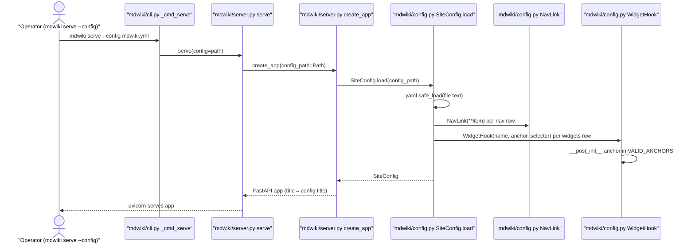
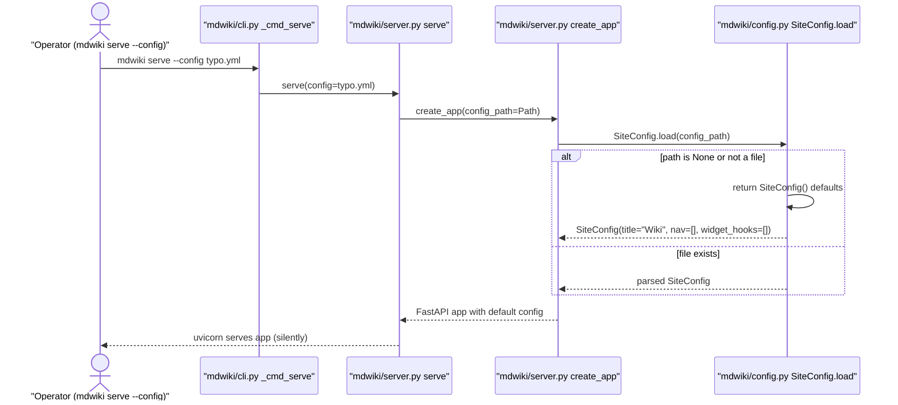
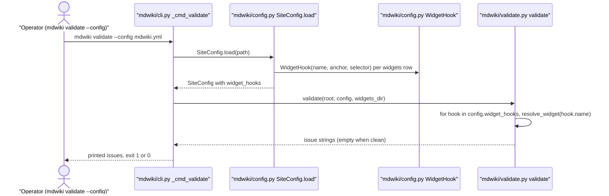
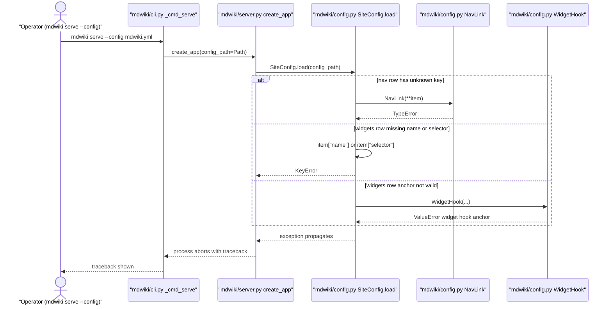
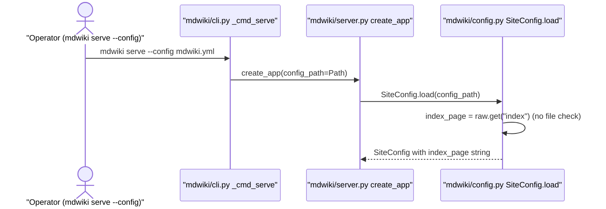

# Site Configuration Loading

Category: Site Management
Domain span: Python Server only. No Shared Contract (browser use of `backend_base` and `nav` belongs to [Page Shell & Asset Serving](Page-Shell-and-Asset-Serving.md)).

Loads optional `mdwiki.yml` into one `SiteConfig` object. Missing file gives defaults. Only hook rows validated, and only the anchor value.

## Code Elements

| Code Element | What it does | File path |
|---|---|---|
| `SiteConfig` | Dataclass. Holds `title`, `nav`, `theme_dir`, `backend_base`, `widget_hooks`, `index_page`. Defaults: title `"Wiki"`, rest empty/None. | mdwiki/config.py |
| `SiteConfig.load` | Classmethod. `path` None or not a file -> `SiteConfig()`. Else `yaml.safe_load`, maps known keys, ignores the rest. | mdwiki/config.py |
| `NavLink` | Dataclass `label`, `href`. Built as `NavLink(**item)` from each `nav` row. | mdwiki/config.py |
| `WidgetHook` | Dataclass `name`, `anchor`, `selector`. Built from each `widgets` row. | mdwiki/config.py |
| `WidgetHook.__post_init__` | Raises `ValueError` if `anchor` not in `VALID_ANCHORS`. Only validation in the module. | mdwiki/config.py |
| `VALID_ANCHORS` | Module tuple `("top", "bottom", "both")`. | mdwiki/config.py |
| `create_app` | Builds FastAPI app. Calls `SiteConfig.load(config_path)`, passes config to renderer and template context. | mdwiki/server.py |
| `serve` | Wraps `create_app` with `config_path` from `--config`, runs uvicorn. | mdwiki/server.py |
| `_cmd_serve` | CLI handler for `mdwiki serve`. Forwards `--config` to `serve`. | mdwiki/cli.py |
| `_cmd_validate` | CLI handler for `mdwiki validate`. Calls `SiteConfig.load`, then `validate`. | mdwiki/cli.py |
| `validate` | Checks hook widgets resolve (`config.widget_hooks`). Returns issue strings. Other feature's logic, listed as call target. | mdwiki/validate.py |

## Process Flow

1. Caller passes config path (`Path | None`) to `create_app` (via `serve` from `_cmd_serve`, or direct Python call) or to `_cmd_validate`.
2. `SiteConfig.load(path)`:
   1. `path is None` or `not path.is_file()` -> return `SiteConfig()` (all defaults). No error, no warning.
   2. `yaml.safe_load(path.read_text())`, `or {}` for empty file.
   3. `nav` -> list of `NavLink(**item)`. Extra key -> `TypeError`.
   4. `theme` -> `theme_dir = (path.parent / theme).resolve()` if set, else None. Existence not checked.
   5. `widgets` -> list of `WidgetHook(name=item["name"], anchor=item.get("anchor", "bottom"), selector=item["selector"])`. Missing `name`/`selector` -> `KeyError`. Bad anchor -> `ValueError` from `__post_init__`.
   6. `title` (default `"Wiki"`), `backend_base` (default `""`), `index` -> `index_page` (raw string, no existence check). Other keys (incl. `widgets_dir`) never read.
3. `create_app` (server.py) uses result: `FastAPI(title=config.title)`, `theme_dir` for templates (fallback default theme dir if None), `WikiRenderer(content_dir, config, widgets_dir)`. Per request, template context reads `config.title`, `config.nav`, `config.backend_base`.
4. `_cmd_validate` passes same config to `validate`, which reads `widget_hooks`.

Data moves one way: YAML file -> `SiteConfig` fields. Nothing writes back.

## Entry Points

- `mdwiki serve --config <path>` -> `_cmd_serve` (mdwiki/cli.py) -> `serve` -> `create_app`. Only path with `--config` for serving.
- Python API `serve(config=...)` / `create_app(config_path=...)` (mdwiki/server.py), same load call. Used by `from mdwiki import serve` and tests.
- `mdwiki validate --config <path>` -> `_cmd_validate` (mdwiki/cli.py). Only other entry point; no other callers of `SiteConfig.load` in `mdwiki/`.

## Outputs

- FastAPI app with title = `config.title` (mdwiki/server.py `FastAPI(title=config.title)`).
- Theme directory for Jinja2 templates = `config.theme_dir`, else default theme (mdwiki/server.py `create_app`).
- Per-page template context: `site_title`, `nav`, `backend_base` from config (mdwiki/server.py `_render_response`).
- `WikiRenderer` configured with `index_page` (mdwiki/render.py, resolve_url) and `widget_hooks` (mdwiki/render.py, widget injection loop).
- Validation issue strings for unresolved hook widgets, printed by `_cmd_validate` (mdwiki/validate.py, cli.py).
- Process failure: raw `TypeError` / `KeyError` / `ValueError` traceback from malformed row (mdwiki/config.py `load`, `WidgetHook.__post_init__`).

## Use Cases

### UC1: Serve With mdwiki.yml -> App Built From Config

Operator runs `mdwiki serve --config mdwiki.yml`. `_cmd_serve` forwards path to `serve`, which calls `create_app`. `create_app` calls `SiteConfig.load`. File exists, so `yaml.safe_load` runs, `nav` rows become `NavLink`, `widgets` rows become `WidgetHook` (anchor checked in `__post_init__`). Config returned; `create_app` builds FastAPI app with `title` and passes config to renderer and template context. Same path for Python `serve()`/`create_app()` callers.

Tests: Covered — tests/test_render.py::test_home_page_renders_and_has_toast_macro (`create_app(config_path=example/mdwiki.yml)`, asserts `"Example Wiki"` title from config). Note: `serve()` and `_cmd_serve` themselves not exercised.

### UC2: Serve With Missing Config Path -> Defaults

`--config` path absent or not a file (or `None`). `SiteConfig.load` returns `SiteConfig()` immediately. App builds with title `"Wiki"`, no nav, no hooks, default theme. No error, no log line.

Tests: Uncovered — no test calls `load()` with a nonexistent path. `None` branch only incidentally hit by tests/test_mermaid.py::test_mermaid_script_only_loaded_on_pages_that_need_it (`create_app(config_path=None)`).

### UC3: Validate With mdwiki.yml -> Hook Widget Issues Printed

Operator runs `mdwiki validate --config mdwiki.yml`. `_cmd_validate` loads config, passes `widget_hooks` into `validate`. Each hook name checked through `resolve_widget`. Unresolved names become issue strings; CLI prints them and returns exit code 1 if any, else 0.

Tests: Covered — tests/test_render.py::test_validate_is_clean_on_example_site (`SiteConfig.load(example/mdwiki.yml)` then `validate`, asserts `[]`). Note: calls `validate` directly, not `_cmd_validate`; CLI print/exit path untested.

### UC4: Malformed mdwiki.yml Row -> Raw Exception

`nav` row with unknown key, `widgets` row missing `name`/`selector`, or `widgets` row with bad `anchor` raises out of `SiteConfig.load`. Nothing catches it. Entry point (serve or validate) dies with traceback. No mention of config file in message.

Tests: Uncovered — no test feeds a malformed row to `load()`.

### UC5: index Key -> index_page Set (No Existence Check)

`index: Project-Overview.md` in yml. `load` stores the raw string as `index_page`. File existence not checked here; renderer tries it at request/validate time and falls back to `index.md`.

Tests: Uncovered — tests/test_render.py::test_index_override_serves_at_root builds `SiteConfig(index_page=...)` directly and bypasses `load()`. No test loads an `index:` key from yml.

Use-case tally: 2 of 5 covered (UC1, UC3).

## Core Points

- `SiteConfig.load` is the only parser. Every consumer gets one `SiteConfig`; no consumer reads the yml itself.
- Missing file is silent defaults. Malformed content is loud raw exception. Typo'd `--config` path looks identical to "no config".
- Only `widget_hooks` rows get a real check (anchor, in `__post_init__`). Everything else trusts shape of the yml.
- Widgets directory is not a config key. It only comes from `--widgets` (cli.py) / `widgets_dir=` (server.py `create_app`), never from `mdwiki.yml`.
- `index_page` and `theme_dir` are stored unchecked. Existence resolved later by renderer (index) or template loader (theme).

## Non-Obvious Solutions

- `theme` is resolved relative to the directory of `mdwiki.yml` (`path.parent / theme`), not the working directory (mdwiki/config.py `load`).
- The `widgets:` key holds a list of hook rows, while README.md (Widgets section, ~line 225) documents a `widgets_dir:` key that names a directory. Name collision: `widgets` is not the dir key.

## Dependencies

- [Page Routing](Page-Routing.md) - runtime call. Renderer reads `config.index_page` (mdwiki/render.py) during URL resolution.
- [Widget Injection](Widget-Injection.md) - runtime call. Renderer reads `config.widget_hooks` (mdwiki/render.py) to inject hook widgets.
- [Page Shell & Asset Serving](Page-Shell-and-Asset-Serving.md) - runtime call. `create_app` calls `SiteConfig.load`, then reads `title`, `nav`, `theme_dir`, `backend_base` (mdwiki/server.py).
- [Site Validation](Site-Validation.md) - runtime call. `validate` reads `config.widget_hooks` (mdwiki/validate.py); `_cmd_validate` calls `SiteConfig.load` (mdwiki/cli.py).

## Fragility Points

- `widgets_dir:` documented in README (widgets section) but never read. Verified: no `widgets_dir` read from config anywhere in `mdwiki/`; only `--widgets` / `widgets_dir=` arg reaches that identifier. Upgrade direction: read the key in `load` (add field to `SiteConfig`) or remove the doc line.
- Unknown yml keys silently ignored. `load` reads only known keys via `raw.get(...)`. Verified: `widgets_dir` and `foo` in yml produce no error and no effect.
- Nonexistent `--config` path silently yields defaults (mdwiki/config.py line `if path is None or not path.is_file(): return cls()`). Verified: `load(Path('/nonexistent/mdwiki.yml'))` returns default `SiteConfig`.
- Malformed `nav` row -> raw `TypeError` (`NavLink(**item)`). Verified: extra key `extra:` raises `TypeError: NavLink.__init__() got an unexpected keyword argument 'extra'`.
- Malformed `widgets` row -> raw `KeyError` (`item["name"]`, `item["selector"]`). Verified: row without `selector` raises `KeyError: 'selector'`. Message names no file or row index.
- Bad anchor -> `ValueError` from `__post_init__` (clear message, names hook). Verified.
- `theme` directory existence not checked at load. Verified: `load` returns `theme_dir` pointing at nonexistent `no-such-theme`. Failure surfaces later in template setup (downstream behavior not run here).
- `index` value not checked at load. Verified: `index_page='Missing.md'` kept as-is. Fallback to `index.md` lives in renderer (mdwiki/render.py).

## Fragility Note

Quiet failures:
- Typo in `--config` path: server runs with defaults (no title, no nav, no hook widgets). Author notices first when pages look plain.
- `widgets_dir:` set in yml: ignored. Widgets resolve only from `--widgets`; unresolved widgets show built-in toast error marker in place. Author notices first on rendered page or in `mdwiki validate`.
- Unknown keys (typos like `widget:`, `themes:`) do nothing. Noticed only when the feature the key was meant to enable is missing.

Loud failures (not quiet): malformed `nav`/`widgets` rows crash startup. Author sees traceback at `mdwiki serve`/`validate` time.
