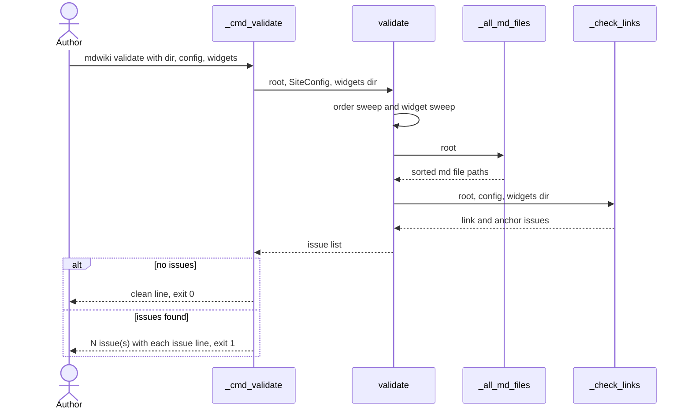
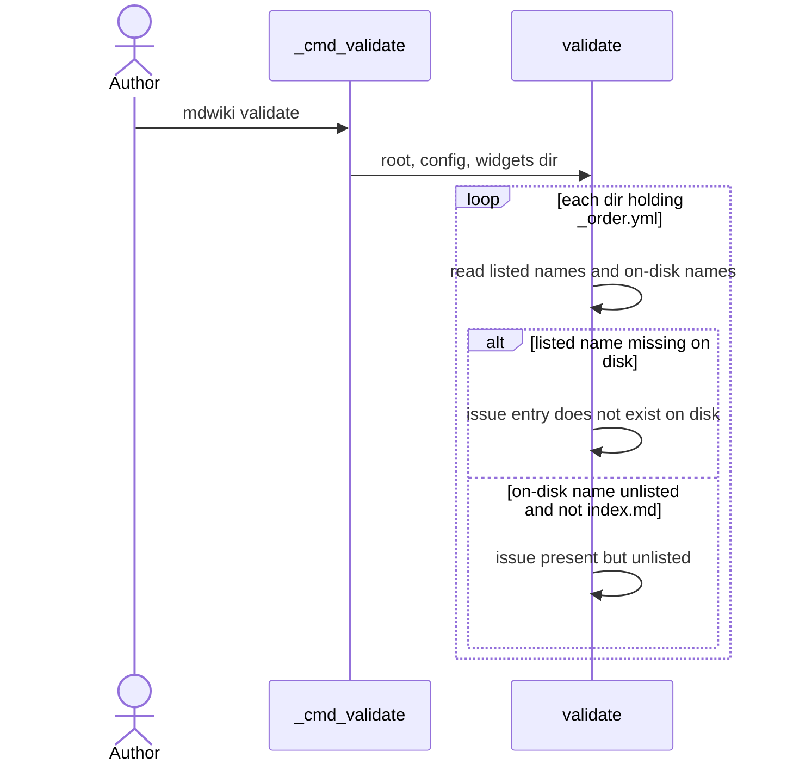
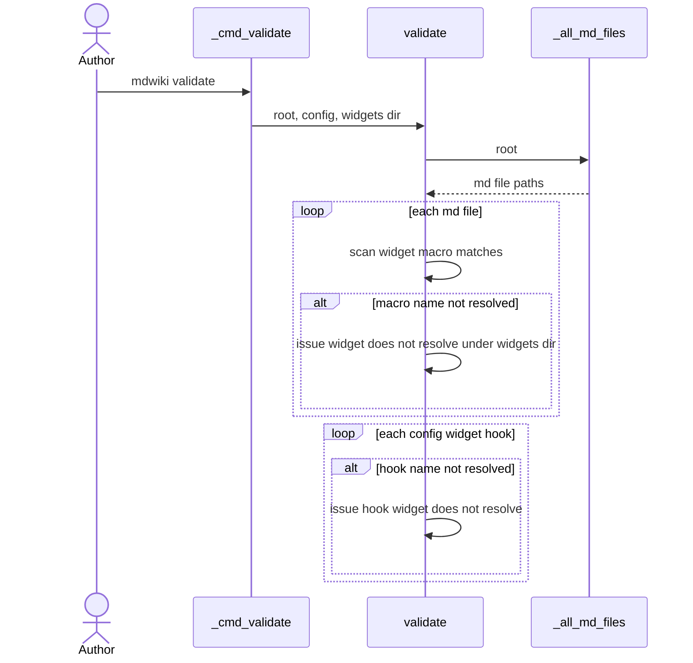
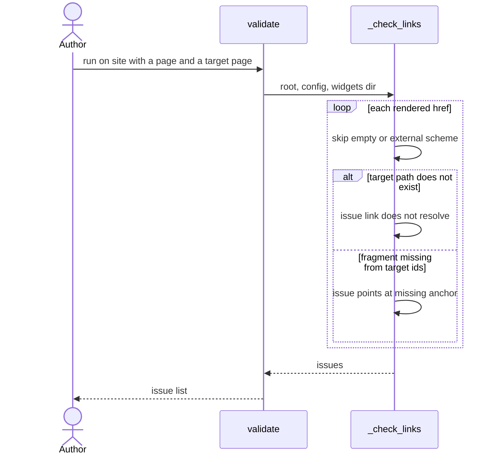
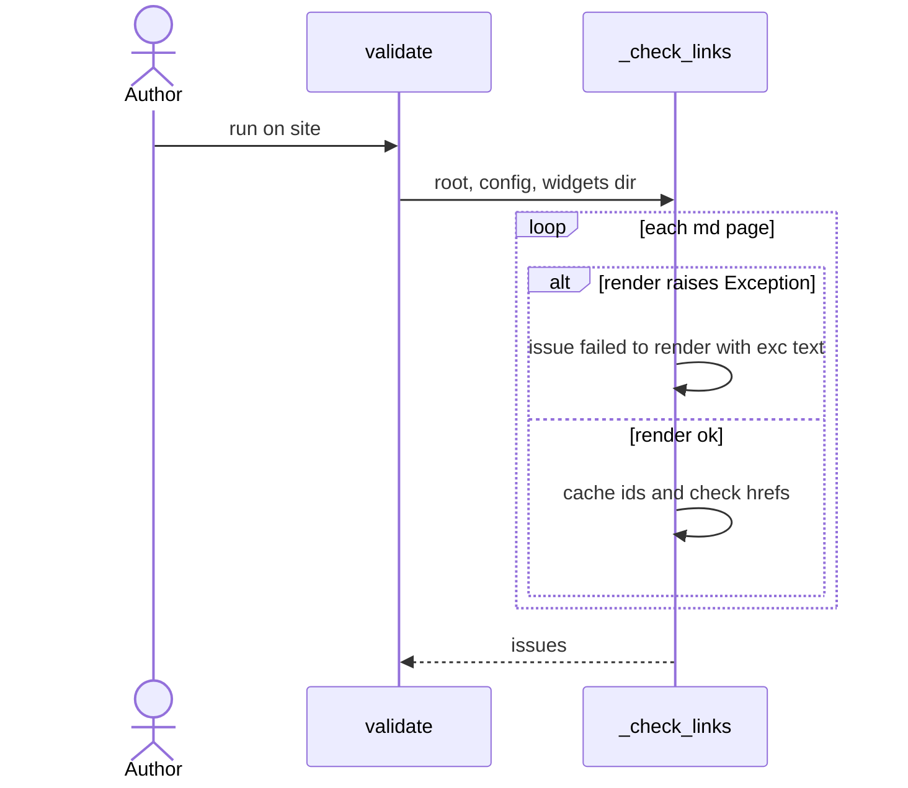

# Site Validation

Pre-flight check. `mdwiki validate --dir --config --widgets` sweeps whole content tree once. Reports every broken thing in one list. Exit 0 clean, exit 1 issues. Read-only. Runtime never calls it. Runtime degrades quietly instead (stale `_order.yml` entries skipped, unresolved widgets become `toast`). Validate exists so author sees all of it at once.

Category: Site Management.

## Code Elements

| Code Element | What it does | File path |
|---|---|---|
| `_cmd_validate` | CLI handler. Loads `SiteConfig`, resolves `--widgets` dir, calls `validate`, prints clean line or issue list, returns exit code 0/1. | mdwiki/cli.py |
| `validate` subparser | Declares `validate` subcommand with `--dir` (required), `--config`, `--widgets`. `set_defaults(func=_cmd_validate)`. | mdwiki/cli.py |
| `validate` | Core sweep. Returns `list[str]` of human-readable issues; empty = clean. Runs order sweep, widget sweep, then `_check_links`. | mdwiki/validate.py |
| `_check_links` | Renders every page via `WikiRenderer` (same renderer as server). Checks each internal `<a href>` resolves and each `#fragment` matches an `id=` on target page. Catches bare `Exception` per page. | mdwiki/validate.py |
| `_all_md_files` | `rglob("*.md")` under root, sorted, files only. Input list for widget and link sweeps. | mdwiki/validate.py |
| `_HREF_RE` | Regex `<a\b[^>]*\bhref="([^"]*)"`. Pulls double-quoted `href` values from rendered HTML. | mdwiki/validate.py |
| `_ID_RE` | Regex `\bid="([^"]*)"`. Collects anchor ids of a rendered page. | mdwiki/validate.py |
| `_EXTERNAL_SCHEME_RE` | Regex `^[A-Za-z][A-Za-z0-9+.\-]*:`. Skips `http:`, `mailto:` etc. hrefs. | mdwiki/validate.py |

## Process Flow

1. Author runs `mdwiki validate --dir DIR [--config FILE] [--widgets DIR]`. Subparser `set_defaults` dispatches to `_cmd_validate`.
2. `_cmd_validate` calls `SiteConfig.load(config path or None)`. Resolves `--widgets` to absolute path or None.
3. `_cmd_validate` calls `validate(Path(dir), config, widgets_dir)`.
4. `validate` resolves root. Order sweep: for root and every subdir with `_order.yml`, compares `read_order_file` list to on-disk `.md` files and subdirs. Listed-but-missing → issue. On-disk-but-unlisted (except `index.md`) → issue.
5. Widget sweep: for every `.md` from `_all_md_files`, scans `WIDGET_MACRO_RE` matches; name not resolved by `resolve_widget` → issue. Then for each `config.widget_hooks` entry, hook name not resolved → issue.
6. `validate` calls `_check_links(root, config, widgets_dir)`. `_check_links` builds one `WikiRenderer`. For each `.md`, renders page. Render exception → issue `failed to render`, page skipped. Otherwise stores page ids in `ids_cache`.
7. For each `_HREF_RE` href in rendered HTML: skip empty or external-scheme. Resolve against page URL with `urljoin`. `page_exists` false → issue. If fragment: `_ids_for` target page (cached); fragment not in ids → issue.
8. Issues flow back up as one list. `_cmd_validate` prints `N issue(s):` plus `  - ` lines, returns 1. Empty list → clean line, returns 0.

No writes. No network. No server started.

## Entry Points

- CLI: `mdwiki validate --dir` subcommand. Grounded in `validate` subparser (mdwiki/cli.py), `set_defaults(func=_cmd_validate)`.
- Python API: direct `validate(root, config, widgets_dir)` call. Only in-repo caller is tests (tests/test_render.py). No other programmatic entry in code.

## Outputs

- Stdout clean line `mdwiki validate: clean, no issues found.`, exit 0. Produced by `_cmd_validate`.
- Stdout `mdwiki validate: N issue(s):` plus one `  - <issue>` line per issue, exit 1. Produced by `_cmd_validate`.
- In-process `list[str]` return from `validate`. Consumed by `_cmd_validate` and tests.

## Use Cases

### UC1: CLI Run -> Clean or Issue Report

Flow: author runs CLI. `_cmd_validate` loads config, calls `validate`. `validate` runs order sweep and widget sweep inline, then `_check_links`. Result list branches: empty → clean line, exit 0. Non-empty → count plus each issue, exit 1. Branch is only on list emptiness; no separate code path per issue kind.

Tests: Uncovered — no automated test calls `_cmd_validate` or checks stdout / exit code. (`test_validate_is_clean_on_example_site` covers `validate()` returning `[]` only.)

### UC2: Order Manifest Drift -> Missing or Unlisted Entry Issue

Flow: for each dir with `_order.yml`, `validate` compares listed names to on-disk names. Listed-not-on-disk → "does not exist on disk" issue. On-disk-not-listed, excluding `index.md` → "present but unlisted" issue. Second kind is reported as failure, though runtime `ordered_entries` appends it alphabetically and serves it.

Tests: Uncovered — no automated test exercises the `_order.yml` sweep.

### UC3: Widget Macro or Hook Name -> Unresolved Widget Issue

Flow: for each `.md`, every widget macro match. Name not found by `resolve_widget` (checks `--widgets` dir first, then standard widgets) → issue naming page and widget. Then each `mdwiki.yml` hook: hook name not resolved → issue. Hook `selector` never checked.

Tests: Uncovered — no automated test feeds an unresolved widget macro or hook name to `validate`.

### UC4: Internal Link -> Dangling Path or Missing Anchor Issue

Flow: `_check_links` renders page, reads `_HREF_RE` hrefs from post-render HTML (after `InternalLinkExtension` rewrite, so extension-less). External-scheme hrefs skipped. `page_exists` false → "does not resolve" issue. Target page exists with `#fragment` absent from its `id=` set → "points at anchor" issue. Valid link → no issue.

Tests: Covered — tests/test_render.py::test_validate_catches_dangling_link_and_broken_anchor (dangling `nowhere.md` and bad `b.md#nope` flagged; good `b.md#hello` not flagged).

### UC5: Page Render Failure -> Failed to Render Issue

Flow: `_check_links` renders each page inside `try`. Any `Exception` → "failed to render (exc)" issue, page's own links not checked. Separate silent path: when target page of a link fails to render, `_ids_for` caches `None`, fragment check skipped with no issue. Target page's own failure is still reported in its own pass.

Tests: Uncovered — no automated test forces a render exception through `validate` or `_check_links`.

## Core Points

- Read-only sweep. Never mutates files. Safe to run anytime, CI-friendly by exit code.
- Renders with same `WikiRenderer` as server. Link and anchor checks match runtime, including `InternalLinkExtension` rewrites.
- Strict where runtime is lenient: unlisted files and unresolved widgets are issues here, not silent at runtime. Same list is also looser than runtime in places (see Fragility Points).
- Only `widgets dir` resolution and hook name are checked for widgets. Hook `selector` and `index:` target are not.
- Errors from `validate` are issue strings, not exceptions. Only render exceptions are caught; order/widget sweeps can raise on bad YAML or unreadable file.

## Non-Obvious Solutions

- `index.md` exempt from "unlisted" check: directory's own leaf entry, folded in by parent's manifest (see `ordering.walk`). Without the exemption every folder page would be flagged.
- Link check runs on rendered HTML, not source markdown. Only way to see the final `href` a browser requests (extension stripped, fragments kept).
- `ids_cache` is pre-filled by main loop with the same render used for hrefs, so fragment checks reuse that render instead of rendering each target twice. Targets not yet visited are rendered on demand in `_ids_for`.

## Dependencies

- Markdown Rendering — runtime call. `WikiRenderer.render_relpath` (renders every page and returns `content_html`), `WikiRenderer.page_exists` (href target existence), `WikiRenderer.resolve_url` (fragment target page lookup), `relpath_to_url` (page URL for `urljoin`). `WIDGET_MACRO_RE` also imported from render.py. Link: [Markdown Rendering](Markdown-Rendering.md)
- Page Ordering — runtime call. `read_order_file` (lists `_order.yml` entries) and `ORDER_FILENAME` (literal `_order.yml`). Link: [Page Ordering](Page-Ordering.md)
- Widget Injection — runtime call. `WIDGET_MACRO_RE` (macro regex match of widget name) and `resolve_widget` (name → directory, host `--widgets` dir checked before standard widgets). Link: [Widget Injection](Widget-Injection.md)
- Site Configuration Loading — runtime call. `SiteConfig.load` in `_cmd_validate` and `config.widget_hooks` read in `validate` (hook names). Link: [Site Configuration Loading](Site-Configuration-Loading.md)
- Internal Link Rewriting — data-model sharing. Shared shape: post-rewrite `<a href="...">` attribute value, `.md` suffix stripped, `#fragment` kept, path resolvable by `page_exists` as extension-less URL. Literal example asserted by test: `href="lesson-2#lesson-2-widgets"`. If rewrite is skipped and `href` keeps `.md`, `_check_links` reports it as "does not resolve" (loud). Link: [Internal Link Rewriting](Internal-Link-Rewriting.md)

## Fragility Points

- Unlisted-but-present files are an issue, same severity as missing entries (mdwiki/validate.py, order sweep). Runtime `ordered_entries` treats them as normal alphabetical append. Exit 1 for a state runtime accepts. No warning tier exists.
- `_HREF_RE` matches double-quoted `href="..."` only. Python-markdown generated links always use double quotes, so normal links are covered. Raw HTML authored with single quotes (`href='...'`) is missed by the link sweep and is not rewritten by `InternalLinkExtension` (raw inline HTML is outside the element tree it walks). Such links are unchecked.
- `_check_links` catches bare `Exception` per page. Page render failure → "failed to render" issue, its links unchecked. Separately `_ids_for` swallows the same exception and returns `None`, so fragment checks into that page are silently skipped with no issue.
- `index:` config target is never checked. Runtime `resolve_url("")` falls back to `index.md` silently (tests/test_render.py::test_index_override_falls_back_to_plain_index_md_when_missing). Validate reports nothing.
- Hook `selector` is never checked against any page. A hook whose glob matches zero pages injects nothing, and validate reports nothing. Only hook `name` resolution is checked.
- `config.nav` entries (`NavLink.href`) are never checked. Validate reads no `nav` data.
- `SiteConfig.load` returns defaults silently when the `--config` path is missing or not a file (mdwiki/config.py). `_cmd_validate` passes that default through, so a mistyped `--config` drops every hook and `index:` setting from the check and still exits 0 when nothing else is wrong.

## Fragility Note

Quiet failures here:

- Mistyped `--config` path: `SiteConfig.load` returns empty config. Hook name checks, `index:` and hook-related checks drop out. Run exits 0 with "clean". Author notices first when a page is missing its `next-button` in production, not in CI.
- Missing `index:` target: runtime serves `index.md` instead, validate says nothing. Author notices first on the live root page.
- Page render exceptions hide anchor failures into that page: target `id=` set becomes `None`, fragment checks into it are skipped silently. Author notices only when that anchor is clicked.

Loud, not quiet: a broken `Internal Link Rewriting` shape (un-stripped `.md` in href) is reported as "does not resolve".
