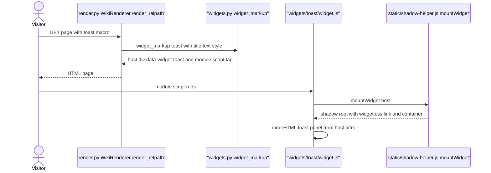
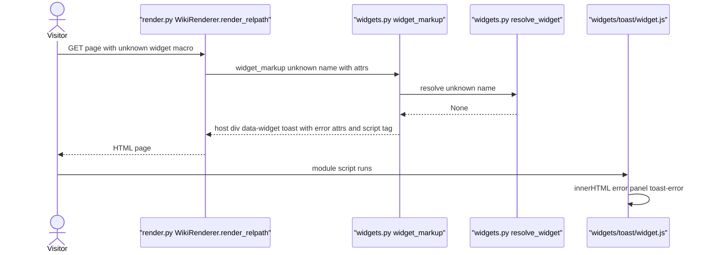
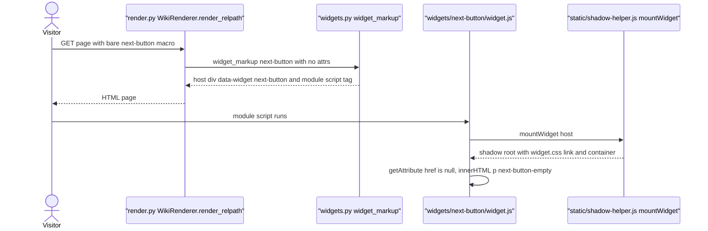
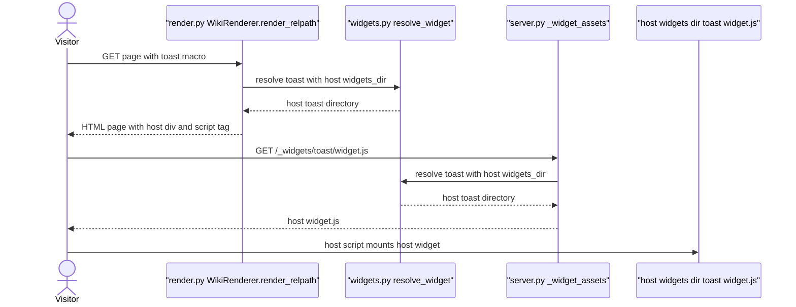

# Standard Widgets

Category: Widget System
Domain span: Browser Client + Python Server

Two widgets ship with mdwiki: `toast` (colored panel, also the not-found error fallback) and `next-button` (next-page link, auto-injected by hook). Server expands widget occurrences into host `<div>` + module script. Browser `widget.js` draws content in Shadow DOM. Host can shadow either name via own `./widgets/<name>/`.

## Code Elements

| Code Element | What it does | File path |
|---|---|---|
| render.py WikiRenderer.render_relpath | Extracts widget macros from page body, fills placeholders with widget markup, loops `mdwiki.yml` hook rows matching page relpath, emits top/bottom markup | mdwiki/render.py |
| render.py WikiRenderer._hook_attrs | For hook `next-button`: calls `ordering.adjacent`, returns `href` (via `relpath_to_url`) and `label` (via `_title_for`); returns None when no next page | mdwiki/render.py |
| render.py WikiRenderer._title_for | Page title of a relpath (frontmatter, H1, or filename fallback) | mdwiki/render.py |
| widgets.py widget_markup | Builds host `<div class="mdwiki-widget" data-widget=... attrs>` + `<script type="module" src="/_widgets/<name>/widget.js">`; HTML-escapes attr values; substitutes `toast` not-found fallback | mdwiki/widgets.py |
| widgets.py resolve_widget | Resolves widget name: host widgets dir first, then standard set, else None | mdwiki/widgets.py |
| widgets.py STANDARD_WIDGETS_DIR | Path constant to `mdwiki/widgets/` (standard set root) | mdwiki/widgets.py |
| server.py _widget_assets | Route `/_widgets/{name}/{asset_path}`: serves `widget.js`/`widget.css` from resolved widget dir; 404 if unresolved or path escapes dir | mdwiki/server.py |
| ordering.py adjacent | Page Ordering feature. Returns next Page leaf matching hook selector, or None | mdwiki/ordering.py |
| shadow-helper.js mountWidget | Attaches open Shadow DOM to host, adds `<link>` to `/_widgets/<host dataset.widget>/widget.css`, gives callback empty container | mdwiki/static/shadow-helper.js |
| widgets/toast/widget.js | Reads host attrs `title`, `text`, `style` (default `info`); writes panel via `container.innerHTML` | mdwiki/widgets/toast/widget.js |
| widgets/toast/widget.css | `.toast` base, `.toast-info` / `.toast-warning` / `.toast-error` colors, `.toast-title` | mdwiki/widgets/toast/widget.css |
| widgets/next-button/widget.js | Reads host attrs `href`, `label` (default `Next`); no href: writes `p.next-button-empty` "No next page."; else writes `a.next-button` with label + arrow entity | mdwiki/widgets/next-button/widget.js |
| widgets/next-button/widget.css | `.next-button` link styling, hover, `.next-button-empty` muted italic | mdwiki/widgets/next-button/widget.css |

## Process Flow

Server side, per page render:

1. `render_relpath` pulls every `{ { widget: name attrs } }` macro out of body into placeholders (before Markdown runs). Attrs parsed by `[A-Za-z0-9_-]+="[^"]*"` pairs only.
2. Markdown converts body. Each placeholder replaced by `widget_markup(name, attrs, widgets_dir)`.
3. For each `mdwiki.yml` hook row: skip if page excludes name (`widgets.exclude`), skip if selector does not match relpath, compute attrs (`_hook_attrs`; None means skip), emit markup at `top`, `bottom`, or both anchors.
4. `widget_markup` calls `resolve_widget`. Unresolved name: replace name with `toast` and attrs with `title="Widget not found"`, `text="No widget named '<name>'."`, `style="error"`. Attr values HTML-escaped (`html.escape`, quote=True).
5. Output HTML carries host div with attrs as plain attributes, plus deferred module script.

Browser side, per widget occurrence:

6. Module script fetches `/_widgets/<name>/widget.js` (server route `_widget_assets`, resolved via same `resolve_widget` order).
7. `widget.js` runs `document.querySelectorAll('[data-widget="<name>"]')`, calls `mountWidget` per host.
8. `mountWidget` attaches open shadow root, loads widget's `widget.css`, passes container to build callback.
9. Build callback reads host `getAttribute` values and writes template into `container.innerHTML`. Attr values are read back unescaped (see Fragility Points).

Page Ordering only feeds next-button: `_hook_attrs` is the sole producer of `href`/`label` on the hook path. Widget does no ordering logic.

## Entry Points

- EP1: Macro in page body `{ { widget: <name> attrs } }` (author-written). Entry Code Element: `render.py WikiRenderer.render_relpath`.
- EP2: `mdwiki.yml` `widgets:` hook row (`next-button, bottom, lessons/*` in example config), matched per page render. Entry Code Element: `render.py WikiRenderer.render_relpath` hook loop, which calls `render.py WikiRenderer._hook_attrs` for `next-button`.
- EP3: Browser executes a widget's module script on page load (`widget.js` top-level `querySelectorAll`). Entry Code Element: `widgets/toast/widget.js` or `widgets/next-button/widget.js`.

No other entry point. Browser-side JS has no event listeners; widgets render once at load.

## Outputs

- O1: Host `<div class="mdwiki-widget" data-widget="<name>" ...attrs>` + module script tag in server HTML. Produced by `widgets.py widget_markup`.
- O2: Toast panel `div.toast toast-<style>` (with `strong.toast-title` when title non-empty) in shadow root. Produced by `widgets/toast/widget.js`.
- O3: Next link `a.next-button href=<href>` with `<label> &rarr;` text in shadow root. Produced by `widgets/next-button/widget.js`.
- O4: Empty-state `p.next-button-empty` "No next page." in shadow root. Produced by `widgets/next-button/widget.js` when href absent.
- O5: Widget asset response (`widget.js`, `widget.css`) or 404 for unknown name. Produced by `server.py _widget_assets`.
- O6: Shadow root `<link rel=stylesheet>` to widget CSS. Produced by `static/shadow-helper.js mountWidget`.

## Use Cases

### UC1: Toast Macro -> Panel Rendered

Author writes `{ { widget: toast title="..." text="..." style="warning" } }` in page body. `render_relpath` extracts macro, Markdown runs, `_fill` calls `widget_markup("toast", attrs, widgets_dir)`. `resolve_widget` finds standard `toast` dir. Output host div carries `title`, `text`, `style` as attributes. Browser runs `toast/widget.js`, `mountWidget` attaches shadow root, `innerHTML` writes panel with class `toast-warning`.



**Tests:** Covered — `tests/test_render.py::test_home_page_renders_and_has_toast_macro` (asserts host markup and script src only; attr values and browser panel render not asserted)

### UC2: Unresolved Macro -> Error Toast Fallback

Author writes macro with name that resolves nowhere. `widget_markup` swaps name to `toast` and attrs to error set. Host div emitted with `style="error"`. Browser renders error panel "Widget not found".



**Tests:** Covered — `tests/test_render.py::test_unresolved_widget_falls_back_to_toast_error` (checks markup only; browser error panel uncovered)

### UC3: Page Load -> Next Button Link

Visitor requests `/lessons/lesson-1`. Hook row `next-button` with selector `lessons/*` matches. `_hook_attrs` calls `ordering.adjacent` for next leaf, gets `lessons/lesson-2.md`, builds `href` from `relpath_to_url` and `label` from `_title_for`. Markup emitted at bottom anchor. Browser draws anchor. If `adjacent` returns None (last page), `_hook_attrs` returns None and no host emitted.

```mermaid
sequenceDiagram
  actor Visitor
  participant Render as "render.py WikiRenderer.render_relpath"
  participant Hook as "render.py WikiRenderer._hook_attrs"
  participant Order as "ordering.py adjacent"
  participant Title as "render.py WikiRenderer._title_for"
  participant Markup as "widgets.py widget_markup"
  participant Next as "widgets/next-button/widget.js"
  participant Shadow as "static/shadow-helper.js mountWidget"
  Visitor->>Render: GET /lessons/lesson-1
  Render->>Hook: attrs for next-button hook on lessons/lesson-1.md
  Hook->>Order: adjacent lessons/lesson-1.md selector lessons/* direction 1
  Order-->>Hook: Page lessons/lesson-2.md
  Hook->>Title: title of lessons/lesson-2.md
  Title-->>Hook: Lesson 2 title
  Hook-->>Render: href /lessons/lesson-2 and label Lesson 2 title
  Render->>Markup: widget_markup next-button with href and label
  Markup-->>Render: host div and module script tag
  Render-->>Visitor: HTML page
  Visitor->>Next: module script runs
  Next->>Shadow: mountWidget host
  Shadow-->>Next: shadow root with widget.css link and container
  Next->>Next: innerHTML anchor with href and label
```

**Tests:** Covered — `tests/test_render.py::test_lesson_1_has_next_button_pointing_to_lesson_2` (checks server href and label only; browser anchor render uncovered)

### UC4: Bare Next Button Macro -> Empty State

Author writes `{ { widget: next-button } }` with no attrs. `widget_markup` emits host with no attrs. Browser reads `href` as null, writes "No next page.". Only path that reaches empty state: hook path never emits next-button without href.



**Tests:** Uncovered — no automated test exercises a bare next-button macro, and no test runs the browser empty-state render

### UC5: Host Widgets Dir -> Shadowed Widget Served

Host passes `widgets_dir` containing `toast/` (or `next-button/`). `resolve_widget` returns host dir first. `widget_markup` emits the same name, so host markup is identical. Browser requests `/_widgets/toast/widget.js`; `server.py _widget_assets` resolves to host dir and serves host's `widget.js`.



**Tests:** Uncovered — every test in `tests/` constructs app or renderer with `widgets_dir=None` (or passes None to `widget_markup`); no test exercises host shadowing

## Core Points

1. Widgets are server-expanded markup, not server-rendered content. Server emits only host div with attrs and a module script. All visible output built in browser by `widget.js` into Shadow DOM.
2. Attr names are the contract. toast reads `title`, `text`, `style`. next-button reads `href`, `label`. Server must emit exact names; browser must read exact names.
3. Toast is also the error channel. Unresolved widget names never fail the page; they turn into an error toast by reusing `toast` name and attr set.
4. next-button does no ordering. Hook path gets `href` and `label` from `render.py WikiRenderer._hook_attrs`, which asks `ordering.adjacent`. No next page means no host emitted at all.
5. Host shadowing is by directory name only. Same name, host's `widgets/<name>/` wins for both markup and asset route, including the toast fallback.

## Non-Obvious Solutions

- Module scripts are deferred, so `document.querySelectorAll` in each `widget.js` sees host divs already in DOM. Each widget script mounts every occurrence of its name on the page, not just its own script's neighbor. One script load serves all occurrences.
- Hook next-button is omitted on last page instead of rendered as empty state. "No next page." is reachable only through a bare macro, never through the hook.
- The not-found fallback is a normal `toast` occurrence. If host shadows `toast` with a widget that ignores `title`/`text`/`style`, the fallback renders blank.

## Dependencies

- Widget Injection — parent-child — Widget Injection is the parent extension point (macro expansion and hook loop in `render.py`, `widget_markup` in `widgets.py`). Standard Widgets is the child implementation (`toast`, `next-button`).
- Page Ordering — data-model sharing — shape: next-button host attrs `href` (string, URL path such as `/lessons/lesson-2`, from `relpath_to_url` of `ordering.adjacent` result `Page.relpath`) and `label` (string, page title from `_title_for`). Neither calls the other in the direction of data flow other than `_hook_attrs` calling `ordering.adjacent`; the shared shape is these two host attrs.
- Page Shell & Asset Serving — runtime call — browser module import of `/_assets/shadow-helper.js` (served from `mdwiki/static/`), and `server.py _widget_assets` route serves `/_widgets/<name>/<asset>`.

## Shared Contract

Spans Python server and browser client. Artifacts:

- Toast host attrs, exact strings: `title`, `text`, `style`. Set in `mdwiki/render.py` `_fill` (from macro attrs) and `mdwiki/widgets.py` `widget_markup` (fallback). Read in `mdwiki/widgets/toast/widget.js` via `host.getAttribute('title')`, `host.getAttribute('text')`, `host.getAttribute('style')`. Style value must also match CSS classes `.toast-info`, `.toast-warning`, `.toast-error` in `mdwiki/widgets/toast/widget.css`.
- next-button host attrs, exact strings: `href`, `label`. Set in `mdwiki/render.py` `WikiRenderer._hook_attrs` return dict keys `"href"` and `"label"`. Read in `mdwiki/widgets/next-button/widget.js` via `host.getAttribute('href')` and `host.getAttribute('label')`.
- Widget directory name = `data-widget` value = `/_widgets/<name>/` path segment. Literal strings `"toast"` (`widgets.py widget_markup`) and `"next-button"` (`render.py _hook_attrs` and hook config) must equal `[data-widget="toast"]`/`[data-widget="next-button"]` selectors in each `widget.js` and `dataset.widget` read by `shadow-helper.js`.

Silent failure: rename any attr on one side only. Server still emits markup, browser still mounts, no exception, no console error. Result: toast shows empty text or default `info` styling; next-button shows "No next page." on every hook-injected page. `mdwiki validate` only checks widget names resolve, not attr names. `test_lesson_1_has_next_button_pointing_to_lesson_2` catches a Python-side `href` rename (asserts `href="/lessons/lesson-2"` in HTML) but no test catches browser-side attr reads or toast attrs.

## Fragility Points

1. Unescaped innerHTML interpolation of attr values (verified seed). `widgets.py widget_markup` escapes values with `html.escape`, but browser `getAttribute` decodes them and `toast/widget.js` writes `${title}`, `${text}`, `${style}` and `next-button/widget.js` writes `${href}`, `${label}` into `innerHTML` with no escaping. Reachable via macro: value `[^"]*` forbids `"` but allows unquoted HTML such as `` in text, and `href="javascript:..."` on next-button. Hook path: `label` is page title from `_title_for`, which is raw H1/frontmatter text, also unescaped in browser. Upgrade direction: write with `textContent` and `setAttribute`, validate `href` scheme.
2. Toast `style` not validated (verified seed). `toast-${style}` class for any value; only `info`, `warning`, `error` have CSS. Other values get base `.toast` styling with no warning. Default `info` applies only via `|| 'info'` when attr absent or empty.
3. Attr names `title` and `style` collide with HTML global attributes on host div (verified: `widget_markup` puts them on light-DOM host). Host `title` shows as native hover tooltip. Host `style` takes raw CSS: fallback `style="error"` is invalid CSS and ignored, but a macro `style="color:red"` applies inline style to host div and emits class `toast-color:red` with no effect on panel.
4. Hardcoded strings in next-button (verified seed). Default label `'Next'`, arrow `&rarr;`, and `"No next page."` are literals in `next-button/widget.js`. Default label is reachable only via bare macro; hook path always passes `label`.
5. Hardcoded widget name `"toast"` in `widgets.py widget_markup` fallback. Fallback uses host's `toast` if shadowed, so host toast must accept `title`/`text`/`style` or fallback renders blank.

## Fragility Note

Shared Contract drift is quiet. Attr rename on either side produces no error and no validate issue. Page reader sees wrong panel style, empty toast, or "No next page." on every next button. Python-side drift on next-button `href` is caught by `test_lesson_1_has_next_button_pointing_to_lesson_2`. Browser-side drift and all toast attr drift are not caught by any test. Fragility Point 1 is quiet in a different way: injected markup renders as a working page, so nobody sees it unless they inspect source.
