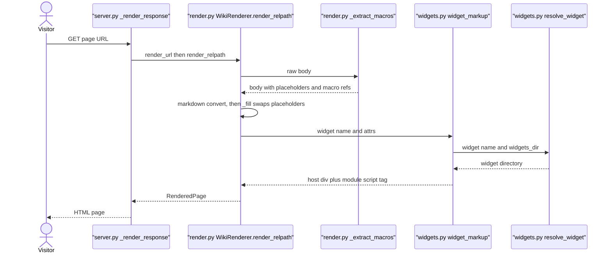
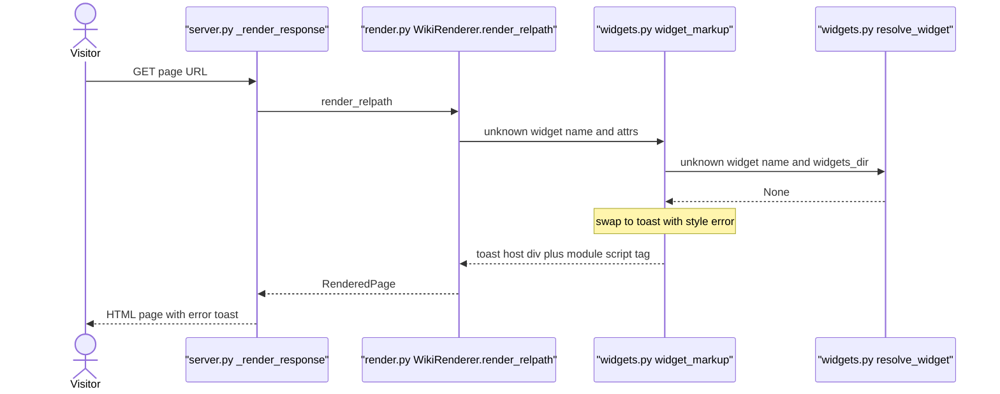
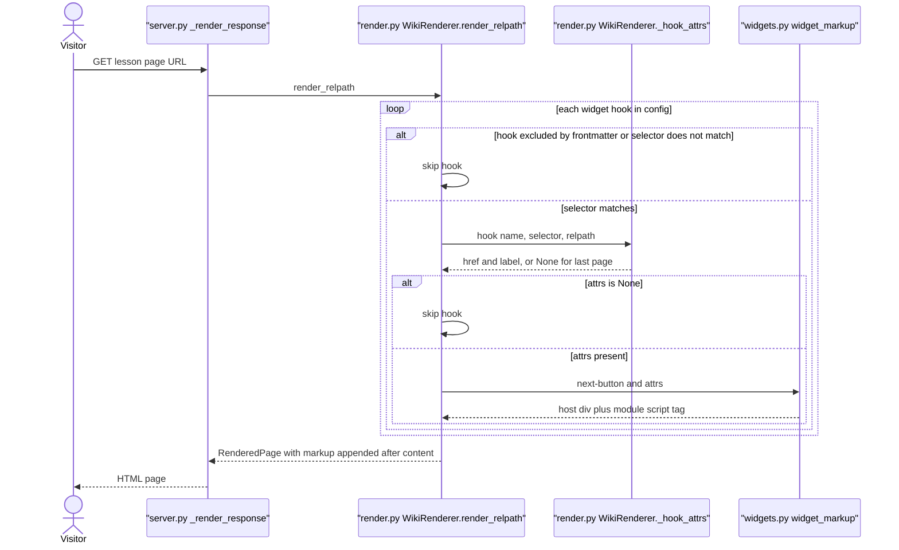
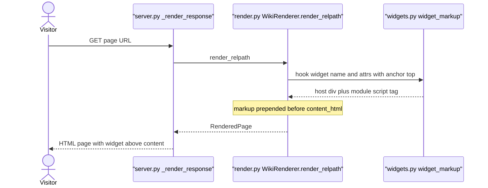
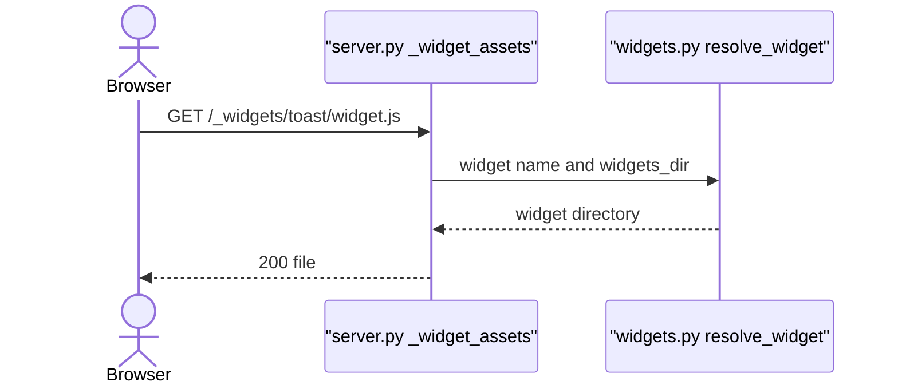
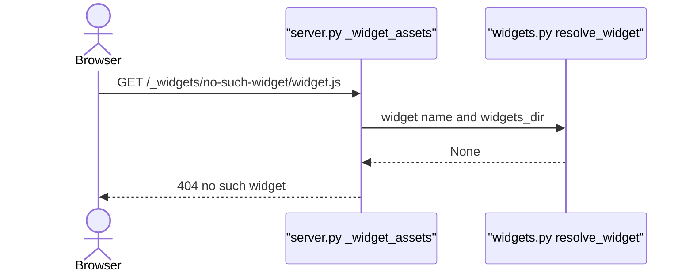
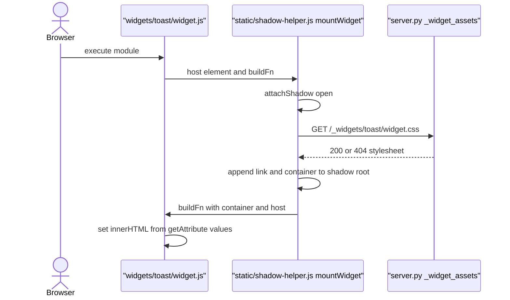
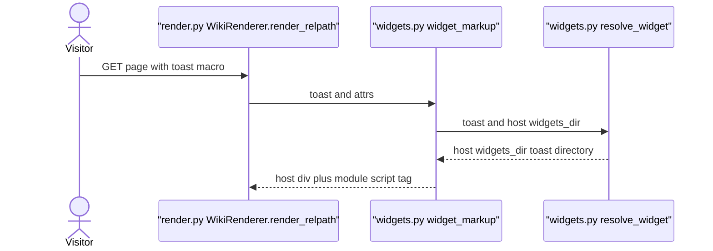

# Widget Injection

Category: Widget System. Domains: Python Server + Browser Client.

Job: place widget host markup into rendered page HTML (two paths: inline macro, config hook), serve widget bundle assets under `/_widgets/<name>/`, mount widget in open Shadow DOM in browser. Widget never fails page. Unresolved name becomes error toast.

## Code Elements

| Code Element | What it does | File path |
|---|---|---|
| `WIDGET_MACRO_RE` | Regex for inline macro token. Captures name and attr string. Public, reused by validate. | `mdwiki/render.py` |
| `_extract_macros` | Pre-markdown pass. Swaps each macro token for indexed placeholder. Returns body plus `(name, attrs)` refs list. | `mdwiki/render.py` |
| `_ATTR_RE` | Parses `key="value"` pairs out of macro attr string. | `mdwiki/render.py` |
| `_PLACEHOLDER` / `_PLACEHOLDER_RE` | Plain-alnum sentinel `MDWIKIWIDGETPLACEHOLDER{idx}ENDMDWIKIWIDGETPLACEHOLDER` and its matcher. Survives markdown convert. | `mdwiki/render.py` |
| `WikiRenderer.render_relpath` | Owns full path. Runs macro extract, markdown convert, nested `_fill` (placeholder to `widget_markup`), hook loop (exclude check, selector match, anchor top/bottom/both), joins top + content + bottom. | `mdwiki/render.py` |
| `WikiRenderer._hook_attrs` | Params per hook name. Only `next-button` has a branch (calls ordering `adjacent`, `direction=1`). All others return `{}`. Returns `None` to skip hook. | `mdwiki/render.py` |
| `resolve_widget` | Name to directory. Host `widgets_dir/<name>/` checked first, then `STANDARD_WIDGETS_DIR/<name>/`, else `None`. | `mdwiki/widgets.py` |
| `widget_markup` | Builds `
` plus `<script type="module" src="/_widgets/NAME/widget.js">`. Unresolved name swaps to `toast` with `style="error"`. Attr values `html.escape(quote=True)`. | `mdwiki/widgets.py` |
| `STANDARD_WIDGETS_DIR` | Package dir `mdwiki/widgets/` holding built-in widgets. | `mdwiki/widgets.py` |
| `WidgetHook` | Dataclass for one `widgets:` row in `mdwiki.yml`: `name`, `anchor`, `selector`. No params field. Validates anchor in `VALID_ANCHORS`. | `mdwiki/config.py` |
| `VALID_ANCHORS` | `("top", "bottom", "both")`. | `mdwiki/config.py` |
| `SiteConfig.load` | Parses `widgets:` list into `WidgetHook` objects. `anchor` defaults `bottom`. | `mdwiki/config.py` |
| `_render_response` | Page route handler. Calls `renderer.render_url`, passes content into `page.html`. Entry for all page-level injection. | `mdwiki/server.py` |
| `_widget_assets` | Route `GET /_widgets/{name}/{asset_path:path}`. Resolves widget dir, serves file, 404 on unknown widget or missing or escaping asset. | `mdwiki/server.py` |
| `mountWidget` | Browser helper. Attaches open shadow root to host, appends `<link>` to `/_widgets/<name>/widget.css` (name read from `host.dataset.widget`), appends container, calls `buildFn(container, host)`. | `mdwiki/static/shadow-helper.js` |
| `toast` bundle | Standard widget. Reads `title`, `text`, `style` via `getAttribute`. Also the not-found fallback. | `mdwiki/widgets/toast/widget.js` |
| `next-button` bundle | Standard widget. Reads `href`, `label` via `getAttribute`. Empty `href` renders "No next page." | `mdwiki/widgets/next-button/widget.js` |

## Process Flow

Two injection paths, one renderer.

Macro path:
1. Page GET hits `_render_response`, which calls `render_relpath`.
2. `_extract_macros` runs on raw body before markdown. Each macro token becomes a placeholder. Refs list keeps `(name, attrs)`.
3. Markdown converts body. Placeholders pass through as plain text.
4. `_fill` regex-swaps each placeholder with `widget_markup(name, attrs, widgets_dir)`.

Hook path:
1. `render_relpath` loops `config.widget_hooks`.
2. Skip hook if its name is in frontmatter `widgets.exclude`.
3. Skip hook if `Path(relpath).match(selector)` is false.
4. `_hook_attrs` gives params. `None` means skip (for `next-button`, last page in sequence).
5. `widget_markup` output goes into `top_parts` and/or `bottom_parts` per anchor. These are concatenated around `content_html`, not run through markdown.

Resolution and fallback (both paths): `widget_markup` calls `resolve_widget`. Unresolved name replaced with `toast` and attrs `title`/`text`/`style=error`.

Browser side:
1. Page HTML loads `/_widgets/NAME/widget.js` as module. Module imports `/_assets/shadow-helper.js`.
2. Widget bundle queries `[data-widget="NAME"]` hosts, calls `mountWidget(host, buildFn)`.
3. `mountWidget` attaches open shadow root, links `/_widgets/NAME/widget.css`, runs `buildFn` into container.
4. Stylesheet and module requests both hit `_widget_assets`, which uses `resolve_widget`.

## Entry Points

- Page GET (any page URL) -> `_render_response` -> `render_relpath`. Only route that triggers macro and hook paths. Hook path fires for every page whose relpath matches a hook selector.
- Browser GET `/_widgets/{name}/{asset_path}` -> `_widget_assets`. Fired by module script tag (`widget.js`) and by `mountWidget` (`widget.css`). This is the only server route for widget assets.
- Browser module execution of a widget bundle -> `mountWidget`. Fires once per widget bundle load, per page.

No other entry points. No cron, no event, no API write path.

## Outputs

- Host `
` plus module `<script>` tag, inline in page body where macro sat. Produced by `widget_markup` via `render_relpath`/`_fill`.
- Host markup plus script tag at top and/or bottom of page content for hooks. Produced by `render_relpath` hook loop.
- Error toast markup (`data-widget="toast"`, `style="error"`) when name unresolved. Produced by `widget_markup`.
- Asset file response (200) or 404 (`no such widget`, `asset not found`). Produced by `_widget_assets`.
- Open shadow root with `<link rel=stylesheet>` to `widget.css` and rendered container in browser. Produced by `mountWidget` plus bundle `buildFn`.

Silent non-outputs: hook skipped by `widgets.exclude`, by selector mismatch, or by `_hook_attrs` returning `None`. No markup, no log.

## Use Cases

### UC1: Page Macro -> Widget Markup In Page

Visitor GETs a page. `render_relpath` extracts macro tokens into placeholders, markdown converts, `_fill` swaps each placeholder for `widget_markup` output. Host div and script tag land where macro sat. Resolved name, so no fallback.

Tests: Covered — `tests/test_render.py::test_home_page_renders_and_has_toast_macro` (asserts `data-widget="toast"` and `/_widgets/toast/widget.js` in home HTML) and `tests/test_render.py::test_lesson_1_has_next_button_pointing_to_lesson_2` (asserts macro-authored toast on lesson-1).

### UC2: Unresolved Macro Name -> Toast Error Fallback

Macro names widget with no directory in host dir or standard set. `widget_markup` swaps to `toast`, attrs `title="Widget not found"`, `text="No widget named ..."`, `style="error"`. Page still 200.

Tests: Covered — `tests/test_render.py::test_unresolved_widget_falls_back_to_toast_error`. Calls `widget_markup` directly, not via page GET.

### UC3: Hook Match -> Auto-Injected next-button At Bottom

Hook row `next-button, bottom, lessons/*` in `mdwiki.yml`. `render_relpath` checks exclude list and `Path.match`, then `_hook_attrs` computes next target via ordering `adjacent`. Target exists: markup appended after content. Last page: `_hook_attrs` returns `None`, hook skipped, no markup. Frontmatter `widgets.exclude: [next-button]` skips hook before selector check. Exclude branch has no test.

Tests: Covered — `tests/test_render.py::test_lesson_1_has_next_button_pointing_to_lesson_2` (next-button host with `href="/lessons/lesson-2"`, label from target title) and `tests/test_render.py::test_lesson_3_is_last_no_next_button` (last page, `None` branch). Frontmatter exclude branch: Uncovered, no test in `tests/test_render.py`.

### UC4: Hook With anchor top Or both -> Markup Before Content

Hook row with `anchor: top` or `both`. Markup goes into `top_parts`, prepended before `content_html`. Same resolution path as UC3. Example site uses only default `bottom`, so top/both branch never exercised.

Tests: Uncovered — no automated test exercises `anchor` top or both.

### UC5: Browser Requests Widget Bundle -> File Served

Browser fetches `/_widgets/toast/widget.js` (module script tag from UC1) or `widget.css` (from `mountWidget`). `_widget_assets` resolves dir, checks asset inside widget dir, returns file.

Tests: Covered — `tests/test_render.py::test_widget_assets_serve` (200 for `widget.js` and `widget.css` of `toast`).

### UC6: Browser Requests Unknown Widget Asset -> 404

Asset request for name with no dir in host or standard set. `_widget_assets` returns 404 `no such widget`. Asset path escaping widget dir also 404 (`asset not found`), not separately tested.

Tests: Covered — `tests/test_render.py::test_widget_assets_serve` (404 for `/_widgets/no-such-widget/widget.js`). Escaping-path 404: Uncovered.

### UC7: Browser Mounts Widget -> Shadow DOM Render

Bundle runs, imports `mountWidget`, calls it per host. `mountWidget` attaches open shadow root, requests `widget.css` (served by UC5 path), appends container, runs bundle's `buildFn` which reads attrs with `getAttribute` and writes `innerHTML`.

Tests: Uncovered — no browser or e2e tests exist. Repo has no `*.spec.*`, `*.test.*`, or playwright/cypress setup.

### UC8: Host Widget Shadows Standard Widget -> Host Markup Served

Host supplies `widgets_dir/toast/`. `resolve_widget` checks host dir first, so macro and hook markup for `toast` and asset requests for `toast/widget.js` come from host copy. Shadowing is by name only. Host dir missing a `widget.js` gives 404 at UC5 path with no fallback to standard copy.

Tests: Uncovered — no test passes a `widgets_dir` containing a shadowing widget.

## Core Points

- Two paths, one renderer. Macro is extracted before markdown and filled after; hooks are concatenated around already-rendered content. Macro output goes through markdown placeholder dance; hook output does not.
- Both paths emit the same markup via `widget_markup`. Name resolution, fallback, and attr escaping live in one function.
- Widget params are plain host attributes. Server escapes with `html.escape(quote=True)`. Bundle reads them with `getAttribute`. Hook path params come only from `_hook_attrs` in code, not from YAML.
- Assets served only through `/_widgets/{name}/...`, resolved by the same `resolve_widget` as markup. Standard set and host set resolve identically.

## Non-Obvious Solutions

- Placeholder is plain alnum text, not `\x02`/`\x03`. Python-Markdown strips STX/ETX, so a placeholder built from them would vanish silently. Comment in `render.py` says so.
- Macro extraction is regex on raw body, before markdown. It is not fence-aware. A macro token inside a fenced code block expands into a live widget inside the `<pre>` (verified: toast markup appeared inside `<code>`).
- Hook markup bypasses markdown entirely. It is string-joined around `content_html`. This is why hook widgets never appear inside prose or code.
- Unresolved name never raises. Fallback is a real widget (`toast`), resolved through the same path as everything else.

## Dependencies

- [Markdown Rendering](Markdown-Rendering.md): parent. Widget Injection is called from `render_relpath` on every page render. Typed `runtime call`.
- [Page Ordering](Page-Ordering.md): `runtime call`. `_hook_attrs` calls `ordering.adjacent(..., direction=1)` to find next page for `next-button`.
- [Standard Widgets](Standard-Widgets.md): `parent-child`. Widget Injection is the extension point (resolution, markup, asset route). Standard Widgets are the shipped implementations (`toast`, `next-button`).
- [Site Configuration Loading](Site-Configuration-Loading.md): `runtime call`. `SiteConfig.load` builds `WidgetHook` list that `render_relpath` iterates.
- [Page Shell & Asset Serving](Page-Shell-and-Asset-Serving.md): `runtime call` (inbound). `/_widgets/{name}/...` route in `server.py` calls `resolve_widget`.
- [Site Validation](Site-Validation.md): `runtime call` (inbound). `validate.py` imports `WIDGET_MACRO_RE` and `resolve_widget` to flag unresolved macros and hooks.

## Shared Contract

Widget Injection's own Code Elements span Python Server (`render.py`, `widgets.py`, `config.py`, `server.py`) and Browser Client (`shadow-helper.js`, widget bundles). Artifacts the two sides must agree on:

- Host element attribute `data-widget="NAME"` (written in `widgets.py` `widget_markup`; read by `shadow-helper.js` `mountWidget` via `host.dataset.widget`, and by bundle selectors `[data-widget="NAME"]`).
- Host element class `mdwiki-widget` (written in `widget_markup`; styled in `mdwiki/theme/app.css`; not read by JS).
- Module script URL `/_widgets/NAME/widget.js` (written in `widget_markup`; served by `_widget_assets`).
- Stylesheet URL `/_widgets/NAME/widget.css` (hard-coded in `mountWidget`; served by `_widget_assets`).
- Shared helper URL `/_assets/shadow-helper.js` (imported by every bundle; served by `_assets` route from theme dir or `STATIC_DIR`).
- Export name `mountWidget` from `shadow-helper.js`.
- Param attributes (plain host attributes): `toast` reads `title`, `text`, `style`; `next-button` reads `href`, `label`. Server emits; bundle reads with `getAttribute`.

Fails silently when broken: renaming `data-widget` or param attrs on one side only leaves bundle rendering empty defaults with no error. Changing `widget.css` link or missing file gives 404 in browser console only, widget renders unstyled. Changing `/_assets/shadow-helper.js` path breaks every bundle's import with console error, page shows no widget content. None raise on server.

## Fragility Points

- **`_hook_attrs` single-case switch.** Only `next-button` gets params. Every other hook gets `{}`. `WidgetHook` has no attrs field, so `mdwiki.yml` cannot pass params to hook widgets. Verified in `render.py` lines 159-169 and `config.py` lines 21-28.
- **`Path.match` right-anchored.** `lessons/*` matches `x/lessons/a.md` (verified: `True`). Matches nested paths under any parent named `lessons`. Only `lessons/sub/a.md` is excluded (verified: `False`). Hook injects into unintended pages silently.
- **`widgets.exclude` applies to hooks only.** Verified: `excluded` checked only in hook loop, `render.py` line 201. Macro tokens in body are not affected by frontmatter exclude.
- **Macro expansion not fence-aware.** Macro token in fenced code block expands into live widget (verified). No escape syntax exists in code.
- **Literal sentinel collides with placeholder.** Page text containing the sentinel with a digit index (e.g. `MDWIKIWIDGETPLACEHOLDER` + `0` + `ENDMDWIKIWIDGETPLACEHOLDER`, written joined) makes `_fill` index an empty `macro_refs` list. Verified: raises `IndexError`, page 500s.
- **Fallback hard-coded to `toast`.** `widgets.py` line 35. Fallback resolves whatever `toast` resolves to, so a host `toast` shadow changes error rendering. A host `toast` dir without `widget.js` 404s the fallback too.
- **`mountWidget` always links `widget.css`.** No existence check. Widget without stylesheet causes 404 per host, not an error.
- **Shadowing is per name, not per file.** Host dir with name `toast` but no `widget.js` 404s; no fallback to standard copy.
- **Top and bottom anchors and exclude branch untested.** Example site and tests exercise `bottom` only.

## Fragility Note

Quiet failures:

- Attr-name drift between `widget_markup` callers and bundles renders widget with empty defaults. No server or console error. Page author notices first, if at all.
- Missing `widget.css` for a host widget gives unstyled widget plus 404 in browser network log. Author notices visually.
- Hook selector over-matches (`right-anchored` `Path.match`). `next-button` appears on unintended nested pages with no error. Reader notices first.
- Macro token inside code sample renders as live widget inside `<pre>`. Author notices visually.
- Literal sentinel string in page source is the only loud failure: page 500s.
